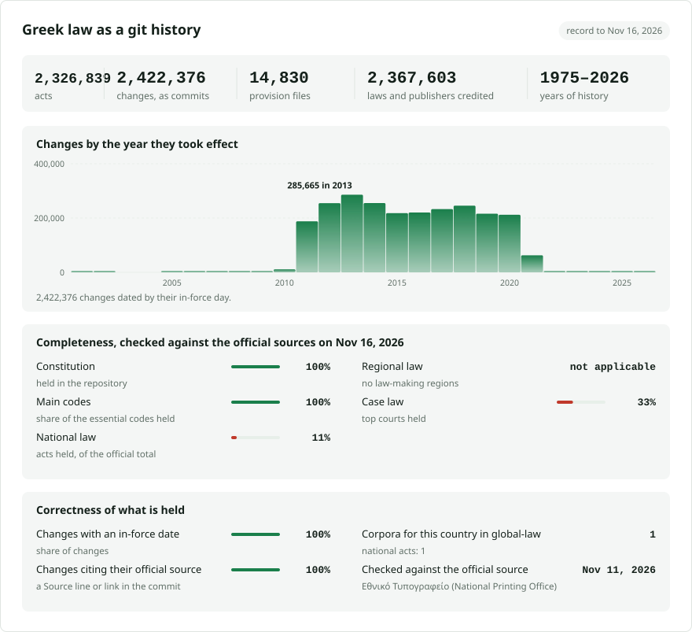

# Greece: law history in git

**English** · **[Ή διαβάστε το στα ελληνικά](README.md)**

<picture>
<source media="(prefers-color-scheme: dark)" srcset="data/effort-dark.svg">

</picture>

The law of Greece as a git history: one file per article, one commit per version on the day it took effect, and the act that made each change as the commit's author. `git blame` names the act behind every paragraph; `git log` lists every change to an article; picking a date gives the text in force that day.

Part of [lexifina/global-law](https://github.com/lexifina/global-law), one git history for every country's law: this is Greece's national law, which global-law reads at `greece/national/acts/`.

**What is in it now:** the Constitution from 1975: its 1975 text and the 1986 revision, and 5 versions since 2001; 20 codes; 1,030 laws of 1999 to 2026, 88 of them with every later amendment found (laws before 2000 are arriving by OCR); 3,079 presidential decrees of 2004 to 2026; 328,276 regulatory decisions of 101 national bodies and 1,997,426 decisions of 356 regions, decentralised administrations and municipalities, from Diavgeia; and 51,636 decisions of the Areios Pagos. Most of the 2.6 million commits are these Diavgeia decisions, not laws. The codes, in [`codes/`](codes/README.md): the Civil Code, on record from 1940 (α.ν. 2250/1940, in `codes/civil-code/1940/`) and as π.δ. 456/1984 with its Introductory Law, and the Code of Civil Procedure (π.δ. 503/1985); the Penal Code (ν. 4619/2019) and the Code of Criminal Procedure (ν. 4620/2019); the Codes of Administrative Procedure (ν. 2690/1999) and of Administrative Court Procedure (ν. 2717/1999); the Code of the Organisation of Courts (ν. 4938/2022); the Lawyers Code (ν. 4194/2013); the Civil Servants Code (ν. 3528/2007); the Code of Municipal and Community Employees (ν. 3584/2007); the Code of Municipalities and Communities (ν. 3463/2006); the Individual Labour Law Code (π.δ. 80/2022); the Road Traffic Code (ν. 2696/1999); the Income Tax Code (ν. 4172/2013), consolidated up to ν. 5264/2025; the Tax Procedure Code (ν. 5104/2024); the Code of Indirect Taxes on Transactions (ν. 5177/2025), consolidated up to ν. 5301/2026; the Property Tax Code (ν. 5219/2025), consolidated up to ν. 5264/2025; the Code for the Collection of Public Revenue (ν. 4978/2022); the National Customs Code, consolidated up to ν. 5259/2025; and the VAT Code, consolidated as in force until 18.9.2026 (up to ν. 5313/2026). The five consolidated codes (customs, VAT, income tax, indirect taxes on transactions, property tax) are the Finance Ministry's official administrative codifications; every other code is held as enacted, and amendment histories of the Penal Code, the Code of Criminal Procedure, the Code of Civil Procedure and the Civil Code are in progress. The Civil Code (1940 and 1984), the Code of Civil Procedure, the two administrative procedure codes, the Road Traffic Code and the 1975 and 1986 texts of the Constitution are OCR of the Gazette scans (the Code of Civil Procedure at low OCR confidence). [`ACTS.md`](ACTS.md) lists the acts of the first build, with their folders and versions (eight laws are in two folders: as enacted, and followed through their amendments).

Each act is in `<kind>/<year>/<number>/` (`decrees/2019/42/` is π.δ. 42/2019, `laws/2019/4624/` is ν. 4624/2019 on personal data), the Constitution is [`constitution/`](constitution/) (`art-101.md` is Article 101), the Diavgeia decisions are in `norm/<body>/<year>/<month>/<ΑΔΑ>/` and `local/<body>/<year>/<month>/<ΑΔΑ>/` (the Athens acts in `local/dimos-athinaion/`), and the Areios Pagos decisions are in `caselaw/areios-pagos/<year>/<chamber>/<number range>/<number>/` (`caselaw/areios-pagos/2009/civil/0001-1000/1/`). The eight laws held both as enacted and followed through their amendments keep the second copy in `laws/<year>/<number>-me-tropopoiiseis/`. `data/paths.json` maps each act id to its folder.

The text is in Greek, as the Government Gazette (ΦΕΚ) prints it, and as Diavgeia posts the decisions of public bodies. An English translation is not part of this record.

## Questions as git commands

| Question | Command |
| --- | --- |
| Every change to Article 101 of the Constitution | `git log -p --word-diff -- constitution/art-101.md` |
| Which revision wrote each paragraph of Article 101? | `git blame constitution/art-101.md` |
| Every version of Article 101, with the day each took effect | `git log --format="%h %(trailers:key=In-force,valueonly,separator=) %an" -- constitution/art-101.md` |
| Article 101 in one of those versions | `git show <commit>:constitution/art-101.md` |

**Outside git**, we also host this record publicly, for free:

- **[Ask Claude about Greek law](https://global-law.lexifina.com/v1/try_claude?country=greece)**: opens Claude with a first question ready.
- **[Ask ChatGPT](https://global-law.lexifina.com/v1/try_chatgpt?country=greece)**: the same question in ChatGPT.
- **[Search Greek law on our site](https://lexifina.com/law?country=greece&q=%CE%B5%CF%84%CE%AE%CF%83%CE%B9%CE%B1+%CE%AC%CE%B4%CE%B5%CE%B9%CE%B1)**: a search for "ετήσια άδεια", with each provision's text and its versions, no account needed.
- **[Developer REST API](https://global-law.lexifina.com/v1/search_law?query=%CE%B5%CF%84%CE%AE%CF%83%CE%B9%CE%B1+%CE%AC%CE%B4%CE%B5%CE%B9%CE%B1&jurisdiction=greece)**: the same search as JSON, with no key. See the [documentation here](https://lexifina.com/api/global-law).

Both assistants read the record through the free Global law connector (MCP, `https://global-law.lexifina.com/mcp`); the first time, the chat gives you the link that adds it. Ask in Greek or in English.

**Host it yourself easily.** All it takes is git and Python, and the tools run on your machine:

```sh
git clone --depth 1 https://github.com/lexifina/global-law && cd global-law
python3 tools/countries.py add greece/national/acts
python3 tools/law.py show 2026-01-01 greece/national/acts/constitution/art-101.md
```

Opened in Claude Code, Cursor, VS Code or Codex, the clone also starts a local MCP server with the same tools ([MCP.md](https://github.com/lexifina/global-law/blob/main/MCP.md)).

## Dates

Each commit is dated at noon, Europe/Athens, on the day the version took effect, and carries it in its `In-force:` trailer (with `Enacted:` and `Published:`):

- for the Constitution, the day each revision resolution was published in the Gazette, as each resolution provides (17 April 2001, 2 June 2008, 28 November 2019); the whole-text republication that follows is a second commit on its own day, holding only its own differences (spelling, punctuation, a few misprints);
- for laws and decrees, the day their commencement article gives, most often publication in the Gazette, by the date on the issue's masthead. For the laws followed through their amendments, provisions that start later arrive in their own commits; any other act whose commencement article gives some provisions another day is dated by its general day, and its commit message says so;
- for the Diavgeia decisions, the day each was posted on Diavgeia (ν. 4727/2020 art. 78 par. 2; ν. 3861/2010 art. 2 par. 4).

Each change is credited to the act that made it (`ν. 5221/2025`, `π.δ. 42/2019`, `Αναθεώρηση 2019 (ΦΕΚ Α΄ 187/2019)`), with an address that cannot exist (`n-5221-2025@et.invalid`). The 2001 text of the Constitution, the oldest with a text layer, is credited to the Εθνικό Τυπογραφείο as the oldest version available, and each republication to its own Gazette issue.

## How it is checked

- Each revision commit of the Constitution changes exactly the articles its resolution lists, and the parser stops if a changed paragraph matches none of the resolution's quoted provisions; the newest version is the 2019 republication (ΦΕΚ Α΄ 211/2019), the current official text.
- The laws followed through their amendments are rebuilt from the Gazette alone, since Greece publishes no official consolidated text of ordinary laws: the parser stops unless each amending instruction's target is found exactly once and every quoted provision appears word for word in the result. ν. 4624/2019 agrees word for word with the Data Protection Authority's consolidated text except in two places, where the amending law's own Gazette text is followed.
- Every version links the Gazette issue, or the Diavgeia record, it was read from; [`REPRODUCE.md`](REPRODUCE.md) lists every source with the day it was retrieved.
- History is append-only: no merge commits, no rewriting, and no commit dated in the future.
- [vulnerabilities/](vulnerabilities/README.en.md): possible drafting mistakes in Greek law, found by global-law's detectors and checked by hand.

## What it does not show

- **Most Greek law.** The completeness chart above puts national law here at about 19% of the official total: it measures numbered laws (νόμοι) held as text, 1,030 of about 5,338 numbered laws since 1975. All 20 main codes are on record, in [codes/](codes/README.md), all but five of them as enacted (each README there says what it holds).
- **Later amendments to most acts.** Only the 88 laws followed through their amendments carry them; the other laws, the decrees, the codes other than the five consolidated ones, and the Diavgeia decisions are held as enacted or posted. Amending acts are kept as their own text.
- **A checked text of the Constitution before 2001.** The 1975 text and the 1986 revision ([constitution/1975/](constitution/1975/), [constitution/1986/](constitution/1986/)) are OCR of the Gazette page images, not yet checked against a second copy.
- **Case law of courts other than the Areios Pagos.**
- **Signatures, footnotes and the Gazette's layout.**

## Sources

| Source | Kind | Past versions | Notes |
| --- | --- | --- | --- |
| [Εθνικό Τυπογραφείο](https://www.et.gr) (ΦΕΚ) | Official Gazette, series Α΄ | each issue as published; amendments applied here | The text of the Constitution and of every law and decree; its [relation index](https://search.et.gr) names amending laws |
| [Διαύγεια](https://diavgeia.gov.gr) | Decisions of public bodies | as posted | Regulatory decisions of national bodies, and decisions of regions, decentralised administrations and municipalities (open data, CC BY 4.0) |
| [legalize-dev/legalize-gr](https://github.com/legalize-dev/legalize-gr) | Gazette issues as text | no | Used only to find amending laws; its text is not used |
| [Αρχή Προστασίας Δεδομένων Προσωπικού Χαρακτήρα](https://www.dpa.gr) | Consolidated texts of ν. 4624/2019 and ν. 3471/2006 | no | Used only to check; no text copied |

## Licence

See [`LICENSE`](LICENSE). Greek copyright law does not extend to official legislative, administrative and judicial texts (ν. 2121/1993, άρθρο 2 παρ. 5); Lexifina's own contributions (the history, commit messages, tables and tools) are CC0 1.0.

No AI model wrote, translated or corrected legal text; the scripts were written by an AI model (see [`REPRODUCE.md`](REPRODUCE.md)).

## Visualisations

[visualisations/](visualisations/README.en.md): Greek law in 20 charts, drawn from this repository.

Including:

- The revisions of the Constitution, laws with "and other provisions" and how soon laws are amended
- What municipalities, regions and ministries post on Diavgeia, how soon, and legality review
- What the Areios Pagos decides, how long it takes and where its cases come from

## More

From [lexifina/global-law](https://github.com/lexifina/global-law):

- [FEATURES.md](https://github.com/lexifina/global-law/blob/main/FEATURES.md): every feature, and what every corpus must support (`git blame`, `law.py`, the MCP tools)
- [FAQ.md](https://github.com/lexifina/global-law/blob/main/FAQ.md): questions and answers · [CONTRIBUTING.md](https://github.com/lexifina/global-law/blob/main/CONTRIBUTING.md): proposing changes · [MCP.md](https://github.com/lexifina/global-law/blob/main/MCP.md): the MCP server · [REPRODUCE.md](https://github.com/lexifina/global-law/blob/main/REPRODUCE.md): how it was built · [CHANGELOG.md](https://github.com/lexifina/global-law/blob/main/CHANGELOG.md)
- [FRESHNESS.md](https://github.com/lexifina/global-law/blob/main/FRESHNESS.md): how current each corpus is · [Monitoring](https://github.com/lexifina/global-law/tree/main/monitoring): whether updates are running · [WATCHING.md](https://github.com/lexifina/global-law/blob/main/WATCHING.md): how each official source is watched for changes
- [performance/](https://github.com/lexifina/global-law/tree/main/performance): how fast the tools are, measured
- [visualisations/](https://github.com/lexifina/global-law/tree/main/visualisations): charts and bridges across the world's law
- [Vulnerabilities](https://github.com/lexifina/global-law/tree/main/vulnerabilities): mistakes in legislation as published
