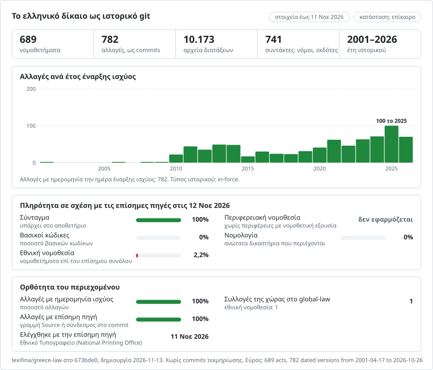

# Ελλάδα: η ιστορία του δικαίου σε git

**Ελληνικά** · [English](README.en.md)

<picture>
<source media="(prefers-color-scheme: dark)" srcset="data/el/effort-dark.svg">

</picture>

Μέρος του [lexifina/global-law](https://github.com/lexifina/global-law), μιας ενιαίας ιστορίας git για το δίκαιο κάθε χώρας: εδώ βρίσκεται το εθνικό δίκαιο της Ελλάδας, το οποίο το global-law διαβάζει στο `greece/national/acts/`.

Το δίκαιο της Ελλάδας ως ιστορία git: ένα αρχείο ανά άρθρο, ένα commit ανά μεταβολή την ημέρα που αυτή τέθηκε σε ισχύ, και ως συντάκτης κάθε commit η αναθεώρηση ή το φύλλο ΦΕΚ που επέφερε τη μεταβολή. Το `git blame` κατονομάζει την αναθεώρηση πίσω από κάθε παράγραφο· το `git log` απαριθμεί κάθε μεταβολή ενός άρθρου· η μετάβαση (checkout) σε μια ημερομηνία δίνει το κείμενο που ίσχυε εκείνη την ημέρα.

Ακολουθεί τον κοινό σχεδιασμό του [lexifina/global-law](https://github.com/lexifina/global-law), που το τοποθετεί στο `gr/`. Τα κείμενα είναι στα ελληνικά, όπως δημοσιεύθηκαν στην Εφημερίδα της Κυβερνήσεως (ΦΕΚ).

**Τι περιέχει σήμερα**

| Φάκελος | Νομοθέτημα | Εκδόσεις | Ιστορικό |
| --- | --- | ---: | --- |
| `syntagma/` | Σύνταγμα της Ελλάδας | 5 | Το κείμενο μετά την αναθεώρηση του 2001 (σε ισχύ από 17 Απριλίου 2001), την αναθεώρηση του 2008 (2 Ιουνίου 2008) και την επανέκδοση ολόκληρου του κειμένου (27 Ιουνίου 2008), την αναθεώρηση του 2019 (28 Νοεμβρίου 2019) και την επανέκδοση ολόκληρου του κειμένου (24 Δεκεμβρίου 2019), που είναι το ισχύον επίσημο κείμενο |
| `nomos-4624-2019/` | ν. 4624/2019, προστασία δεδομένων προσωπικού χαρακτήρα (Αρχή Προστασίας Δεδομένων, μέτρα εφαρμογής του ΓΚΠΔ, Οδηγία 2016/680) | 7 | Όπως δημοσιεύθηκε (29 Αυγούστου 2019· το άρθ. 86 από 1 Σεπτεμβρίου 2019) και στη συνέχεια κάθε τροποποίηση από το φύλλο ΦΕΚ του ίδιου του τροποποιητικού νόμου: ν. 4829/2021 (10 Σεπτεμβρίου 2021), ν. 5002/2022 (9 Δεκεμβρίου 2022), ν. 5043/2023 (13 Απριλίου 2023), ν. 5197/2025 (16 Μαΐου 2025) και ν. 5221/2025 (28 Ιουλίου 2025) |

**Όχι ολόκληρη η ιστορία.** Το Σύνταγμα του 1975 και οι αναθεωρήσεις του 1986 υπάρχουν στο ΦΕΚ μόνο ως εικόνες σελίδων, χωρίς επίπεδο κειμένου. Δεν διαβάζουμε κείμενο από εικόνες (χωρίς OCR), γι' αυτό η ιστορία αρχίζει με το κείμενο όπως είχε μετά την αναθεώρηση του 2001. Η πρώτη αυτή έκδοση αποδίδεται στον εκδότη ως «παλαιότερη διαθέσιμη έκδοση» ("oldest version available").

**Ο ν. 4624/2019 είναι πλήρης.** Η ιστορία του αρχίζει με τον νόμο όπως ψηφίστηκε και περιέχει κάθε τροποποίησή του, καθεμία εφαρμοσμένη με τη διατύπωση του ίδιου του τροποποιητικού νόμου.

## Οι ερωτήσεις ενός νομικού ως εντολές git

| Ερώτηση | Εντολή |
| --- | --- |
| Τι όριζε το άρθ. 101 την 1η Ιανουαρίου 2010; | `python tools/se_ischy.py 2010-01-01 syntagma 101` |
| Το ίδιο, μόνο με git (bash) | `git show $(git rev-list -1 --before="2010-01-01T23:59:59Z" main -- syntagma/art-101.md):syntagma/art-101.md` |
| Το ίδιο, σε PowerShell | `$r = git rev-list -1 --before="2010-01-01T23:59:59Z" main -- syntagma/art-101.md; git show "$($r):syntagma/art-101.md"` |
| Ποια αναθεώρηση έγραψε κάθε παράγραφο του άρθ. 86; | `git blame syntagma/art-086.md` |
| Κάθε μεταβολή του άρθ. 32, λέξη προς λέξη | `git log -p --word-diff syntagma/art-032.md` |
| Κάθε μεταβολή με χρονολογική σειρά | `git log --reverse --format="%ad %an" --date=short main` |
| Όλα όσα άλλαξε η αναθεώρηση του 2019 | `git show law/psifisma-2019` (οι ετικέτες `law/<key>` επισημαίνουν κάθε commit) |
| Ολόκληρο το Σύνταγμα σε μια ημερομηνία | `python tools/se_ischy.py 2005-01-01 syntagma` |
| Το κείμενο κάθε έκδοσης | `git show syntagma/2019-12-24` (ετικέτες `<act>/<in-force day>`) |
| Τι όριζε το άρθ. 18 του ν. 4624/2019 την 1η Ιανουαρίου 2024; | `python tools/se_ischy.py 2024-01-01 nomos-4624-2019 18` |
| Όλα όσα άλλαξε ο ν. 5002/2022 στον ν. 4624/2019 | `git show law/n-5002-2022` |

Τα άρθρα που προστέθηκαν με αναθεώρηση διατηρούν την αρίθμηση με την οποία τυπώθηκαν: το άρθ. 5Α είναι το αρχείο `art-005-a.md` (το `se_ischy.py` δέχεται `5Α` ή `5A`). Οι τίτλοι των μερών, των τμημάτων και των κεφαλαίων είναι οι πρώτες γραμμές του άρθρου με το οποίο αρχίζουν, ώστε τα αρχεία, διαβασμένα με τη σειρά, να δίνουν ολόκληρο το κείμενο. Το προοίμιο είναι το `syntagma/prooimio.md`. Μετά από ανακατασκευή, ανανεώστε τις ετικέτες με `git fetch --force --tags`: ένα απλό fetch κρατά τις παρωχημένες ετικέτες.

## Ημερομηνίες

- Κάθε commit φέρει ημερομηνία **στις 12:00, ώρα Europe/Athens, την ημέρα που η μεταβολή τέθηκε σε ισχύ**. Η ημερομηνία του Ψηφίσματος και η ημερομηνία του ΦΕΚ είναι πεδία trailer (`Enacted:`, `Published:`)· η ημέρα έναρξης ισχύος βρίσκεται στο `In-force:`, το οποίο διαβάζουν τα εργαλεία.
- **Κάθε αναθεώρηση τέθηκε σε ισχύ με τη δημοσίευση του Ψηφίσματός της στο ΦΕΚ.** Το ορίζει το ίδιο κάθε Ψήφισμα (παράγραφος Δ: «τίθενται σε ισχύ με τη δημοσίευση του Ψηφίσματος αυτού στην Εφημερίδα της Κυβερνήσεως»): 17 Απριλίου 2001 (ΦΕΚ Α΄ 84), 2 Ιουνίου 2008 (Α΄ 102) και 28 Νοεμβρίου 2019 (Α΄ 187).
- **Κάθε αναθεώρηση αποτελείται από δύο commits.** Κάθε Ψήφισμα τυπώνει μόνο τις αναθεωρημένες διατάξεις και στη συνέχεια διατάσσει την επανέκδοση ολόκληρου του Συντάγματος σε μεταγενέστερο φύλλο. Το πρώτο commit, την ημέρα του Ψηφίσματος, αλλάζει μόνο τα αναθεωρημένα άρθρα, με τη διατύπωση του ίδιου του Ψηφίσματος: η παράγραφος Γ ορίζει ότι αυτή είναι το μόνο αυθεντικό κείμενο μιας αναθεωρημένης διάταξης. Το δεύτερο commit, την ημέρα της επανέκδοσης (27 Ιουνίου 2008, ΦΕΚ Α΄ 120· 24 Δεκεμβρίου 2019, Α΄ 211), φέρει τις διαφορές της ίδιας της επανέκδοσης και αποδίδεται σε εκείνο το φύλλο ΦΕΚ. Οι διαφορές αυτές αφορούν την ορθογραφία, τη στίξη και τα κεφαλαία, καθώς και λίγα τυπογραφικά λάθη. Για παράδειγμα, η επανέκδοση του 2008 τύπωσε «δημοσεύει» στο άρθ. 42 και η επανέκδοση του 2019 αποκατέστησε το «δημοσιεύει». Το ίδιο το Ψήφισμα του 2019 τύπωσε εσφαλμένα «εκλέγειται» στο άρθ. 32 παρ. 4, και η επανέκδοση το διόρθωσε.
- **Η έναρξη εφαρμογής δεν αποτυπώνεται στις ημερομηνίες.** Το Ψήφισμα του 2001 ορίζει ότι οι διατάξεις του για τη λειτουργία της Βουλής εφαρμόζονται μόλις εκδοθεί νέος Κανονισμός της Βουλής (παράγραφος Ε). Το άρθ. 96 παρ. 5 (2019) αφήνει σε νόμο την έναρξη της δικής του εφαρμογής. Οι προϋποθέσεις αυτές βρίσκονται στο κείμενο, όχι στις ημερομηνίες των commits.
- **Ο ν. 4624/2019 και οι νόμοι που τον τροποποιούν** τίθενται σε ισχύ με τη δημοσίευσή τους στο ΦΕΚ, ο καθένας με το δικό του άρθρο έναρξης ισχύος, το οποίο ο parser διαβάζει από το φύλλο (ν. 4624/2019 άρθ. 87· ν. 4829/2021, τελευταίο άρθρο· ν. 5002/2022 άρθ. 51· ν. 5043/2023 άρθ. 124· ν. 5197/2025, τελευταίο άρθρο· ν. 5221/2025 άρθ. 168). Καμία από τις εξαιρέσεις των άρθρων αυτών δεν αφορά διάταξη που χρησιμοποιείται εδώ. Η μόνη εξαίρεση είναι το ίδιο το άρθ. 86 του ν. 4624/2019, του οποίου η παρ. 6 ορίζει την έναρξη ισχύος του την 1η Σεπτεμβρίου 2019, γι' αυτό εμφανίζεται σε δικό του commit. Ημέρα δημοσίευσης είναι η ημερομηνία στην κεφαλίδα του φύλλου.
- Το `--before="YYYY-MM-DD"` μόνο του χρησιμοποιεί την ώρα του ρολογιού σας, οπότε μπορεί να παραλείψει μεταβολή που τέθηκε σε ισχύ εκείνη την ημέρα. Χρησιμοποιήστε `T23:59:59Z` όπως παραπάνω ή το εργαλείο.

## Πώς ελέγχεται

- Κάθε έκδοση διαβάζεται ξανά από το git την ημέρα που τέθηκε σε ισχύ και την προηγούμενη ημέρα (`tools/check_repo.py`)· και οι δύο πρέπει να συμφωνούν με τη συλλογή. Τα αποτελέσματα βρίσκονται στο `REPRODUCE.md`.
- Έλεγχοι ακεραιότητας: κανένα merge commit στο `main`, οι ημερομηνίες των commits δεν πηγαίνουν ποτέ προς τα πίσω, τίποτα δεν φέρει μελλοντική ημερομηνία, και τα trailers κάθε commit αναλύονται κανονικά από το git.
- **Σε σχέση με το επίσημο κείμενο.** Η νεότερη έκδοση είναι η επανέκδοση του 2019 (ΦΕΚ Α΄ 211/24.12.2019), αναλυμένη άρθρο προς άρθρο. Το Σύνταγμα δεν έχει αναθεωρηθεί από τότε.
- **Σε σχέση με τα Ψηφίσματα.** Κάθε commit αναθεώρησης αλλάζει ακριβώς τα άρθρα που απαριθμεί το μέρος Α του Ψηφίσματός του:
  - 2008: άρθρα 57, 79, 101 και 115·
  - 2019: άρθρα 21, 32, 54, 62, 68, 73, 86, 96, 101Α, 112, 113, 114, 115 και 119.

  Ο parser σταματά αν μια παράγραφος που άλλαξε σε αναθεωρημένο άρθρο δεν αντιστοιχεί σε καμία από τις διατάξεις που παραθέτει το Ψήφισμα. Οι αστερίσκοι του ίδιου του εκδότη στις επανεκδόσεις σημειώνουν τα ίδια άρθρα (`***` για το 2008, `****` για το 2019).
- **ν. 4624/2019.** Η Ελλάδα δεν δημοσιεύει επίσημο κωδικοποιημένο κείμενο των κοινών νόμων, γι' αυτό η ιστορία ανασυντίθεται μόνο από το ΦΕΚ: ο νόμος όπως ψηφίστηκε (ΦΕΚ Α΄ 137/2019) και στη συνέχεια κάθε τροποποιητική διάταξη, που εντοπίζεται στο δικό της φύλλο με βάση τον αριθμό και τον τίτλο του άρθρου. Ο parser σταματά, εκτός αν:
  - ο στόχος κάθε τροποποιητικής εντολής εντοπίζεται ακριβώς μία φορά·
  - όπου μια εντολή περιγράφει μια μεταβολή και στη συνέχεια αναδιατυπώνει το αποτέλεσμα, η περιγραφόμενη μεταβολή, εφαρμοσμένη στο παλαιό κείμενο, δίνει το αναδιατυπωμένο κείμενο. Οι λίγες λέξεις που αλλάζει μόνη της μια αναδιατύπωση (για παράδειγμα «το σκοπό» που αναδιατυπώνεται ως «τον σκοπό») απαριθμούνται στο `REPRODUCE.md`·
  - κάθε παρατιθέμενη διάταξη εμφανίζεται αυτολεξεί στην έκδοση που προκύπτει.
- **Ποιοι νόμοι τροποποιούν τον ν. 4624/2019** διαπιστώθηκε με τρεις τρόπους: με σάρωση πλήρους κειμένου κάθε φύλλου ΦΕΚ Α΄ από το 2019 στο legalize-gr (`tools/scan_legalize_gr.py`), με το επίσημο ευρετήριο συσχετίσεων του search.et.gr και με τις σημειώσεις τροποποιήσεων του κωδικοποιημένου κειμένου της Αρχής Προστασίας Δεδομένων Προσωπικού Χαρακτήρα. Μαζί δίνουν πέντε τροποποιητικούς νόμους, και ο καθένας διαβάστηκε στο δικό του φύλλο.
- **Σε σχέση με επίσημο κείμενο.** Η τελευταία έκδοση συμφωνεί αυτολεξεί με το κωδικοποιημένο κείμενο της Αρχής Προστασίας Δεδομένων (PDF της 10ης Δεκεμβρίου 2025) σε κάθε άρθρο και τίτλο εκτός από δύο:
  - άρθ. 84Α: στο κείμενο της Αρχής λείπει το τρίτο εδάφιο της παρ. 7, που προστέθηκε με το άρθ. 56 του ν. 5197/2025·
  - άρθ. 18 παρ. 8: το κείμενο της Αρχής διατηρεί το «π.δ. 50/2001», το οποίο ο ν. 5221/2025 αναδιατυπώνει ως «π.δ. 85/2022».

  Και στις δύο περιπτώσεις ακολουθείται το κείμενο του ίδιου του τροποποιητικού νόμου στο ΦΕΚ.
- Κάθε έκδοση φέρει τη διεύθυνση URL του PDF του ΦΕΚ και το sha256 των bytes του. Ο αριθμός και η ημερομηνία κάθε φύλλου που χρησιμοποιήθηκε ελέγχθηκαν με την κεφαλίδα του ίδιου του φύλλου.
- Το αποθετήριο ανακατασκευάζεται μια δεύτερη φορά από τα ίδια δεδομένα και πρέπει να δίνει πανομοιότυπα hashes.

## Τι σημαίνει «συντάκτης»

Συντάκτης (author) ενός commit είναι αυτό που επέφερε τη μεταβολή, με διεύθυνση e-mail που δεν μπορεί να υπάρχει (`psifisma-2019@et.invalid`), ώστε να το κατονομάζουν το `git blame` και το `git log --author`.

- **Μια αναθεώρηση** («Αναθεώρηση 2019 (ΦΕΚ Α΄ 187/2019)») είναι το Ψήφισμα μιας Αναθεωρητικής Βουλής.
- **Μια επανέκδοση** («ΦΕΚ Α΄ 211/2019 (republication)», είδος `publisher`) είναι ολόκληρο το κείμενο όπως το επανατύπωσε το ΦΕΚ. Τα commits της περιέχουν μόνο διαφορές που δεν εξηγεί καμία αναθεώρηση.
- **Το πρώτο commit** (2001) αποδίδεται στο Εθνικό Τυπογραφείο ως το παλαιότερο διαθέσιμο κείμενο. Το μήνυμά του κατονομάζει το Σύνταγμα του 1975 και τα Ψηφίσματα του 1986 και του 2001 στα οποία βασίζεται. Η επανέκδοση του 2001 σημειώνει με `**` τις διατάξεις που άλλαξε η αναθεώρηση του 2001, αλλά η ιστορία αυτή δεν περιέχει το κείμενο πριν από το 2001, οπότε δεν μπορεί να δείξει αυτές τις αλλαγές.
- Το blame αποδίδει ολόκληρες γραμμές (μία παράγραφος ανά γραμμή). Χρησιμοποιήστε `git log -p --word-diff` για να δείτε ακριβώς ποιες λέξεις άλλαξαν.

## Τι δεν δείχνει

- **Το Σύνταγμα του 1975 και οι αναθεωρήσεις του 1986** (η αναθεώρηση του 1986 και η μεταφορά του κειμένου στη δημοτική, ΦΕΚ Α΄ 24/14.3.1986), που υπάρχουν μόνο ως σαρωμένες εικόνες.
- **Το κείμενο στην καθαρεύουσα.** Τα Ψηφίσματα ορίζουν το κείμενο του 1975 στην καθαρεύουσα ως αυθεντικό κείμενο των διατάξεων που δεν αναθεωρήθηκαν ποτέ. Το αποθετήριο αυτό περιέχει το επίσημο κείμενο στη δημοτική, όπως το δημοσιεύει το ΦΕΚ.
- **Η πράξη του Προέδρου της Βουλής, οι υπογραφές και οι υποσημειώσεις** που πλαισιώνουν κάθε επανέκδοση, καθώς και οι αστερίσκοι του εκδότη.
- **Για τον ν. 4624/2019:** οι υπογραφές και η τυπογραφική μορφή του ίδιου του ΦΕΚ. Οι καταργημένες παράγραφοι αφαιρούνται αντί να σημειώνονται, εκτός όπου ένας τροποποιητικός νόμος ο ίδιος αναδιατυπώνει μια παράγραφο ως «[Καταργείται]» (άρθ. 18 παρ. 6 από το 2025).
- **Ο Ποινικός Κώδικας (ν. 4619/2019), ο Κώδικας Ποινικής Δικονομίας (ν. 4620/2019) και ο Αστικός Κώδικας.** Η Ελλάδα δεν έχει επίσημο κωδικοποιημένο κείμενό τους, και το legalize-gr περιέχει κάθε φύλλο ΦΕΚ μόνο όπως δημοσιεύθηκε, χωρίς ενσωματωμένες τροποποιήσεις. Μια περιορισμένη σάρωση του legalize-gr βρίσκει τουλάχιστον δέκα νόμους που τροποποιούν τους δύο κώδικες του 2019 από το 2019. Ο ν. 4855/2021 και ο ν. 5090/2024 μόνοι τους περιέχουν πολύ περισσότερες από εκατό τροποποιήσεις σε επίπεδο άρθρου σε αυτούς, οπότε για κάθε κώδικα θα έπρεπε να εφαρμοστεί με το χέρι κάθε τροποποιητικός νόμος. Αυτό απαιτεί περισσότερη εργασία από όση χωρά σε ένα μόνο πέρασμα. Ο Αστικός Κώδικας (π.δ. 456/1984) θεσπίστηκε πριν από την περίοδο κατά την οποία τα φύλλα του ΦΕΚ έχουν επίπεδο κειμένου, γι' αυτό δεν υπάρχει καθόλου στο legalize-gr. Αυτά μένουν για μεταγενέστερο πέρασμα.

## Πώς κατασκευάζεται

Η Lexifina διαβάζει τις πηγές που αναφέρονται εδώ και καταγράφει σε ένα αρχείο συλλογής τις χρονολογημένες εκδόσεις κάθε νομοθετήματος και τους νόμους που επέφεραν κάθε μεταβολή. Το `tools/build.py` γράφει το αποθετήριο αυτό από εκείνο το αρχείο, και η ίδια συλλογή δίνει πάντα τα ίδια hashes των commits· το `REPRODUCE.md` δίνει τις λεπτομέρειες και τους ελέγχους. Ένα μοντέλο (Claude) έγραψε τον κώδικα της Lexifina· δεν έγραψε κανένα νομικό κείμενο, και κανένα μοντέλο δεν εκτελείται κατά την κατασκευή της ιστορίας.

Το επίπεδο κειμένου των ίδιων των PDF διαβάζεται με το PyMuPDF, δύο στήλες ανά σελίδα, χωρίς OCR. Η παλαιά κωδικοποίηση της ελληνικής γραμματοσειράς του φύλλου του 2001 αντιστοιχίζεται ξανά σε Unicode. Λατινικά γράμματα που μοιάζουν με ελληνικά μέσα σε ελληνικές λέξεις, κεραίες αριθμών, εισαγωγικά, παύλες και ενωτικά στο τέλος γραμμής κανονικοποιούνται μία φορά.

Κανένα μοντέλο τεχνητής νοημοσύνης δεν έγραψε ούτε άλλαξε νομικό κείμενο. Το Claude Opus 5.5 έγραψε τα scripts και επέλεξε τις πηγές· βλ. `REPRODUCE.md`.

## Πηγές

| Πηγή | Είδος | Παλαιότερες εκδόσεις ανά ημερομηνία | Κατονομάζει την τροποποιητική πράξη | API ή μαζική λήψη | Σημειώσεις |
| --- | --- | --- | --- | --- | --- |
| [Εθνικό Τυπογραφείο](https://www.et.gr) · [αναζήτηση](https://search.et.gr) | Επίσημη Εφημερίδα (ΦΕΚ) | κάθε φύλλο φέρει ημερομηνία | τα Ψηφίσματα είναι οι τροποποιητικές πράξεις | PDF των φύλλων στο `ia37rg02wpsa01.blob.core.windows.net/fek/01/<YYYY>/<YYYY>01<NNNNN>.pdf` | Χρησιμοποιείται. Τα φύλλα από το 2000 περίπου έχουν επίπεδο κειμένου· τα παλαιότερα είναι σαρωμένα |
| [Βουλή των Ελλήνων](https://www.hellenicparliament.gr) | Το κείμενο του Συντάγματος | όχι | δ.ε. | δ.ε. | – |
| [legalize-gr](https://github.com/lighteternal/legalize-gr) | Έργο «git για το δίκαιο» (MIT) | εν μέρει | εν μέρει | δ.ε. | Νόμοι του ΦΕΚ 2000–2026 και 26 κωδικοποιημένοι κώδικες· δεν χρησιμοποιείται, δεν αντιγράφεται |
| [legalize-dev/legalize-gr](https://github.com/legalize-dev/legalize-gr), commit `36cb88a374cd` | Έργο «git για το δίκαιο» (ροή επεξεργασίας υπό MIT· νομοθετικό περιεχόμενο κοινό κτήμα: «Δημόσιος τομέας (επίσημα κρατικά κείμενα)») | όχι: ένα αρχείο ανά φύλλο ΦΕΚ Α΄ από το 2000, όπως δημοσιεύθηκε | το πεδίο `amends` του αντιγράφει το επίσημο ευρετήριο συσχετίσεων του search.et.gr | git | Χρησιμοποιείται για τον εντοπισμό των νόμων που τροποποιούν τον ν. 4624/2019 (`tools/scan_legalize_gr.py`). Το κείμενό του **δεν** χρησιμοποιείται: το αρχείο του για το ΦΕΚ Α΄ 137/2019 συμφωνεί αυτολεξεί με το ΦΕΚ μόνο σε 53 από τα 87 άρθρα. Λείπουν 4 άρθρα, και στα υπόλοιπα χάνεται κείμενο ή αναμειγνύεται κείμενο των δύο στηλών. Αρχική πηγή κάθε αρχείου: το PDF του ΦΕΚ στο πεδίο `source` του |
| [Αρχή Προστασίας Δεδομένων Προσωπικού Χαρακτήρα](https://www.dpa.gr/el/enimerwtiko/nomothesia/proswpikon_dedomenon) | Το κωδικοποιημένο κείμενο του ν. 4624/2019 από την Αρχή «με ενσωματωμένες όλες τις τροποποιήσεις» (PDF, 10 Δεκεμβρίου 2025) | όχι | ναι, σε σημειώσεις | PDF | Χρησιμοποιείται μόνο για τον έλεγχο του ν. 4624/2019· δεν αντιγράφεται κείμενο |

Οδηγοί έρευνας που καλύπτουν κάθε χώρα: το [GlobaLex](https://www.nyulawglobal.org/globalex/) και ο οδηγός [Law Library of Congress Guide to Law Online](https://www.loc.gov/research-centers/law-library-of-congress/researcher-resources/guide-to-law-online/).

## Άδεια

Τα νομικά κείμενα είναι επίσημα κείμενα της Ελληνικής Δημοκρατίας, όπως δημοσιεύθηκαν στην Εφημερίδα της Κυβερνήσεως. Πηγή: Εφημερίδα της Κυβερνήσεως (ΦΕΚ), Εθνικό Τυπογραφείο, https://www.et.gr. Η προστασία της ελληνικής νομοθεσίας για την πνευματική ιδιοκτησία δεν εκτείνεται στα επίσημα νομοθετικά κείμενα (ν. 2121/1993, άρθρο 2 παρ. 5). Η διάρθρωση, οι πίνακες, τα μηνύματα των commits και τα εργαλεία είναι της Lexifina, με τους όρους του `LICENSE`.

Το αποθετήριο αυτό δεν αποτελεί νομική συμβουλή ούτε επίσημη δημοσίευση.

Αυτή είναι μετάφραση της αγγλικής έκδοσης ([README.en.md](README.en.md))· σε περίπτωση διαφοράς, υπερισχύει η αγγλική έκδοση.

## Περισσότερα

Από το αποθετήριο [lexifina/global-law](https://github.com/lexifina/global-law) (στα αγγλικά):

- [FEATURES.md](https://github.com/lexifina/global-law/blob/main/FEATURES.md): όλες οι λειτουργίες και τι πρέπει να υποστηρίζει κάθε συλλογή (`git blame`, `law.py`, εργαλεία MCP)
- [FAQ.md](https://github.com/lexifina/global-law/blob/main/FAQ.md): ερωτήσεις και απαντήσεις · [CONTRIBUTING.md](https://github.com/lexifina/global-law/blob/main/CONTRIBUTING.md): πρόταση αλλαγών · [MCP.md](https://github.com/lexifina/global-law/blob/main/MCP.md): διακομιστής MCP · [REPRODUCE.md](https://github.com/lexifina/global-law/blob/main/REPRODUCE.md): πώς δημιουργήθηκε · [CHANGELOG.md](https://github.com/lexifina/global-law/blob/main/CHANGELOG.md)
- [FRESHNESS.md](https://github.com/lexifina/global-law/blob/main/FRESHNESS.md): πόσο ενημερωμένη είναι κάθε συλλογή · [Παρακολούθηση](https://github.com/lexifina/global-law/tree/main/monitoring): αν οι ενημερώσεις λειτουργούν · [WATCHING.md](https://github.com/lexifina/global-law/blob/main/WATCHING.md): πώς παρακολουθείται κάθε επίσημη πηγή για αλλαγές
- [performance/](https://github.com/lexifina/global-law/tree/main/performance): πόσο γρήγορα είναι τα εργαλεία, με μετρήσεις
- [visualisations/](https://github.com/lexifina/global-law/tree/main/visualisations): γραφήματα και συνδέσεις σε όλο το δίκαιο του κόσμου
- [Ευπάθειες](https://github.com/lexifina/global-law/tree/main/vulnerabilities): σφάλματα στα νομοθετήματα όπως δημοσιεύθηκαν
