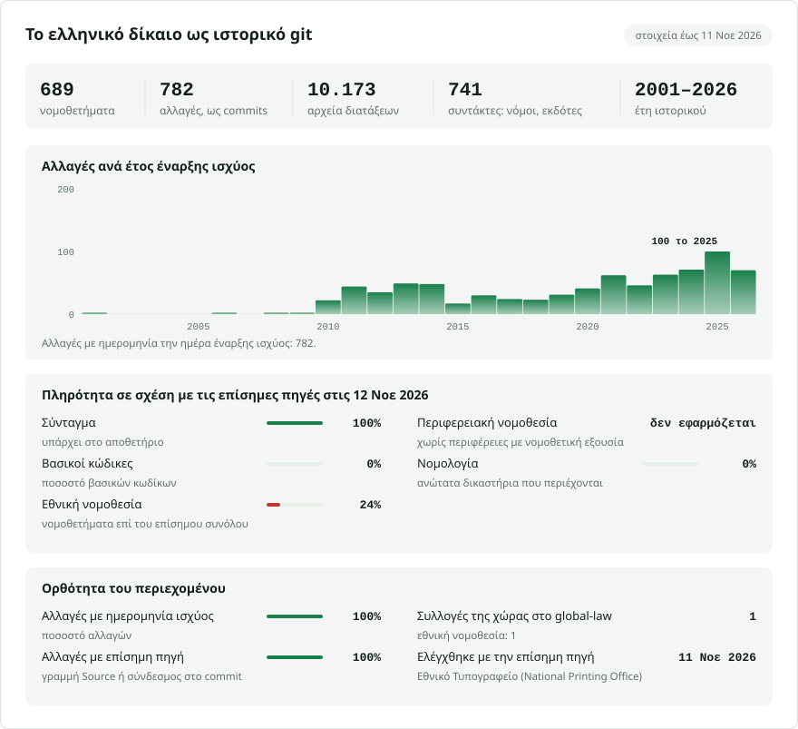

# Ελλάδα: η ιστορία του δικαίου σε git

**Ελληνικά** · **[Or read it in English](README.en.md)**

<picture>
<source media="(prefers-color-scheme: dark)" srcset="data/el/effort-dark.svg">

</picture>

Το δίκαιο της Ελλάδας ως ιστορία git: ένα αρχείο ανά άρθρο, ένα commit ανά έκδοση την ημέρα που τέθηκε σε ισχύ, και ως συντάκτης κάθε commit η πράξη που επέφερε τη μεταβολή. Το `git blame` κατονομάζει την πράξη πίσω από κάθε παράγραφο· το `git log` απαριθμεί κάθε μεταβολή ενός άρθρου· η επιλογή μιας ημερομηνίας δίνει το κείμενο που ίσχυε εκείνη την ημέρα.

Μέρος του [lexifina/global-law](https://github.com/lexifina/global-law), μιας ενιαίας ιστορίας git για το δίκαιο κάθε χώρας: εδώ βρίσκεται το εθνικό δίκαιο της Ελλάδας, το οποίο το global-law διαβάζει στο `greece/national/acts/`.

**Τι περιέχει σήμερα:** το Σύνταγμα από το 1975: το κείμενο του 1975 και την αναθεώρηση του 1986, και 5 εκδόσεις από το 2001· 20 κώδικες· 1.030 νόμους των ετών 1999 έως 2026, από τους οποίους οι 88 με κάθε μεταγενέστερη τροποποίηση που εντοπίστηκε (οι νόμοι πριν από το 2000 προστίθενται με OCR)· 3.079 προεδρικά διατάγματα των ετών 2004 έως 2026· 328.276 κανονιστικές αποφάσεις 101 εθνικών φορέων και 1.997.426 αποφάσεις 356 Περιφερειών, Αποκεντρωμένων Διοικήσεων και Δήμων, από τη Διαύγεια· και 51.636 αποφάσεις του Αρείου Πάγου. Τα περισσότερα από τα 2,6 εκατομμύρια commits είναι αυτές οι αποφάσεις της Διαύγειας, όχι νόμοι. Οι κώδικες, στο [`codes/`](codes/README.md): ο Αστικός Κώδικας, από το 1940 (α.ν. 2250/1940, στο `codes/civil-code/1940/`) και ως π.δ. 456/1984 με τον Εισαγωγικό του Νόμο, και ο Κώδικας Πολιτικής Δικονομίας (π.δ. 503/1985)· ο Ποινικός Κώδικας (ν. 4619/2019) και ο Κώδικας Ποινικής Δικονομίας (ν. 4620/2019)· ο Κώδικας Διοικητικής Διαδικασίας (ν. 2690/1999) και ο Κώδικας Διοικητικής Δικονομίας (ν. 2717/1999)· ο Κώδικας Οργανισμού Δικαστηρίων (ν. 4938/2022)· ο Κώδικας Δικηγόρων (ν. 4194/2013)· ο Υπαλληλικός Κώδικας (ν. 3528/2007)· ο Κώδικας Κατάστασης Δημοτικών και Κοινοτικών Υπαλλήλων (ν. 3584/2007)· ο Κώδικας Δήμων και Κοινοτήτων (ν. 3463/2006)· ο Κώδικας Ατομικού Εργατικού Δικαίου (π.δ. 80/2022)· ο Κώδικας Οδικής Κυκλοφορίας (ν. 2696/1999)· ο Κώδικας Φορολογίας Εισοδήματος (ν. 4172/2013), κωδικοποιημένος έως τον ν. 5264/2025· ο Κώδικας Φορολογικής Διαδικασίας (ν. 5104/2024)· ο Κώδικας εμμέσων φόρων επί των συναλλαγών (ν. 5177/2025), κωδικοποιημένος έως τον ν. 5301/2026· ο Κώδικας Φορολογίας Περιουσίας (ν. 5219/2025), κωδικοποιημένος έως τον ν. 5264/2025· ο Κώδικας Είσπραξης Δημοσίων Εσόδων (ν. 4978/2022)· ο Εθνικός Τελωνειακός Κώδικας, κωδικοποιημένος έως τον ν. 5259/2025· και ο Κώδικας ΦΠΑ, κωδικοποιημένος όπως ισχύει έως 18.9.2026 (έως τον ν. 5313/2026). Οι πέντε κωδικοποιημένοι κώδικες (Τελωνειακός, ΦΠΑ, Φορολογίας Εισοδήματος, εμμέσων φόρων επί των συναλλαγών, Φορολογίας Περιουσίας) είναι οι επίσημες διοικητικές κωδικοποιήσεις του Υπουργείου Οικονομικών· κάθε άλλος κώδικας περιέχεται όπως εκδόθηκε, και οι ιστορικοί τροποποιήσεων του Ποινικού Κώδικα, του Κώδικα Ποινικής Δικονομίας, του Κώδικα Πολιτικής Δικονομίας και του Αστικού Κώδικα είναι σε εξέλιξη. Ο Αστικός Κώδικας (1940 και 1984), ο Κώδικας Πολιτικής Δικονομίας, οι δύο κώδικες διοικητικής διαδικασίας, ο Κώδικας Οδικής Κυκλοφορίας και τα κείμενα του Συντάγματος του 1975 και του 1986 είναι OCR των σαρώσεων του ΦΕΚ (ο Κώδικας Πολιτικής Δικονομίας με χαμηλή βεβαιότητα OCR). Το [`ACTS.md`](ACTS.md) απαριθμεί τις πράξεις της πρώτης έκδοσης, με τον φάκελο και τις εκδόσεις τους (οκτώ νόμοι βρίσκονται σε δύο φακέλους: όπως εκδόθηκαν και με τις τροποποιήσεις τους).

Κάθε πράξη βρίσκεται στο `<είδος>/<έτος>/<αριθμός>/` (το `decrees/2019/42/` είναι το π.δ. 42/2019 και το `laws/2019/4624/` ο ν. 4624/2019 για τα προσωπικά δεδομένα), το Σύνταγμα είναι στο [`constitution/`](constitution/) (το `art-101.md` είναι το άρθρο 101), οι αποφάσεις της Διαύγειας στο `norm/<φορέας>/<έτος>/<μήνας>/<ΑΔΑ>/` και στο `local/<φορέας>/<έτος>/<μήνας>/<ΑΔΑ>/` (οι πράξεις του Δήμου Αθηναίων στο `local/dimos-athinaion/`) και οι αποφάσεις του Αρείου Πάγου στο `caselaw/areios-pagos/<έτος>/<τμήμα>/<εύρος αριθμών>/<αριθμός>/` (το `caselaw/areios-pagos/2009/civil/0001-1000/1/`). Οι οκτώ νόμοι που υπάρχουν και όπως εκδόθηκαν και με τις τροποποιήσεις τους κρατούν το δεύτερο αντίγραφο στο `laws/<έτος>/<αριθμός>-me-tropopoiiseis/`. Το `data/paths.json` αντιστοιχίζει το αναγνωριστικό κάθε πράξης στον φάκελό της.

Το κείμενο είναι στα ελληνικά, όπως το τυπώνει η Εφημερίδα της Κυβερνήσεως (ΦΕΚ) και όπως αναρτά η Διαύγεια τις αποφάσεις των δημόσιων φορέων. Μετάφραση στα αγγλικά δεν αποτελεί μέρος αυτού του αρχείου.

## Ερωτήσεις ως εντολές git

| Ερώτηση | Εντολή |
| --- | --- |
| Κάθε μεταβολή του άρθρου 101 του Συντάγματος | `git log -p --word-diff -- constitution/art-101.md` |
| Ποια αναθεώρηση έγραψε κάθε παράγραφο του άρθρου 101; | `git blame constitution/art-101.md` |
| Κάθε έκδοση του άρθρου 101, με την ημέρα που τέθηκε σε ισχύ | `git log --format="%h %(trailers:key=In-force,valueonly,separator=) %an" -- constitution/art-101.md` |
| Το άρθρο 101 σε μία από αυτές τις εκδόσεις | `git show <commit>:constitution/art-101.md` |

**Εκτός git** διαθέτουμε επίσης το αρχείο δημόσια και δωρεάν:

- **[Ρωτήστε το Claude για το ελληνικό δίκαιο](https://global-law.lexifina.com/v1/try_claude?country=greece)**: ανοίγει το Claude με έτοιμη την πρώτη ερώτηση.
- **[Ρωτήστε το ChatGPT](https://global-law.lexifina.com/v1/try_chatgpt?country=greece)**: η ίδια ερώτηση στο ChatGPT.
- **[Αναζητήστε στο ελληνικό δίκαιο στον ιστότοπό μας](https://lexifina.com/law?country=greece&q=%CE%B5%CF%84%CE%AE%CF%83%CE%B9%CE%B1+%CE%AC%CE%B4%CE%B5%CE%B9%CE%B1)**: αναζήτηση για «ετήσια άδεια», με το κείμενο κάθε διάταξης και τις εκδοχές της, χωρίς λογαριασμό.
- **[REST API για προγραμματιστές](https://global-law.lexifina.com/v1/search_law?query=%CE%B5%CF%84%CE%AE%CF%83%CE%B9%CE%B1+%CE%AC%CE%B4%CE%B5%CE%B9%CE%B1&jurisdiction=greece)**: η ίδια αναζήτηση σε JSON, χωρίς κλειδί. Η τεκμηρίωση είναι [εδώ](https://lexifina.com/api/global-law).

Και οι δύο βοηθοί διαβάζουν το αρχείο μέσω του δωρεάν συνδέσμου Global law (MCP, `https://global-law.lexifina.com/mcp`)· την πρώτη φορά η συνομιλία σάς δίνει τον σύνδεσμο που τον προσθέτει. Ρωτήστε στα ελληνικά ή στα αγγλικά.

**Εύκολα και στον δικό σας υπολογιστή.** Αρκούν το git και η Python, και τα εργαλεία τρέχουν τοπικά:

```sh
git clone --depth 1 https://github.com/lexifina/global-law && cd global-law
python3 tools/countries.py add greece/national/acts
python3 tools/law.py show 2026-01-01 greece/national/acts/constitution/art-101.md
```

Όταν ανοίγει σε Claude Code, Cursor, VS Code ή Codex, ο κλώνος ξεκινά και έναν τοπικό διακομιστή MCP με τα ίδια εργαλεία ([MCP.md](https://github.com/lexifina/global-law/blob/main/MCP.md)).

## Ημερομηνίες

Κάθε commit φέρει ημερομηνία στις 12:00, ώρα Europe/Athens, την ημέρα που η έκδοση τέθηκε σε ισχύ, και την ημέρα αυτή στο trailer `In-force:` (μαζί με τα `Enacted:` και `Published:`):

- για το Σύνταγμα, την ημέρα που δημοσιεύθηκε στο ΦΕΚ το Ψήφισμα κάθε αναθεώρησης, όπως ορίζει το ίδιο κάθε Ψήφισμα (17 Απριλίου 2001, 2 Ιουνίου 2008, 28 Νοεμβρίου 2019)· η επανέκδοση ολόκληρου του κειμένου που ακολουθεί είναι δεύτερο commit, με τη δική του ημερομηνία, και περιέχει μόνο τις δικές της διαφορές (ορθογραφία, στίξη, λίγα τυπογραφικά λάθη)·
- για νόμους και διατάγματα, την ημέρα που ορίζει το άρθρο έναρξης ισχύος τους, συνήθως τη δημοσίευση στο ΦΕΚ, με βάση την ημερομηνία στην κεφαλίδα του φύλλου. Στους νόμους που παρακολουθούνται σε όλες τις τροποποιήσεις τους, οι διατάξεις που αρχίζουν να ισχύουν αργότερα έρχονται σε δικά τους commits· κάθε άλλη πράξη της οποίας το άρθρο έναρξης ισχύος ορίζει άλλη ημέρα για ορισμένες διατάξεις χρονολογείται με τη γενική της ημέρα, και το μήνυμα του commit το αναφέρει·
- για τις αποφάσεις της Διαύγειας, την ημέρα ανάρτησης καθεμίας στη Διαύγεια (ν. 4727/2020 άρθ. 78 παρ. 2· ν. 3861/2010 άρθ. 2 παρ. 4).

Κάθε μεταβολή αποδίδεται στην πράξη που την επέφερε (`ν. 5221/2025`, `π.δ. 42/2019`, `Αναθεώρηση 2019 (ΦΕΚ Α΄ 187/2019)`), με διεύθυνση που δεν μπορεί να υπάρχει (`n-5221-2025@et.invalid`). Το κείμενο του Συντάγματος του 2001, το παλαιότερο με επίπεδο κειμένου, αποδίδεται στο Εθνικό Τυπογραφείο ως η παλαιότερη διαθέσιμη έκδοση, και κάθε επανέκδοση στο δικό της φύλλο ΦΕΚ.

## Πώς ελέγχεται

- Κάθε commit αναθεώρησης του Συντάγματος αλλάζει ακριβώς τα άρθρα που απαριθμεί το Ψήφισμά του, και ο parser σταματά αν μια παράγραφος που άλλαξε δεν αντιστοιχεί σε καμία από τις διατάξεις που παραθέτει το Ψήφισμα· η νεότερη έκδοση είναι η επανέκδοση του 2019 (ΦΕΚ Α΄ 211/2019), το ισχύον επίσημο κείμενο.
- Οι νόμοι που παρακολουθούνται σε όλες τις τροποποιήσεις τους ανασυντίθενται μόνο από το ΦΕΚ, αφού η Ελλάδα δεν δημοσιεύει επίσημο κωδικοποιημένο κείμενο των κοινών νόμων: ο parser σταματά, εκτός αν ο στόχος κάθε τροποποιητικής εντολής εντοπίζεται ακριβώς μία φορά και κάθε παρατιθέμενη διάταξη εμφανίζεται αυτολεξεί στο αποτέλεσμα. Ο ν. 4624/2019 συμφωνεί αυτολεξεί με το κωδικοποιημένο κείμενο της Αρχής Προστασίας Δεδομένων εκτός από δύο σημεία, όπου ακολουθείται το κείμενο του ίδιου του τροποποιητικού νόμου στο ΦΕΚ.
- Κάθε έκδοση παραπέμπει στο φύλλο ΦΕΚ, ή στην ανάρτηση της Διαύγειας, από το οποίο διαβάστηκε· το [`REPRODUCE.md`](REPRODUCE.md) απαριθμεί κάθε πηγή με την ημέρα λήψης της.
- Η ιστορία μόνο συμπληρώνεται: κανένα merge commit, καμία επανεγγραφή της ιστορίας, κανένα commit με μελλοντική ημερομηνία.
- [vulnerabilities/](vulnerabilities/): πιθανά νομοτεχνικά σφάλματα στο ελληνικό δίκαιο, που εντόπισαν οι ανιχνευτές του global-law και ελέγχθηκαν με το χέρι.

## Τι δεν δείχνει

- **Το μεγαλύτερο μέρος του ελληνικού δικαίου.** Το διάγραμμα πληρότητας παραπάνω υπολογίζει την εθνική νομοθεσία που περιέχεται εδώ σε περίπου 19% του επίσημου συνόλου: μετρά τους αριθμημένους νόμους που περιέχονται ως κείμενο, 1.030 από περίπου 5.338 αριθμημένους νόμους από το 1975. Και οι 20 βασικοί κώδικες βρίσκονται εδώ, στο [codes/](codes/README.md), όλοι πλην πέντε όπως εκδόθηκαν (το README του καθενός λέει τι περιέχει).
- **Τις μεταγενέστερες τροποποιήσεις των περισσότερων πράξεων.** Τις περιέχουν μόνο οι 88 νόμοι που ακολουθούνται στις τροποποιήσεις τους· οι υπόλοιποι νόμοι, τα διατάγματα, οι κώδικες πλην των πέντε κωδικοποιημένων, και οι αποφάσεις της Διαύγειας περιέχονται όπως εκδόθηκαν ή αναρτήθηκαν. Οι τροποποιητικές πράξεις διατηρούνται ως αυτοτελή κείμενα.
- **Ελεγμένο κείμενο του Συντάγματος πριν από το 2001.** Το κείμενο του 1975 και η αναθεώρηση του 1986 ([constitution/1975/](constitution/1975/), [constitution/1986/](constitution/1986/)) είναι OCR των εικόνων σελίδων του ΦΕΚ και δεν έχουν ακόμη ελεγχθεί με δεύτερο αντίγραφο.
- **Τη νομολογία άλλων δικαστηρίων** εκτός του Αρείου Πάγου.
- **Τις υπογραφές, τις υποσημειώσεις και την τυπογραφική μορφή του ΦΕΚ.**

## Πηγές

| Πηγή | Είδος | Παλαιότερες εκδόσεις | Σημειώσεις |
| --- | --- | --- | --- |
| [Εθνικό Τυπογραφείο](https://www.et.gr) (ΦΕΚ) | Εφημερίδα της Κυβερνήσεως, τεύχος Α΄ | κάθε φύλλο όπως δημοσιεύθηκε· οι τροποποιήσεις εφαρμόζονται εδώ | Το κείμενο του Συντάγματος και κάθε νόμου και διατάγματος· το [ευρετήριο συσχετίσεων](https://search.et.gr) του κατονομάζει τους τροποποιητικούς νόμους |
| [Διαύγεια](https://diavgeia.gov.gr) | Πράξεις δημόσιων φορέων | όπως αναρτήθηκαν | Κανονιστικές αποφάσεις εθνικών φορέων και αποφάσεις Περιφερειών, Αποκεντρωμένων Διοικήσεων και Δήμων (ανοικτά δεδομένα, CC BY 4.0) |
| [legalize-dev/legalize-gr](https://github.com/legalize-dev/legalize-gr) | Φύλλα ΦΕΚ ως κείμενο | όχι | Χρησιμοποιείται μόνο για τον εντοπισμό τροποποιητικών νόμων· το κείμενό του δεν χρησιμοποιείται |
| [Αρχή Προστασίας Δεδομένων Προσωπικού Χαρακτήρα](https://www.dpa.gr) | Κωδικοποιημένα κείμενα του ν. 4624/2019 και του ν. 3471/2006 | όχι | Χρησιμοποιείται μόνο για έλεγχο· δεν αντιγράφεται κείμενο |

## Άδεια

Βλ. [`LICENSE`](LICENSE). Η ελληνική νομοθεσία για την πνευματική ιδιοκτησία δεν εκτείνεται στα επίσημα νομοθετικά, διοικητικά και δικαστικά κείμενα (ν. 2121/1993, άρθρο 2 παρ. 5)· οι συνεισφορές της ίδιας της Lexifina (η ιστορία, τα μηνύματα των commits, οι πίνακες και τα εργαλεία) διατίθενται υπό CC0 1.0.

Κανένα μοντέλο τεχνητής νοημοσύνης δεν έγραψε, μετέφρασε ή διόρθωσε νομικό κείμενο· τα scripts τα έγραψε ένα μοντέλο τεχνητής νοημοσύνης (βλ. [`REPRODUCE.md`](REPRODUCE.md)).

Αυτή είναι μετάφραση της αγγλικής έκδοσης ([README.en.md](README.en.md))· σε περίπτωση διαφοράς, υπερισχύει η αγγλική έκδοση.

## Οπτικοποιήσεις

[visualisations/](visualisations/): το ελληνικό δίκαιο σε 20 γραφήματα, σχεδιασμένα από τα δεδομένα αυτού του αποθετηρίου.

Μεταξύ άλλων:

- Οι αναθεωρήσεις του Συντάγματος, οι νόμοι «και άλλες διατάξεις» και πόσο γρήγορα τροποποιούνται οι νόμοι
- Τι αναρτούν στη Διαύγεια δήμοι, περιφέρειες και υπουργεία, πόσο γρήγορα, και ο έλεγχος νομιμότητας
- Τι αποφασίζει ο Άρειος Πάγος, πόσο χρόνο χρειάζεται και από πού έρχονται οι υποθέσεις

## Περισσότερα

Από το αποθετήριο [lexifina/global-law](https://github.com/lexifina/global-law) (στα αγγλικά):

- [FEATURES.md](https://github.com/lexifina/global-law/blob/main/FEATURES.md): όλες οι λειτουργίες και τι πρέπει να υποστηρίζει κάθε συλλογή (`git blame`, `law.py`, εργαλεία MCP)
- [FAQ.md](https://github.com/lexifina/global-law/blob/main/FAQ.md): ερωτήσεις και απαντήσεις · [CONTRIBUTING.md](https://github.com/lexifina/global-law/blob/main/CONTRIBUTING.md): πρόταση αλλαγών · [MCP.md](https://github.com/lexifina/global-law/blob/main/MCP.md): διακομιστής MCP · [REPRODUCE.md](https://github.com/lexifina/global-law/blob/main/REPRODUCE.md): πώς δημιουργήθηκε · [CHANGELOG.md](https://github.com/lexifina/global-law/blob/main/CHANGELOG.md)
- [FRESHNESS.md](https://github.com/lexifina/global-law/blob/main/FRESHNESS.md): πόσο ενημερωμένη είναι κάθε συλλογή · [Παρακολούθηση](https://github.com/lexifina/global-law/tree/main/monitoring): αν οι ενημερώσεις λειτουργούν · [WATCHING.md](https://github.com/lexifina/global-law/blob/main/WATCHING.md): πώς παρακολουθείται κάθε επίσημη πηγή για αλλαγές
- [performance/](https://github.com/lexifina/global-law/tree/main/performance): πόσο γρήγορα είναι τα εργαλεία, με μετρήσεις
- [visualisations/](https://github.com/lexifina/global-law/tree/main/visualisations): γραφήματα και συνδέσεις σε όλο το δίκαιο του κόσμου
- [Ευπάθειες](https://github.com/lexifina/global-law/tree/main/vulnerabilities): σφάλματα στα νομοθετήματα όπως δημοσιεύθηκαν
