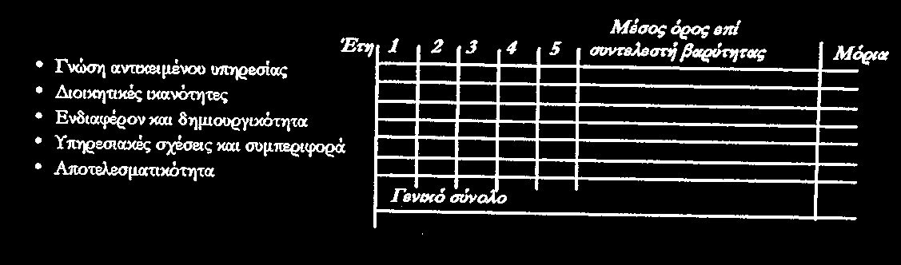

# Άρθρο 85

Κριτήρια για το σχηματισμό της κρίσης

1. Η επιλογή των προϊσταμένων Γενικής Διεύθυνσης γίνεται από το Ειδικό Υπηρεσιακό Συμβούλιο βάσει κριτηρίων που αξιολογούνται ως ακολούθως: α. Επαγγελματικά − Τεχνικά προσόντα − Ο βασικός τίτλος σπουδών: άριστα 300 μόρια, λίαν καλώς 250 μόρια, καλώς 200 μόρια. − Ο δεύτερος τίτλος σπουδών εφόσον είναι της ίδιας εκπαιδευτικής βαθμίδας με το βασικό τίτλο σπουδών: άριστα 80 μόρια, λίαν καλώς 60 μόρια, καλώς 40 μόρια. − Το διδακτορικό δίπλωμα σε γνωστικό αντικείμενο συναφές με το αντικείμενο της υπηρεσίας: μόρια 200 − Το διδακτορικό δίπλωμα σε άλλο γνωστικό αντικείμενο: μόρια 120 − Ο μεταπτυχιακός τίτλος ετήσιας τουλάχιστον διάρκειας σε γνωστικό αντικείμενο συναφές με το αντικείμενο της υπηρεσίας: μόρια 120 − Ο μεταπτυχιακός τίτλος ετήσιας τουλάχιστον διάρκειας σε άλλο γνωστικό αντικείμενο: μόρια 60 − Η άριστη γνώση μιας από τις γλώσσες των χωρών της Ευρωπαϊκής Ένωσης: μόρια 60 − Η πολύ καλή γνώση μιας από τις γλώσσες των χωρών της Ευρωπαϊκής Ένωσης: μόρια 50 − Η καλή γνώση μιας από τις γλώσσες των χωρών της Ευρωπαϊκής Ένωσης: μόρια 40 − Η άριστη γνώση κάθε επιπλέον ξένης γλώσσας: μόρια 50 − Η πολύ καλή γνώση κάθε επιπλέον ξένης γλώσσας: μόρια 40 − Η επιτυχής αποφοίτηση από την Εθνική Σχολή Δημόσιας Διοίκησης ή από την Εθνική Σχολή Τοπικής Αυτοδιοίκησης του Ε.Κ.Δ.Δ.Α.: μόρια 120. Εάν ο υπάλληλος έχει αποφοιτήσει και από τις δύο ως άνω σχολές, μοριοδοτείται μόνο για τη μία εξ αυτών. − Η αποφοίτηση από τη Σχολή Εθνικής Άμυνας ή από τη Σχολή Εθνικής Ασφάλειας: μόρια 30. Εάν ο υπάλληλος έχει αποφοιτήσει και από τις δύο ως άνω σχολές, μοριοδοτείται μόνο για τη μία εξ αυτών. − Η πιστοποιημένη επιμόρφωση που παρέχεται από το Εθνικό Κέντρο Δημόσιας Διοίκησης και Αυτοδιοίκησης (Ε.Κ.Δ.Δ.Α.) και άλλες σχολές του Δημοσίου, καθώς και αυτή που παρέχεται από Πανεπιστήμια ή Τ.Ε.Ι. ή από το Ευρωπαϊκό Ινστιτούτο Δημόσιας Διοίκησης και αποδεικνύεται με αντίστοιχο πιστοποιητικό: μέχρι 100 μόρια (ανά ημέρα επιμόρφωσης ένα (1) μόριο με ανώτατο όριο τα 100 μόρια). Σε περίπτωση που υποψήφιος κατέχει διδακτορικό δίπλωμα και μεταπτυχιακό τίτλο ή περισσότερα του ενός διδακτορικά διπλώματα ή μεταπτυχιακούς τίτλους ή έχει αποφοιτήσει από την Ε.Σ.Δ.Δ. και την Ε.Σ.Τ.Α. του Ε.Κ.Δ.Δ.Α. και κατέχει διδακτορικό δίπλωμα ή μεταπτυχιακό τίτλο, υπολογίζεται το προσόν με τα περισσότερα μόρια, καθώς και το ένα τρίτο (1/3) των μορίων του άλλου ή άλλων προσόντων. β. Εργασιακή − Διοικητική εμπειρία − Ο χρόνος υπηρεσίας: μέχρι 600 μόρια (για κάθε έτος υπηρεσίας 20 μόρια με ανώτατο όριο τα 30 έτη). Χρόνος υπηρεσίας μεγαλύτερος του εξαμήνου λογίζεται ως πλήρες έτος. − Ο χρόνος υπηρεσίας σε θέση προϊσταμένου Γενικής Διεύθυνσης: μέχρι 350 μόρια (για κάθε συμπληρωμένο μήνα 9,72 μόρια με ανώτατο όριο τους 36 μήνες). − Ο χρόνος υπηρεσίας σε θέση προϊσταμένου Διεύθυνσης: μέχρι 250 μόρια (για κάθε συμπληρωμένο μήνα 6,94 μόρια με ανώτατο όριο τους 36 μήνες). Το σύνολο των μορίων που μπορεί να λάβει υποψήφιος από το χρόνο υπηρεσίας σε θέση προϊσταμένου Γενικής Διεύθυνσης και προϊσταμένου Διεύθυνσης δεν μπορεί να υπερβαίνει τα 350 μόρια. γ. Ικανότητες − δεξιότητες

(1) Υπηρεσιακή αξιολόγηση: μέχρι 700 μόρια Τα ανωτέρω κριτήρια αξιολογούνται βάσει της βαθμολόγησης τους στις εκθέσεις αξιολόγησης της τελευταίας πενταετίας και λαμβάνεται υπόψη ο μέσος όρος αυτής για κάθε κριτήριο με συντελεστή βαρύτητας 14.

(2) Ειδικές δραστηριότητες (ιδίως συγγραφικές εργασίες, ανακοινώσεις−εισηγήσεις σε συνέδρια, ημερίδες

κ.λπ. συναφείς με αντικείμενο της υπηρεσίας ή της δημόσιας διοίκησης γενικότερα, εκπροσώπηση σε συμβούλια, επιτροπές ή ομάδες εργασίας τόσο στο εσωτερικό όσο και στο εξωτερικό, μέλη Δ.Σ., Πρόεδροι, Διοικητές και λοιπά όργανα διοίκησης νομικών προσώπων του δημόσιου τομέα ή επιμόρφωση πέραν της αναφερόμενης στην περίπτωση 1α): μέχρι 150 μόρια

(3) Η ηθική αμοιβή του επαίνου: 20 μόρια

(4) Το μετάλλιο διακεκριμένων πράξεων: 50 μόρια

(5) Συνέντευξη: από 100 μέχρι 450 μόρια, ως ακολούθως: ικανοποιητικώς 100, καλώς 200, πολύ καλώς 300, άριστα 450.

2. Η επιλογή των προϊσταμένων Διεύθυνσης ή αντίστοιχου επιπέδου οργανικής μονάδας γίνεται από το οικείο υπηρεσιακό συμβούλιο βάσει κριτηρίων που αξιολογούνται ως ακολούθως: α. Επαγγελματικά − Τεχνικά προσόντα − Ο βασικός τίτλος σπουδών: άριστα 300 μόρια, λίαν καλώς 250 μόρια, καλώς 200 μόρια. − Ο δεύτερος τίτλος σπουδών εφόσον είναι της ίδιας εκπαιδευτικής βαθμίδας με το βασικό τίτλο σπουδών: άριστα 80 μόρια, λίαν καλώς 60 μόρια, καλώς 40 μόρια. − Το διδακτορικό δίπλωμα σε γνωστικό αντικείμενο συναφές με το αντικείμενο της υπηρεσίας: μόρια 180 − Το διδακτορικό δίπλωμα σε άλλο γνωστικό αντικείμενο: μόρια 100 − Ο μεταπτυχιακός τίτλος ετήσιας τουλάχιστον διάρκειας σε γνωστικό αντικείμενο συναφές με το αντικείμενο της υπηρεσίας: μόρια 100 − Ο μεταπτυχιακός τίτλος ετήσιας τουλάχιστον διάρκειας σε άλλο γνωστικό αντικείμενο: μόρια 60 − Η άριστη γνώση μιας από τις γλώσσες των χωρών της Ευρωπαϊκής Ένωσης: μόρια 50 − Η πολύ καλή γνώση μιας από τις γλώσσες των χωρών της Ευρωπαϊκής Ένωσης: μόρια 40 − Η καλή γνώση μιας από τις γλώσσες των χωρών της Ευρωπαϊκής Ένωσης: μόρια 30 − Η άριστη γνώση κάθε επιπλέον ξένης γλώσσας: μόρια 40 − Η πολύ καλή γνώση κάθε επιπλέον ξένης γλώσσας: μόρια 30 − Η επιτυχής αποφοίτηση από την Εθνική Σχολή Δημόσιας Διοίκησης ή από την Εθνική Σχολή Τοπικής Αυτοδιοίκησης του Ε.Κ.Δ.Δ.Α.: μόρια 100. Εάν ο υπάλληλος έχει αποφοιτήσει και από τις δύο ως άνω σχολές μοριοδοτείται μόνο για τη μία εξ αυτών. − Η αποφοίτηση από τη Σχολή Εθνικής Άμυνας ή από τη Σχολή Εθνικής Ασφάλειας: μόρια 30. Εάν ο υπάλληλος έχει αποφοιτήσει και από τις δύο ως άνω σχολές μοριοδοτείται μόνο για τη μία εξ αυτών. − Η πιστοποιημένη επιμόρφωση που παρέχεται από το Εθνικό Κέντρο Δημόσιας Διοίκησης και Αυτοδιοίκησης και άλλες σχολές του Δημοσίου, καθώς και αυτή που παρέχεται από Πανεπιστήμια ή Τ.Ε.Ι. ή από το Ευρωπαϊκό Ινστιτούτο Δημόσιας Διοίκησης και αποδεικνύεται με αντίστοιχο πιστοποιητικό: μέχρι 80 μόρια (ανά ημέρα επιμόρφωσης ένα (1) μόριο με ανώτατο όριο τα 80 μόρια). Σε περίπτωση που υποψήφιος κατέχει διδακτορικό δίπλωμα και μεταπτυχιακό τίτλο ή περισσότερα του ενός διδακτορικά διπλώματα ή μεταπτυχιακούς τίτλους ή έχει αποφοιτήσει από την Ε.Σ.Δ.Δ. και την Ε.Σ.Τ.Α. του Εθνικού Κέντρου Δημόσιας Διοίκησης και Αυτοδιοίκησης (Ε.Κ.Δ.Δ.Α.) και κατέχει διδακτορικό δίπλωμα ή μεταπτυχιακό τίτλο, υπολογίζεται το προσόν με τα περισσότερα μόρια, καθώς και το ένα τρίτο (1/3) των μορίων του άλλου ή άλλων προσόντων. β. Εργασιακή − Διοικητική εμπειρία − Ο χρόνος υπηρεσίας: μέχρι 600 μόρια (για κάθε έτος υπηρεσίας 20 μόρια με ανώτατο όριο τα 30 έτη). Χρόνος υπηρεσίας μεγαλύτερος του εξαμήνου λογίζεται ως πλήρες έτος. − Ο χρόνος υπηρεσίας σε θέση προϊσταμένου Διεύθυνσης: μέχρι 200 μόρια (για κάθε συμπληρωμένο μήνα 5,56 μόρια με ανώτατο όριο τους 36 μήνες). − Ο χρόνος υπηρεσίας σε θέση προϊσταμένου Τμήματος ή αυτοτελούς γραφείου: μέχρι 125 μόρια (για κάθε συμπληρωμένο μήνα 3,47 μόρια με ανώτατο όριο τους 36 μήνες). Το σύνολο των μορίων που μπορεί να λάβει υποψήφιος από το χρόνο υπηρεσίας σε θέση προϊσταμένου Διεύθυνσης και προϊσταμένου Τμήματος ή αυτοτελούς γραφείου δεν μπορεί να υπερβεί τα 200 μόρια. γ. Ικανότητες − δεξιότητες

(1) Υπηρεσιακή αξιολόγηση: μέχρι 450 μόρια Τα ανωτέρω κριτήρια αξιολογούνται βάσει της βαθμολόγησης τους στις εκθέσεις αξιολόγησης της τελευταίας πενταετίας και λαμβάνεται υπόψη ο μέσος όρος αυτής για κάθε κριτήριο με συντελεστή βαρύτητας 9.

(2) Ειδικές δραστηριότητες (ιδίως συγγραφικές εργασίες, ανακοινώσεις−εισηγήσεις σε συνέδρια, ημερίδες κ.λπ. συναφείς με αντικείμενο της υπηρεσίας ή της δημόσιας διοίκησης γενικότερα, εκπροσώπηση σε συμβούλια, επιτροπές ή ομάδες εργασίας τόσο στο εσωτερικό όσο και στο εξωτερικό, μέλη Δ.Σ., Πρόεδροι, Διοικητές και λοιπά όργανα διοίκησης νομικών προσώπων του δημόσιου τομέα, ή επιμόρφωση πέραν της αναφερόμενης στην περίπτωση 2α): μέχρι 120 μόρια

(3) Η ηθική αμοιβή του επαίνου: 20 μόρια

(4) Το μετάλλιο διακεκριμένων πράξεων: 50 μόρια

(5) Συνέντευξη: από 50 μέχρι 200 μόρια, ως ακολούθως: ικανοποιητικώς 50, καλώς 100, πολύ καλώς 150, άριστα 200.

3. Η επιλογή των προϊσταμένων Τμήματος, Αυτοτελούς Γραφείου ή αντίστοιχου επιπέδου οργανικής μονάδας γίνεται από το οικείο υπηρεσιακό συμβούλιο βάσει κριτηρίων που αξιολογούνται ως ακολούθως: α. Επαγγελματικά − Τεχνικά προσόντα − Ο βασικός τίτλος σπουδών: άριστα 300 μόρια, λίαν καλώς 250 μόρια, καλώς 200 μόρια. − Ο δεύτερος τίτλος σπουδών εφόσον είναι της ίδιας εκπαιδευτικής βαθμίδας με το βασικό τίτλο σπουδών: άριστα 80, λίαν καλώς 60, καλώς 40. − Το διδακτορικό δίπλωμα σε γνωστικό αντικείμενο συναφές με το αντικείμενο της υπηρεσίας: μόρια 180 − Το διδακτορικό δίπλωμα σε άλλο γνωστικό αντικείμενο: μόρια 100 − Ο μεταπτυχιακός τίτλος ετήσιας τουλάχιστον διάρκειας σε γνωστικό αντικείμενο συναφές με το αντικείμενο της υπηρεσίας: μόρια 100

− Ο μεταπτυχιακός τίτλος ετήσιας διάρκειας σε άλλο γνωστικό αντικείμενο: μόρια 60 − Η άριστη γνώση μιας από τις γλώσσες των χωρών της Ευρωπαϊκής Ενωσης: μόρια 70 − Η πολύ καλή γνώση μιας από τις γλώσσες των χωρών της Ευρωπαϊκής Ένωσης: μόρια 60 − Η καλή γνώση μιας από τις γλώσσες των χωρών της Ευρωπαϊκής Ένωσης: μόρια 50 − Η άριστη γνώση κάθε επιπλέον ξένης γλώσσας: μόρια 60 − Η πολύ καλή γνώση κάθε επιπλέον ξένης γλώσσας: μόρια 50 − Η επιτυχής αποφοίτηση από την Εθνική Σχολή Δημόσιας Διοίκησης ή από την Εθνική Σχολή Τοπικής Αυτοδιοίκησης του Ε.Κ.Δ.Δ.Α.: μόρια 130. Εάν ο υπάλληλος έχει αποφοιτήσει και από τις δύο ως άνω σχολές, μοριοδοτείται μόνο για τη μία εξ αυτών. − Η αποφοίτηση από τη Σχολή Εθνικής Άμυνας ή από τη Σχολή Εθνικής Ασφάλειας: μόρια 30. Εάν ο υπάλληλος έχει αποφοιτήσει και από τις δύο ως άνω σχολές, μοριοδοτείται μόνο για τη μία εξ αυτών. − Η πιστοποιημένη επιμόρφωση που παρέχεται από το Εθνικό Κέντρο Δημόσιας Διοίκησης και Αυτοδιοίκησης και άλλες σχολές του Δημοσίου, καθώς και αυτή που παρέχεται από Πανεπιστήμια ή Τ.Ε.Ι. ή από το Ευρωπαϊκό Ινστιτούτο Δημόσιας Διοίκησης και αποδεικνύεται με αντίστοιχο πιστοποιητικό: μέχρι 100 μόρια (ανά ημέρα επιμόρφωσης ένα (1) μόριο με ανώτατο όριο τα 100 μόρια). Σε περίπτωση που υποψήφιος κατέχει διδακτορικό δίπλωμα και μεταπτυχιακό τίτλο ή περισσότερα του ενός διδακτορικά διπλώματα ή μεταπτυχιακούς τίτλους ή έχει αποφοιτήσει από την Ε.Σ.Δ.Δ. και την Ε.Σ.Τ.Α. του Εθνικού Κέντρου Δημόσιας Διοίκησης και Αυτοδιοίκησης (Ε.Κ.Δ.Δ.Α.) και κατέχει διδακτορικό δίπλωμα ή μεταπτυχιακό τίτλο, υπολογίζεται το προσόν με τα περισσότερα μόρια, καθώς και το ένα τρίτο (1/3) των μορίων του άλλου ή άλλων προσόντων. β. Εργασιακή − Διοικητική εμπειρία − Ο χρόνος υπηρεσίας: μέχρι 450 μόρια (για κάθε έτος υπηρεσίας 15 μόρια με ανώτατο όριο τα 30 έτη). Χρόνος υπηρεσίας μεγαλύτερος του εξαμήνου λογίζεται ως πλήρες έτος. − Ο χρόνος υπηρεσίας σε θέση προϊσταμένου Διεύθυνσης: μέχρι 200 μόρια (για κάθε συμπληρωμένο μήνα 5,56 μόρια με ανώτατο όριο τους 36 μήνες). − Ο χρόνος υπηρεσίας σε θέση προϊσταμένου Τμήματος ή αυτοτελούς γραφείου: μέχρι 125 μόρια (για κάθε συμπληρωμένο μήνα 3,47 μόρια με ανώτατο όριο τους 36 μήνες). Το σύνολο των μορίων που μπορεί να λάβει υποψήφιος από το χρόνο υπηρεσίας σε θέση προϊσταμένου Διεύθυνσης και προϊσταμένου Τμήματος ή αυτοτελούς γραφείου δεν μπορεί να υπερβαίνει τα 200 μόρια. γ. Ικανότητες − δεξιότητες

(1) Υπηρεσιακή αξιολόγηση: μέχρι 300 μόρια Τα ανωτέρω κριτήρια αξιολογούνται βάσει της βαθμολόγησης τους στις εκθέσεις αξιολόγησης της τελευταίας πενταετίας και λαμβάνεται υπόψη ο μέσος όρος αυτής για κάθε κριτήριο με συντελεστή βαρύτητας 6. Το κριτήριο «Διοικητικές ικανότητες» δεν λαμβάνεται υπόψη κατά την κρίση για την επιλογή προϊσταμένων τμήματος ή αυτοτελούς γραφείου ή αντίστοιχου επιπέδου οργανικής μονάδας όταν αυτό δεν υπάρχει. Στην περίπτωση αυτή τα υπόλοιπα κριτήρια αξιολογούνται και λαμβάνεται υπόψη ο μέσος όρος της τελευταίας πενταετίας για κάθε κριτήριο με συντελεστή βαρύτητας 7,5.

(2) Ειδικές δραστηριότητες (ιδίως συγγραφικές εργασίες, ανακοίνωσεις−εισηγήσεις σε συνέδρια, ημερίδες κ.λπ. συναφείς με αντικείμενο της υπηρεσίας ή της δημόσιας διοίκησης γενικότερα, εκπροσώπηση σε συμβούλια, επιτροπές ή ομάδες εργασίας τόσο στο εσωτερικό όσο και στο εξωτερικό, μέλη Δ.Σ., Πρόεδροι, Διοικητές και λοιπά όργανα διοίκησης νομικών προσώπων του δημόσιου τομέα ή επιμόρφωση πέραν της αναφερόμενης στην περίπτωση 3 α): μέχρι 60 μόρια

(3) Η ηθική αμοιβή του επαίνου: 20 μόρια

(4) Το μετάλλιο διακεκριμένων πράξεων: 40 μόρια

(5) Ειδική αξιολόγηση από το υπηρεσιακό συμβούλιο: από 50 μέχρι 200 μόρια. Το υπηρεσιακό συμβούλιο μοριοδοτεί κάθε υποψήφιο με βάση τη συνολική υπηρεσιακή εικόνα του υπαλλήλου που αποκομίζει από το σύνολο των στοιχείων του προσωπικού μητρώου.

4. Η συνολική βαθμολογία των κριτηρίων των περιπτώσεων β΄ και γ΄ των παραγράφων 1, 2 και 3 του παρόντος εξάγεται με προσέγγιση δύο δεκαδικών ψηφίων.

5. Για τη βαθμολογία του κριτηρίου της επιμόρφωσης της περίπτωσης α΄ των παραγράφων 1, 2 και 3 του παρόντος λαμβάνεται υπόψη η επιμόρφωση της τελευταίας δεκαετίας.

6. Η βαθμολογία του κριτηρίου της υπηρεσιακής αξιολόγησης της περίπτωσης γ΄ των παραγράφων 1, 2 και 3 του παρόντος εξάγεται με βάση τις εκθέσεις αξιολόγησης που υπάρχουν στο προσωπικό μητρώο του υπαλλήλου έστω και αν δεν καλύπτουν πλήρη πενταετία.

7. Την τελική βαθμολογία του κριτηρίου της συνέντευξης της περίπτωσης γ΄ των παραγράφων 1 και 2 του παρόντος, των ειδικών δραστηριοτήτων της περίπτωσης γ΄ των παραγράφων 1, 2 και 3 του παρόντος, καθώς και της ειδικής αξιολόγησης της περίπτωσης γ΄ της παραγράφου 3 του παρόντος αποτελεί ο μέσος όρος του βαθμού των μελών του Υπηρεσιακού Συμβουλίου.

8. Η επίδραση των αναρρωτικών αδειών στην ικανότητα του υπαλλήλου για την άσκηση καθηκόντων προϊσταμένου, όπως επίσης και οι συστηματικά επαναλαμβανόμενες αναρρωτικές άδειες και η ύπαρξη πειθαρχικών ποινών, συνεκτιμώνται από το υπηρεσιακό συμβούλιο στη βαθμολόγηση της συνέντευξης ή της ειδικής αξιολόγησης.
