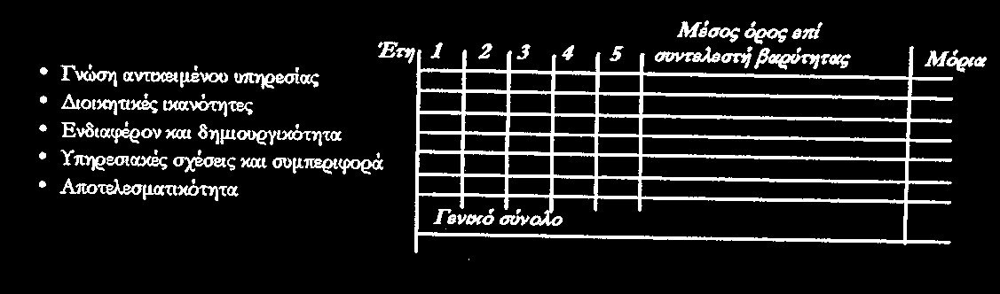

# Άρθρο 86

Επιλογή προϊσταμένων οργανικών μονάδων

1. Η κατάταξη των υποψηφίων γίνεται βάσει της βαθμολογίας που ο κάθε υποψήφιος λαμβάνει σύμφωνα με τα κριτήρια του προηγούμενου άρθρου και η επιλογή γίνεται κατά φθίνουσα σειρά βαθμολογίας και κατά τη διαδικασία των επόμενων παραγράφων.

2. α) Η επιλογή προϊσταμένων Γενικών Διευθύνσεων γίνεται από το Ειδικό Υπηρεσιακό Συμβούλιο ύστερα από

κοινή απόφαση−προκήρυξη του Υπουργείου Εσωτερικών, Δημόσιας Διοίκησης και Αποκέντρωσης και του οικείου Υπουργού και προκειμένου για Ν.Π.Δ.Δ. του Υπουργού που το εποπτεύει, με την οποία προσδιορίζονται οι κενές θέσεις προϊσταμένων Γενικών Διευθύνσεων και καθορίζονται οι όροι και οι προϋποθέσεις συμμετοχής στη διαδικασία της επιλογής.

β) Η προκήρυξη εκδίδεται πέντε (5) μήνες πριν από τη λήξη της θητείας των υπηρετούντων προϊσταμένων Γενικών Διευθύνσεων και περίληψη της δημοσιεύεται σε δύο (2) τουλάχιστον ημερήσιες εφημερίδες της Αθήνας. Εάν πρόκειται για Ν.Π.Δ.Δ. που εδρεύει εκτός Αθηνών, η περίληψη δημοσιεύεται και σε μία εφημερίδα ημερήσια ή εβδομαδιαία της έδρας του Ν.Π.Δ.Δ., εφόσον εκδίδεται. Για λόγους ευρύτερης δημοσιότητας ο οικείος φορέας καταχωρεί την προκήρυξη στην ιστοσελίδα του. Η τυχόν μη καταχώρηση της προκήρυξης στην ιστοσελίδα του οικείου φορέα δεν επηρεάζει το κύρος της σχετικής διαδικασίας.

γ) Δικαίωμα υποβολής αίτησης υποψηφιότητας έχουν και υπάλληλοι άλλων δημόσιων υπηρεσιών ή νομικών προσώπων δημοσίου δικαίου, εφόσον πληρούν τους όρους και τις προϋποθέσεις της προκήρυξης. Η αίτηση υποψηφιότητας συνοδεύεται από βιογραφικό σημείωμα που συντάσσεται με ευθύνη του υποψηφίου και το περιεχόμενο του οποίου προκύπτει από τα στοιχεία του προσωπικού μητρώου του υπαλλήλου.

δ) Το Ειδικό Υπηρεσιακό Συμβούλιο ελέγχει σε πρώτο στάδιο όλες τις αιτήσεις υποψηφιοτήτων εάν και κατά πόσο πληρούν τους όρους του νόμου και της προκήρυξης. Όσοι από τους υποψηφίους δεν πληρούν τους όρους της προκήρυξης αποκλείονται με απόφαση του Ειδικού Υπηρεσιακού Συμβουλίου από την περαιτέρω διαδικασία. Σε δεύτερο στάδιο, το Ειδικό Υπηρεσιακό Συμβούλιο μοριοδοτεί κάθε υποψήφιο, κατά τα οριζόμενα στην παρ. 1 του άρθρου 85. Ειδικώς, για τη συνέντευξη, το Ειδικό Υπηρεσιακό Συμβούλιο καλεί κάθε υποψήφιο χωριστά, προκειμένου να μορφώσει γνώμη για την προσωπικότητα, την ικανότητα και την εν γένει καταλληλότητα του για την άσκηση των καθηκόντων του προϊσταμένου Γενικής Διεύθυνσης.

ε) Οι Προϊστάμενοι Γενικών Διευθύνσεων των οποίων η θητεία λήγει, εξακολουθούν να διατηρούν τη θέση τους και να ασκούν τα καθήκοντα τους έως την επιλογή και τοποθέτηση νέων Προϊσταμένων.

στ) Σε περίπτωση που προϊστάμενος Γενικής Διεύθυνσης δεν επιλέγεται για δεύτερη φορά, καταλαμβάνει κενή θέση προϊσταμένου Διεύθυνσης και αν δεν υπάρχει, καταλαμβάνει την πρώτη θέση προϊσταμένου Διεύθυνσης που θα κενωθεί. Ως τότε θεωρείται προϊστάμενος Διεύθυνσης και τα καθήκοντα του προσδιορίζονται με απόφαση του οικείου Υπουργού ή του μονομελούς οργάνου διοίκησης του Ν.Π.Δ.Δ., ανάλογα με τις υπηρεσιακές ανάγκες. Η θητεία του ανανεώνεται αυτόματα εκτός εάν με απόφαση του οικείου υπηρεσιακού συμβουλίου απαλλαγεί από τα καθήκοντα του προϊσταμένου Διεύθυνσης για σοβαρό λόγο αναγόμενο στην πλημμελή άσκηση αυτών. Επίσης, οι προϊστάμενοι Γενικής Διεύθυνσης, οι οποίοι δεν επιλέγονται πάλι μετά τη λήξη της θητείας τους, μπορούν να αποχωρήσουν από την υπηρεσία διατηρώντας τις αποδοχές του προϊσταμένου Γενικής Διεύθυνσης, εφόσον υποβάλουν αίτηση παραίτησης μέσα σε αποκλειστική προθεσμία δύο (2) μηνών από την ανακοίνωση της μη επανεπιλογής τους.

ζ) Αν κενωθεί θέση προϊσταμένου Γενικής Διεύθυνσης πριν από τη λήξη της θητείας ή συσταθεί νέα, το Ειδικό Υπηρεσιακό Συμβούλιο επιλέγει νέο προϊστάμενο για το υπόλοιπο της θητείας σύμφωνα με τις ανωτέρω διατάξεις.

3. α) Η επιλογή προϊσταμένων Διευθύνσεων, Τμημάτων και αυτοτελών γραφείων ή αντίστοιχου επιπέδου οργανικών μονάδων γίνεται από το οικείο υπηρεσιακό συμβούλιο, το αργότερο μέσα σε ένα μήνα από τη λήξη της θητείας τους.

β) Το υπηρεσιακό συμβούλιο μοριοδοτεί τους υποψηφίους για τις θέσεις προϊσταμένων Διευθύνσεων ή Τμημάτων, κατά τα οριζόμενα στις παραγράφους 2 και 3, αντίστοιχα, του άρθρου 85. Ειδικώς, για τις θέσεις προϊσταμένων Διεύθυνσης, το υπηρεσιακό συμβούλιο καλεί σε συνέντευξη κάθε υποψήφιο χωριστά, προκειμένου να μορφώσει γνώμη για την προσωπικότητα, την ικανότητα και την εν γένει καταλληλότητα του για την άσκηση των καθηκόντων του προϊσταμένου Διεύθυνσης.

γ) Για την εφαρμογή των παραγράφων 2 και 3 του άρθρου 84, αν δεν καλύπτεται ο αριθμός των προϊσταμένων των οργανικών μονάδων από υπαλλήλους με τις προϋποθέσεις που ορίζονται σε αυτές συμπληρώνεται από υπαλλήλους με βαθμό Β΄.

δ) Έγγραφη δήλωση του υπαλλήλου, ότι δεν επιθυμεί να κριθεί κατά την επιλογή προϊσταμένων οργανικών μονάδων, γίνεται δεκτή από το υπηρεσιακό συμβούλιο εκτός εάν οι ανάγκες της υπηρεσίας επιβάλλουν τη μη αποδοχή της.

ε) Οι προϋποθέσεις που προβλέπονται στις παραγράφους 2 και 3 του άρθρου 84 πρέπει να συντρέχουν το αργότερο έως και την ημέρα λήξης της θητείας των προϊσταμένων.

4. Όσοι επιλέγονται από το Ειδικό Υπηρεσιακό Συμβούλιο και τα υπηρεσιακά συμβούλια τοποθετούνται, με απόφαση του οικείου οργάνου, ως προϊστάμενοι σε αντίστοιχου επιπέδου οργανικές μονάδες για τρία (3) έτη. Στην περίπτωση που υπάλληλος άλλης δημόσιας υπηρεσίας ή Ν.Π.Δ.Δ. επιλεγεί ως προϊστάμενος Γενικής Διεύθυνσης, με την τοποθέτηση του αποσπάται αυτοδίκαια στην υπηρεσία για την οποία έχει επιλεγεί. Ο χρόνος της θητείας του αποσπασμένου υπαλλήλου ως προϊσταμένου Γενικής Διεύθυνσης λογίζεται ως χρόνος πραγματικής υπηρεσίας στην οργανική του θέση για κάθε συνέπεια. Οι τοποθετούμενοι ως προϊστάμενοι εξακολουθούν να ασκούν τα καθήκοντα τους και μετά τη λήξη της θητείας τους ως την τυχόν επανεπιλογή τους ή την τοποθέτηση του νέου προϊσταμένου.

5. Με την επιφύλαξη των διατάξεων της επόμενης παραγράφου, υπάλληλος που επιλέγεται σύμφωνα με τις διατάξεις του παρόντος για τρίτη φορά ως προϊστάμενος Διεύθυνσης ή αντίστοιχου επιπέδου οργανικής μονάδας, θεωρείται ότι καταλαμβάνει αυτοδικαίως θέση προϊσταμένου αντίστοιχου επιπέδου. Επίσης, υπάλληλος που επιλέγεται για τρίτη φορά ως προϊστάμενος Τμήματος, αυτοτελούς γραφείου ή αντίστοιχου επιπέδου οργανικής μονάδας, καθώς και ενδιάμεσων οργανικών μονάδων μεταξύ διεύθυνσης και τμήματος ή τμήματος και γραφείου ή αντίστοιχου επιπέδου οργανικών μονάδων, όπως αυτές προβλέπονται από τις οικείες οργανικές διατάξεις, θεωρείται ότι καταλαμβάνει αυτοδικαίως θέση προϊσταμένου αντίστοιχου επιπέδου. Όσοι καταλαμβάνουν κατά την παράγραφο αυτή θέσεις προϊσταμένων κρίνονται εφεξής μόνο για επιλογή σε θέσεις προϊσταμένων οργανικών μονάδων ανώτερου επιπέδου. Σε περίπτωση κατά την οποία προϊστάμενος Διεύθυνσης ή αντίστοιχου επιπέδου οργανικής μονάδας, δεν επανεπιλέγεται μετά τη λήξη της θητείας του, καταλαμβάνει, χωρίς κρίση υπηρεσιακού συμβουλίου, θέση προϊσταμένου Τμήματος ή αντίστοιχου επιπέδου οργανικής μονάδας εκτός αν το υπηρεσιακό συμβούλιο με αιτιολογημένη απόφαση του κρίνει διαφορετικά.

6. Με απόφαση του υπηρεσιακού συμβουλίου, ο προϊστάμενος μπορεί να απαλλαγεί από τα καθήκοντα του και πριν από τη λήξη της τριετίας, για σοβαρό λόγο αναγόμενο στην πλημμελή άσκηση των υπηρεσιακών του καθηκόντων και ιδιαίτερα για αδικαιολόγητη επιείκεια ή μεροληψία κατά τη σύνταξη των εκθέσεων αξιολόγησης, για πλημμελή άσκηση ή αδυναμία άσκησης ελέγχου επί των υπαλλήλων, για μη προσήκουσα συμπεριφορά προς τους πολίτες, ευθυνοφοβία, απροθυμία για την εφαρμογή νέων μεθόδων οργάνωσης, λειτουργίας και αποδοτικότητας, αδικαιολόγητη καθυστέρηση στη διεκπεραίωση των υποθέσεων, κακή συνεργασία με λοιπούς προϊσταμένους και μειωμένη ποιοτική και ποσοτική απόδοση. Ο προϊστάμενος μπορεί, επίσης, να απαλλαγεί από τα καθήκοντα του με αίτηση του, ύστερα από απόφαση του υπηρεσιακού συμβουλίου, που συνεκτιμά τις υπηρεσιακές ανάγκες. Στην περίπτωση αυτή και ανεξάρτητα από τους λόγους της παραίτησης, στερείται του δικαιώματος επιλογής του ως προϊσταμένου οργανικής μονάδας για μία τριετία από την επομένη της έκδοσης της απόφασης απαλλαγής του από τα καθήκοντα προϊσταμένου.

7. Αν κενωθεί θέση προϊσταμένου Διεύθυνσης, Τμήματος ή αυτοτελούς γραφείου πριν από τη λήξη της θητείας ή συσταθεί νέα, το οικείο υπηρεσιακό συμβούλιο επιλέγει νέο προϊστάμενο για το υπόλοιπο της θητείας. Η επιλογή προϊσταμένων για τις θέσεις που κενώθηκαν ή συστάθηκαν γίνεται το αργότερο μέσα σε ένα μήνα από τότε που οι θέσεις κενώθηκαν ή συστάθηκαν. Για την επιλογή προϊσταμένου σύμφωνα με τις διατάξεις της παραγράφου αυτής, απαιτείται να υποβληθεί αίτηση από τον ενδιαφερόμενο υπάλληλο στην οικεία υπηρεσία διοικητικού ή προσωπικού, το αργότερο μέσα σε δεκαπέντε (15) ημέρες από την ημέρα που έλαβε γνώση με φροντίδα της υπηρεσίας διοικητικού ή προσωπικού. Αν δεν υποβληθούν υποψηφιότητες για θέση προϊσταμένου οργανικής μονάδας, το υπηρεσιακό συμβούλιο αναθέτει καθήκοντα κατά προτίμηση σε υπάλληλο που υπηρετεί στον τόπο που θα ασκήσει καθήκοντα προϊσταμένου.

8. Αν οι υπάλληλοι που κρίνονται για να επιλεγούν ως προϊστάμενοι στις ίδιες θέσεις υπάγονται στην αρμοδιότητα διαφορετικών υπηρεσιακών συμβουλίων, με απόφαση του οργάνου, που συγκροτεί τα υπηρεσιακά συμβούλια, ορίζεται το υπηρεσιακό συμβούλιο που διενεργεί την επιλογή.

9. Οι διατάξεις για την επιλογή προϊσταμένων Διευθύνσεων εφαρμόζονται και στις περιπτώσεις που από τις οργανικές διατάξεις προβλέπονται ενδιάμεσου επιπέδου οργανικές μονάδες μεταξύ Διεύθυνσης και Τμήματος.
