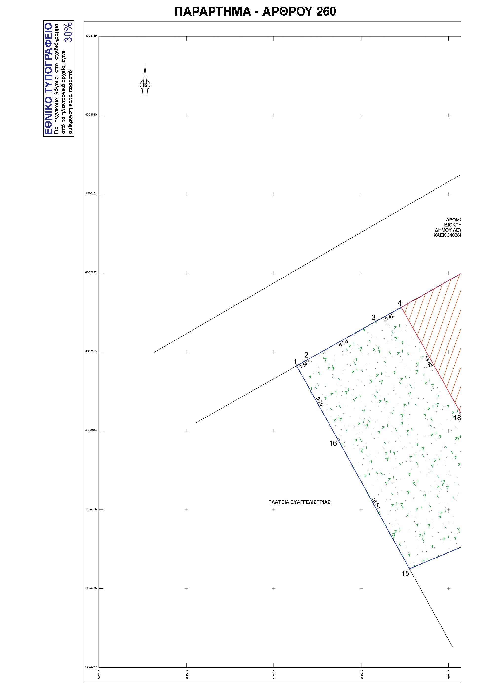
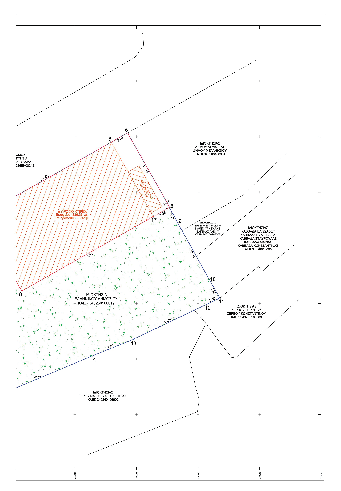
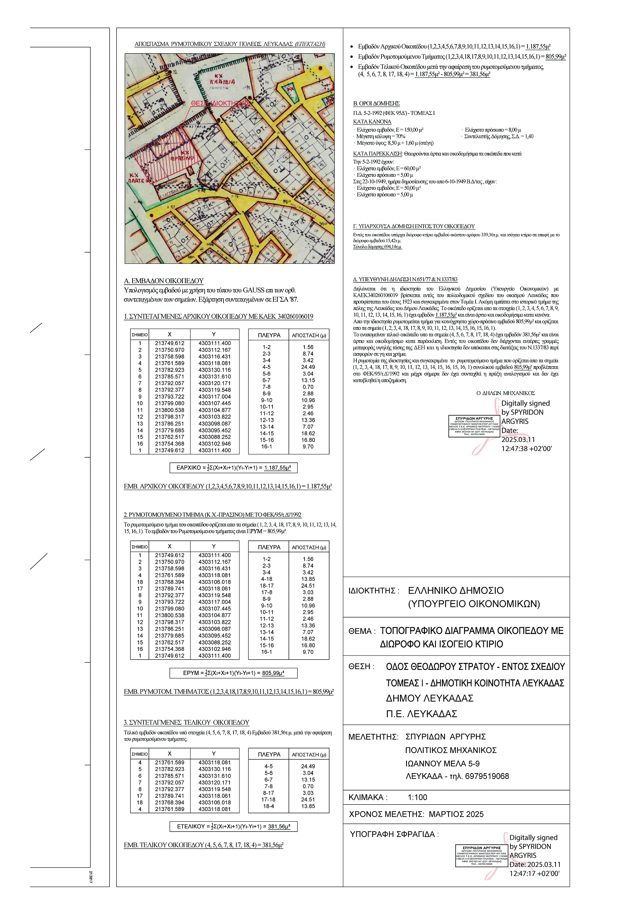

# Άρθρο 275

Έναρξη ισχύος

1. Με την επιφύλαξη των επόμενων παραγράφων, η ισχύς του παρόντος νόμου αρχίζει από τη δημοσίευσή του στην Εφημερίδα της Κυβερνήσεως, εκτός αν ορίζεται διαφορετικά στις επιμέρους διατάξεις του.

2. Η ισχύς της περ. α) της παρ. 1 του άρθρου 50 αρχίζει από την 1η.10.2025.

3. Η ισχύς της παρ. 2 του άρθρου 93 αρχίζει από την ψηφιακή υλοποίηση του μητρώου κατόχων αποστακτικών μηχανημάτων της παρ. Ε1 του άρθρου 7 του ν. 2969/2001 (Α’ 281) και διήμερων μικρών αποσταγματοποιών της παρ. 5 του άρθρου 5 του ιδίου νόμου, η ημερομηνία έναρξης της οποίας καθορίζεται με την απόφαση του δεύτερου εδαφίου της παρ. 43 του άρθρου 196.

4. Η ισχύς του άρθρου 105 αρχίζει από την ψηφιακή υλοποίηση του μητρώου ΕΚΜΕΑ, η ημερομηνία έναρξης της οποίας καθορίζεται με την απόφαση της παρ. 54 του άρθρου 196.

5. Η παρ. 1 του άρθρου 207, περί εξαιρέσεων από τον υπολογισμό του εισοδήματος από μισθωτή εργασία, ισχύει από το φορολογικό έτος 2025 και εφεξής.

6. Η παρ. 1 του άρθρου 208, περί της φορολογικής αντιμετώπισης των αμοιβών ναυτικών που υπηρετούν σε ιδιωτικά πλοία αναψυχής, ισχύει για εισοδήματα που αποκτώνται από το φορολογικό έτος 2025 και εφεξής και η παρ. 2 του ίδιου άρθρου, ως προς την παρακράτηση φόρου για τα εισοδήματα αυτά, ισχύει για εισοδήματα που αποκτώνται από 1.10.2025 και εφεξής.

7. Το άρθρο 209, περί της φορολογικής αντιμετώπισης της προμήθειας που λαμβάνουν οι πλανόδιοι λαχειοπώλες, ισχύει για εισοδήματα που αποκτώνται από το φορολογικό έτος 2025 και εφεξής. Ειδικά, το δεύτερο και το τρίτο εδάφιο της παρ. 7 του άρθρου 29 του Κώδικα Φορολογίας Εισοδήματος ως προς την παρακράτηση φόρου για την προμήθεια αυτή, όπως προστίθεται με την παρ. 2 του άρθρου 209 του παρόντος, ισχύει από 1ης.10.2025.

8. Οι παρ. 1, 2 και 3 του άρθρου 210, περί της πληρωμής μισθωμάτων μέσω τραπεζικού λογαριασμού, ισχύουν για μισθώματα του φορολογικού έτους 2026 και εφεξής.

9. Το άρθρο 213, περί κυρώσεων για παράλειψη υποβολής ή εκπρόθεσμη υποβολή φορολογικών δηλώσεων και δηλώσεων πληροφοριακού χαρακτήρα και παράλειψη χορήγησης στοιχείων που ζητούνται από τη φορολογική διοίκηση, ισχύει από τη 19η.4.2024.

10. Το άρθρο 218, περί δήλωσης στοιχείων ακινήτων (Ε9) και Περιουσιολογίου Ακινήτων και προσθήκης περίπτωσης στο Παράρτημα Α’ του Κώδικα Φορολογικής Διαδικασίας, εφαρμόζεται από τη 19η.4.2024.

11. Τα άρθρα 220, 221, 223 έως 235 και παρ. 1 του άρθρου 237 (άρθρο 3 παρ. 1 της Οδηγίας (ΕΕ) 2020/285 του Συμβουλίου της 18ης Φεβρουαρίου 2020 για την τροποποίηση της οδηγίας 2006/112/ΕΚ σχετικά με το κοινό σύστημα φόρου προστιθέμενης αξίας όσον αφορά το ειδικό καθεστώς για τις μικρές επιχειρήσεις και του Κανονισμού (ΕΕ) 904/2010, όσον αφορά τη διοικητική συνεργασία και την ανταλλαγή πληροφοριών με σκοπό την παρακολούθηση της ορθής εφαρμογής του ειδικού καθεστώτος για τις μικρές επιχειρήσεις και άρθρο 3 παρ. 1 της Οδηγίας (ΕΕ) 2022/542 του Συμβουλίου της 5ης Απριλίου 2022 για την τροποποίηση των οδηγιών 2006/112/ΕΚ και (ΕΕ) 2020/285 όσον αφορά τους συντελεστές φόρου προστιθέμενης αξίας) εφαρμόζονται από 1ης.1.2025.

12. Το άρθρο 242, περί εξαιρέσεων από τις δωρεές και την επιβολή του φόρου δωρεάς, ισχύει για παροχές που καταβάλλονται από την 1η.1.2025 και εφεξής.

13. Η παρ. 1 του άρθρου 249, περί του τέλους επιτηδεύματος, ισχύει από το φορολογικό έτος 2024 και εφεξής.

14. Το άρθρο 262, περί προσβασιμότητας πληροφοριών στο Ευρωπαίκο Ενιαίο Σημείο Πρόσβασης ισχύει από τη 10η.7.2026.

15. Η ισχύς των παρ. 1, 2 και 3 του άρθρου 265 αρχίζει τρεις (3) μήνες μετά τη δημοσίευση του παρόντος νόμου στην Εφημερίδα της Κυβερνήσεως.

16. Το άρθρο 269, περί αποζημίωσης και σύνταξης γονέων άτεκνου και άγαμου στρατιωτικού, θανόντος μετά την 1η Ιανουαρίου 2023 σε διατεταγμένη υπηρεσία που συνεπάγεται αυξημένο κίνδυνο και ένεκα αυτής, ισχύει για συμβάντα που έλαβαν χώρα από 1ης Ιανουαρίου 2023 και εφεξής.

Παραγγέλλομε τη δημοσίευση του παρόντος στην Εφημερίδα της Κυβερνήσεως και την εκτέλεσή του ως νόμου του Κράτους. Αθήνα, 28 Ιουλίου 2025 Ο Πρόεδρος της Δημοκρατίας ΚΩΝΣΤΑΝΤΙΝΟΣ ΑΝ. ΤΑΣΟΥΛΑΣ Οι Υπουργοί Εθνικής Οικονομίας και Οικονομικών ΚΥΡΙΑΚΟΣ ΠΙΕΡΡΑΚΑΚΗΣ Αναπληρωτής Υπουργός Εθνικής Οικονομίας και Οικονομικών ΝΙΚΟΛΑΟΣ ΠΑΠΑΘΑΝΑΣΗΣ Εξωτερικών ΓΕΩΡΓΙΟΣ ΓΕΡΑΠΕΤΡΙΤΗΣ Εθνικής Άμυνας ΝΙΚΟΛΑΟΣ - ΓΕΩΡΓΙΟΣ ΔΕΝΔΙΑΣ Εσωτερικών ΘΕΟΔΩΡΟΣ ΛΙΒΑΝΙΟΣ Παιδείας, Θρησκευμάτων και Αθλητισμού ΣΟΦΙΑ ΖΑΧΑΡΑΚΗ Αναπληρωτής Υπουργός Παιδείας, Θρησκευμάτων και Αθλητισμού ΙΩΑΝΝΗΣ ΒΡΟΥΤΣΗΣ Υγείας ΣΠΥΡΙΔΩΝ - ΑΔΩΝΙΣ ΓΕΩΡΓΙΑΔΗΣ Προστασίας του Πολίτη ΜΙΧΑΗΛ ΧΡΥΣΟΧΟΪΔΗΣ Υποδομών και Μεταφορών ΧΡΙΣΤΟΣ ΔΗΜΑΣ Αναπληρωτής Υπουργός Υποδομών και Μεταφορών ΚΩΝΣΤΑΝΤΙΝΟΣ ΚΥΡΑΝΑΚΗΣ Περιβάλλοντος και Ενέργειας ΣΤΑΥΡΟΣ Ν. ΠΑΠΑΣΤΑΥΡΟΥ Ανάπτυξης ΠΑΝΑΓΙΩΤΗΣ ΘΕΟΔΩΡΙΚΑΚΟΣ Εργασίας και Κοινωνικής Ασφάλισης ΝΙΚΗ ΚΕΡΑΜΕΩΣ Δικαιοσύνης ΓΕΩΡΓΙΟΣ ΦΛΩΡΙΔΗΣ Πολιτισμού ΣΤΥΛΙΑΝΗ ΜΕΝΔΩΝΗ Μετανάστευσης και Ασύλου ΑΘΑΝΑΣΙΟΣ ΠΛΕΥΡΗΣ Κοινωνικής Συνοχής και Οικογένειας ΔΟΜΝΑ - ΜΑΡΙΑ ΜΙΧΑΗΛΙΔΟΥ Αγροτικής Ανάπτυξης και Τροφίμων ΚΩΝΣΤΑΝΤΙΝΟΣ ΤΣΙΑΡΑΣ Ναυτιλίας και Νησιωτικής Πολιτικής ΒΑΣΙΛΕΙΟΣ ΚΙΚΙΛΙΑΣ Τουρισμού ΟΛΓΑ ΚΕΦΑΛΟΓΙΑΝΝΗ Ψηφιακής Διακυβέρνησης ΔΗΜΗΤΡΙΟΣ ΠΑΠΑΣΤΕΡΓΙΟΥ Κλιματικής Κρίσης και Πολιτικής Προστασίας ΙΩΑΝΝΗΣ ΚΕΦΑΛΟΓΙΑΝΝΗΣ Επικρατείας ΧΡΗΣΤΟΣ - ΓΕΩΡΓΙΟΣ ΣΚΕΡΤΣΟΣ
