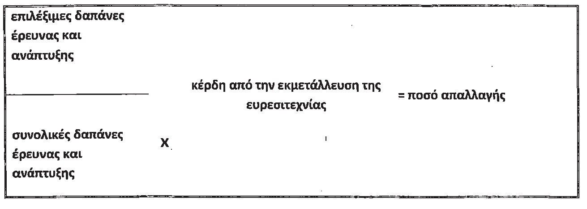

# Άρθρο 71

Προκαταβολή του φόρου εισοδήματος νομικών προσώπων και νομικών οντοτήτων 1.472 Με βάση τη δήλωση που υποβάλλει το νομικό πρόσωπο ή η νομική οντότητα και τους λοιπούς τίτλους βεβαίωσης που προβλέπονται στον Κώδικα Φορολογικής Διαδικασίας βεβαιώνεται ποσό ίσο με ογδόντα τοις εκατό (80%) του φόρου που προκύπτει για τον φόρο που αναλογεί στο εισόδημα του διανυόμενου φορολογικού έτους. 473 474Με βάση τη δήλωση που υποβάλλει το νομικό πρόσωπο ή νομική οντότητα και τους λοιπούς τίτλους βεβαίωσης που προβλέπονται στον Κώδικα Φορολογικής Διαδικασίας αποκλειστικά και μόνο για το φορολογικό έτος 2018, βεβαιώνεται ποσό ίσο με το ενενήντα πέντε τοις εκατό (95%) του φόρου που προκύπτει από Εισφορές κεφαλαίων φυσικού προσώπου μέχρι 300.000 € Υποχρεωτική εκτέλεση εισφοράς μέσω τραπεζικής καταθέσεως - Επιβολή προστίμου αν επιδιώκεται φορολογικό πλεονέκτημα Εξουσιοδοτική διάταξη Τύπος υπολογισμού Προσαύξηση ποσοστού για το φορολογικό έτος επιχειρηματική δραστηριότητα για τον φόρο που αναλογεί στο εισόδημα του έτους αυτού. 2.475 Το ποσοστό του πρώτου εδαφίου της παρ. 1 αυξάνεται σε εκατό τοις εκατό (100%) ειδικά για τις τραπεζικές ημεδαπές ανώνυμες εταιρείες και τα υποκαταστήματα αλλοδαπών τραπεζών που λειτουργούν νόμιμα στην Ελλάδα.

3. Τα ποσοστά των προηγούμενων παραγράφων μειώνονται κατά πενήντα τοις εκατό (50%) για τα νέα νομικά πρόσωπα κατά τα τρία (3) πρώτα οικονομικά έτη από τη δήλωση έναρξης εργασιών τους. Η μείωση αυτή δεν εφαρμόζεται για τα νομικά πρόσωπα που προέρχονται από μετατροπή ή συγχώνευση άλλων επιχειρήσεων με βάση τις διατάξεις οποιουδήποτε νόμου.

4. Η βεβαίωση αυτή γίνεται έναντι του φόρου που αναλογεί στο εισόδημα του διανυόμενου φορολογικού έτους. Σε περίπτωση που δεν υπάρχει δήλωση ή οριστικός τίτλος, ο καταβλητέος φόρος υπολογίζεται με βάση το φόρο που προκύπτει από στοιχεία του εγγύτερου φορολογικού έτους.

5. Οι διατάξεις της προηγούμενης παραγράφου εφαρμόζονται και επί των προσωρινών δηλώσεων που υποβάλλουν τα νομικά πρόσωπα ή οι νομικές οντότητες που έχουν τεθεί υπό εκκαθάριση.

6. Από το ποσό που βεβαιώνεται σύμφωνα με τις διατάξεις του άρθρου αυτού εκπίπτει ο φόρος που παρακρατείται από πηγή Ελλάδος, εφόσον συντρέχει περίπτωση.

7. Αν μειωθεί το φορολογητέο εισόδημα, εφαρμόζονται ανάλογα οι διατάξεις του άρθρου 70. Η εννεάμηνη προθεσμία για την υποβολή της αίτησης μείωσης του προκαταβλητέου ποσού φόρου αρχίζει από την ημέρα έναρξης του νέου φορολογικού έτους.

8. Οι διατάξεις των παραγράφων 4476, 5 και 6 του άρθρου 69 εφαρμόζονται και στα νομικά πρόσωπα και τις νομικές οντότητες. Αν το προκαταβλητέο ποσό φόρου εισοδήματος που υπολογίζεται με βάση τις διατάξεις της παραγράφου αυτής είναι μικρότερο της προκαταβολής φόρου που οφείλεται με βάση τις διατάξεις των παραγράφων 1 και 2, η διαφορά που προκύπτει βεβαιώνεται στο όνομα του νομικού προσώπου ή της νομικής οντότητας ως προκαταβολή φόρου.

9. Οι διατάξεις του άρθρου αυτού δεν έχουν εφαρμογή: 477α) για τις εταιρείες που μετασχηματίζονται σύμφωνα με τις διατάξεις των άρθρων 52 και 54 του παρόντος, του ν.δ. 1297/1972 και του ν. 2166/1993 κατά περίπτωση, 478β) για τις ημεδαπές ανώνυμες εταιρείες που συγχωνεύονται σε ανώνυμη εταιρεία ή διασπώνται, σύμφωνα με τις διατάξεις των άρθρων 68, 80 και 81, κατά περίπτωση, του κ.ν. 2190/1920 (Α΄ 37),

γ) για τις ημεδαπές εταιρείες περιορισμένης ευθύνης που συγχωνεύονται σε εταιρεία περιορισμένης ευθύνης, σύμφωνα με το άρθρο 54 του ν. 3190/1955 (Α΄ 91),

δ) για τις αγροτικές συνεταιριστικές οργανώσεις που συγχωνεύονται σε νέα ή υφιστάμενη αγροτική συνεταιριστική οργάνωση, καθώς και τις δευτεροβάθμιες ή τριτοβάθμιες αγροτικές συνεταιριστικές οργανώσεις που μετατρέπονται σε ανώνυμη εταιρεία ή εταιρεία περιορισμένης ευθύνης, σύμφωνα με τις διατάξεις του άρθρου 21 του ν. 2810/2000 (Α΄ 61). Μειώσεις ποσοστού Εναλλακτικός υπολογισμός Προσωρινές δηλώσεις Εκπτιπτόμενος παρακρατηθείς φόρος Περιπτώσεις μη εφαρμογής παρόντος Προθεσμία υποβολής αίτησης Εφαρμογή του τρόπου υπολογισμού του ποσού βεβαίωσης των παρ. 4,5 και 6  του άρθρου 69 και στα νομικά πρόσωπα και τις νομικές οντότητες.

ε) για τα νομικά πρόσωπα που μετασχηματίζονται, σύμφωνα με ειδικές διατάξεις νόμου, σε άλλο νομικό πρόσωπο που εμπίπτει στις διατάξεις της ίδιας παραγράφου,

στ) για τα διανεμόμενα ή κεφαλαιοποιούμενα κέρδη ανωνύμων εταιρειών, που απαλλάσσονται του φόρου εισοδήματος, βάσει ειδικών διατάξεων νόμων. Μ Ε Ρ Ο Σ   Ε Β Δ Ο Μ Ο  ΦΟΡΟΛΟΓΙΚΑ ΚΙΝΗΤΡΑ479 Άρθρο 71 Α480   Κίνητρα Ευρεσιτεχνίας 1. Τα κέρδη της επιχείρησης από την εκμετάλλευση ευρεσιτεχνίας διεθνώς αναγνωρισμένης στο όνομά της, που αναπτύχθηκε από την ίδια, απαλλάσσονται από τον φόρο εισοδήματος για έως τρία (3) συνεχόμενα φορολογικά έτη, αρχής γενομένης από το έτος μέσα στο οποίο πραγματοποιήθηκαν για πρώτη φορά τα κέρδη αυτά. Για τα επτά (7) επόμενα συνεχόμενα έτη παρέχεται το κίνητρο της απαλλαγής από τον καταβαλλόμενο φόρο εισοδήματος των κερδών της επιχείρησης από την εκμετάλλευση της ευρεσιτεχνίας του πρώτου εδαφίου, κατά ποσοστό δέκα τοις εκατό (10%). Η απαλλαγή χορηγείται με την προϋπόθεση ότι υπάρχει σύνδεση με τις δαπάνες έρευνας και ανάπτυξης που πραγματοποιήθηκαν από την επιχείρηση για την ανάπτυξη της ευρεσιτεχνίας.481

2. Το ποσό της απαλλαγής προκύπτει ως ακολούθως: Ο αριθμητής δύναται να προσαυξάνεται κατά ποσοστό τριάντα τοις εκατό (30%), με την προϋπόθεση ότι δεν υπερβαίνει το ποσό των συνολικών δαπανών έρευνας και ανάπτυξης.

3. Για την εφαρμογή του παρόντος δίνονται οι ακόλουθοι ορισμοί: α. «Ευρεσιτεχνία διεθνώς αναγνωρισμένη»: Αυτή για την οποία έχει απονεμηθεί δίπλωμα ευρεσιτεχνίας που εμπίπτει σε μία (1) τουλάχιστον από τις ακόλουθες περιπτώσεις:

αα) «Ευρωπαϊκό Δίπλωμα Ευρεσιτεχνίας», που χορηγείται από το Ευρωπαϊκό Γραφείο Διπλωμάτων Ευρεσιτεχνίας και έχει κατοχυρωθεί στην Ελλάδα.

Απαλλαγή υπό όρους των κερδών από εκμετάλλευση ευρεσιτεχνίας Πώς προκύπτει το ποσό της απαλλαγής Ορισμοί για την εφαρμογή του παρόντος

αβ) «Δίπλωμα Ευρεσιτεχνίας» κατοχυρωμένο στον Οργανισμό Βιομηχανικής Ιδιοκτησίας (Ο.Β.Ι.), αποκλειομένων των Πιστοποιητικών Υποδείγματος Χρησιμότητας (Π.Υ.Χ.), το οποίο έχει, επίσης, κατοχυρωθεί σε ένα ακόμη κράτος, το οποίο: i) έχει προσχωρήσει στην Ευρωπαϊκή Σύμβαση Διπλωμάτων Ευρεσιτεχνίας ή συνεργάζεται στο πλαίσιο αυτής, ή ii) είναι μέλος του Ο.Ο.Σ.Α. ή σε καθεστώς υποψήφιας προς ένταξη χώρας ή σε καθεστώς ενισχυμένης δέσμευσης. Προϋπόθεση για την απαλλαγή από τον φόρο εισοδήματος είναι τα διπλώματα ευρεσιτεχνίας να είναι σε ισχύ τουλάχιστον μέχρι την τελευταία ημέρα της χρήσης για την οποία ζητείται η απαλλαγή. β. «Επιλέξιμες δαπάνες έρευνας και ανάπτυξης»: Το ποσό των δαπανών έρευνας και ανάπτυξης, οι οποίες πραγματοποιούνται, κατά το τρέχον και τα προηγούμενα φορολογικά έτη από την ίδια την επιχείρηση ή έχουν ανατεθεί σε τρίτα, μη συνδεδεμένα με την επιχείρηση πρόσωπα, κατά την έννοια της περ. ζ’ του άρθρου 2 και συνδέονται άμεσα με τη δημιουργία, ανάπτυξη ή βελτίωση της ευρεσιτεχνίας. γ. «Συνολικές δαπάνες έρευνας και ανάπτυξης»: Το σύνολο των επιλέξιμων και μη δαπανών έρευνας και ανάπτυξης, που συνδέονται άμεσα με τη δημιουργία, ανάπτυξη ή βελτίωση της ευρεσιτεχνίας και οι οποίες έχουν πραγματοποιηθεί κατά το τρέχον και τα προηγούμενα φορολογικά έτη. Στην έννοια των μη επιλέξιμων δαπανών περιλαμβάνονται οι δαπάνες απόκτησης της ευρεσιτεχνίας και οι δαπάνες έρευνας και ανάπτυξης που έχουν ανατεθεί σε τρίτα συνδεδεμένα με την επιχείρηση πρόσωπα, κατά την έννοια της περ. ζ’ του άρθρου 2 και οι οποίες συνδέονται άμεσα με τη δημιουργία, ανάπτυξη ή βελτίωση της ευρεσιτεχνίας. δ. «Κέρδη από την εκμετάλλευση της ευρεσιτεχνίας»: Το εισόδημα που αποκτάται ως αντάλλαγμα για τη χρήση ή το δικαίωμα χρήσης των δικαιωμάτων επί διπλωμάτων ευρεσιτεχνίας, καθώς και τα έσοδα από την πώληση των διπλωμάτων ευρεσιτεχνίας, μετά την αφαίρεση των επιλέξιμων δαπανών για έρευνα και ανάπτυξη, που αναλογούν στα εισοδήματα αυτά και τα οποία πραγματοποιήθηκαν το τρέχον φορολογικό έτος. Επίσης, ως κέρδη από την εκμετάλλευση της ευρεσιτεχνίας νοούνται και τα κέρδη από την πώληση προϊόντων παραγωγής της επιχείρησης, ανεξάρτητα εάν αυτά παρήχθησαν σε εγκαταστάσεις της ίδιας της επιχείρησης ή τρίτων, για την οποία χρησιμοποιήθηκε ευρεσιτεχνία, κατά το μέρος που αναλογούν στη χρήση του διπλώματος ευρεσιτεχνίας.

4. Το ποσό της απαλλαγής, το οποίο υπολογίζεται σύμφωνα με την παρ. 2, εμφανίζεται σε ειδικό λογαριασμό αποθεματικού και υπόκειται σε φορολογία με τις γενικές διατάξεις του Κώδικα, κατά το μέρος που διανέμεται ή κεφαλαιοποιείται κάθε φορά.

5. Με κοινή απόφαση των Υπουργών Οικονομικών, Ανάπτυξης και Επενδύσεων και του Διοικητή της Ανεξάρτητης Αρχής Δημοσίων Εσόδων, καθορίζονται οι φορείς πιστοποίησης της ευρεσιτεχνίας, τα κριτήρια χαρακτηρισμού των επιλέξιμων και μη δαπανών, σύμφωνα με τις γενικές αρχές και τις κατευθυντήριες γραμμές του Εμφάνιση ποσού απαλλαγής σε ειδικό λογαριασμό αποθεματικού Εξουσιοδοτική διάταξη Ο.Ο.Σ.Α., οι προϋποθέσεις, οι όροι, η διαδικασία και κάθε άλλο αναγκαίο θέμα για την εφαρμογή του παρόντος άρθρου.

6. Με απόφαση του αρμοδίου οργάνου του Υπουργείου Ανάπτυξης και Επενδύσεων εγκρίνεται η υπαγωγή της επιχείρησης στο παρόν άρθρο για τα συγκεκριμένα κέρδη από την εκμετάλλευση της ευρεσιτεχνίας, μετά από αίτηση που υποβάλλει στην αρμόδια υπηρεσία του Υπουργείου Ανάπτυξης και Επενδύσεων. Άρθρο 71 Β482   Κεφαλαιοποίηση αφορολόγητων  αποθεματικών εισηγμένων εταιρειών

1. Ανώνυμες εταιρείες, των οποίων οι μετοχές είναι εισηγμένες στο Χρηματιστήριο Αθηνών, μπορούν να κεφαλαιοποιήσουν, ολικώς ή μερικώς, τα αφορολόγητα αποθεματικά διαφόρων αναπτυξιακών νόμων, με εξαίρεση τα αποθεματικά του άρθρου 18 του α.ν. 942/1949 (Α’ 96).

2. Τα αποθεματικά που κεφαλαιοποιούνται φορολογούνται με συντελεστή πέντε τοις εκατό (5%), χωρίς καμιά άλλη επιβάρυνση. Ο φόρος που οφείλεται αποδίδεται στο Δημόσιο με δήλωση, η οποία πρέπει να υποβληθεί μέσα σ` ένα μήνα από την καταχώρηση στο ΓΕ.Μ.Η. της αύξησης του μετοχικού κεφαλαίου και καταβάλλεται σε τέσσερις (4) ίσες τριμηνιαίες δόσεις, από τις οποίες η πρώτη με την υποβολή της εμπρόθεσμης δήλωσης.

3. Ο φόρος αυτός βαρύνει την εταιρεία και δεν εκπίπτει από τα ακαθάριστα έσοδά της κατά τον υπολογισμό των φορολογητέων κερδών ούτε συμψηφίζεται με το φόρο εισοδήματος που οφείλεται από την εταιρεία ή τους μετόχους.

4. Με την καταβολή του φόρου που οφείλεται σύμφωνα με τις διατάξεις της προηγούμενης παραγράφου, εξαντλείται κάθε φορολογική υποχρέωση από τον φόρο εισοδήματος της εταιρείας και των μετόχων της για τα αποθεματικά που κεφαλαιοποιήθηκαν.

5. 483 Σε περίπτωση που πριν από την πάροδο πέντε (5) ετών από την κεφαλαιοποίηση των αποθεματικών διαλυθεί η ανώνυμη εταιρεία ή μειωθεί το μετοχικό της κεφάλαιο με σκοπό επιστροφής των αποθεματικών στους μετόχους, τα κεφαλαιοποιηθέντα αποθεματικά δεν λογίζονται φορολογικώς ως μετοχικό κεφάλαιο που έχει καταβληθεί και φορολογούνται με τις διατάξεις που ισχύουν κάθε φορά για τη φορολογία εισοδήματος κατά τον χρόνο της διάλυσης της εταιρείας ή μείωσης του μετοχικού κεφαλαίου μετά την αφαίρεση του φόρου που καταβλήθηκε σύμφωνα με τις διατάξεις της παραγράφου 2 του παρόντος άρθρου. Η διάταξη της παραγράφου αυτής δεν εφαρμόζεται αν η εταιρεία διαλυθεί με σκοπό τη συγχώνευσή της με άλλη επιχείρηση και ίδρυση νέας ανώνυμης εταιρείας ή σε περίπτωση εξαγοράς ή απορρόφησής της από άλλη ανώνυμη εταιρεία.

6. 484Ανώνυμες εταιρείες, με μετοχές εισηγμένες ή μη, που έχουν σχηματίσει αποθεματικά είτε από υπεραξία μετοχών που προέρχεται από απόσχιση κλάδου ή από συγχώνευση εταιρειών στις οποίες συμμετέχει είτε από την αύξηση της αξίας των συμμετοχών της εταιρείας ή από διανομή μετοχών με βάση τις διατάξεις του άρθρου Κεφαλαιοποίηση αφορολόγητων αποθεματικών εισηγμένων  εταιρειών Φορολογία 5% της κεφαλαιοποίησης αποθεματικών- Απόδοση και καταβολή του φόρου  σε δόσεις Υπολογισμός φόρου – Υπόχρεοι Εξάντληση φορολογικής υποχρέωσης Κεφαλαιοποίηση αποθεματικών που σχηματίστηκαν από μετατροπή Πότε φορολογούνται τα κεφαλαιοποιηθέντα αποθεματικά Έγκριση υπαγωγής επιχείρησης στο παρόν άρθρο με απόφαση οργάνου του Υπ. Ανάπτυξης και Επενδύσεων 1 του α.ν. 148/1967, του ν. 542/1977, του ν. 1249/1982, του ν. 1839/1989 και του ν. 2065/1992 κατόπιν κεφαλαιοποιήσεως της υπεραξίας που προέκυψε από την αναπροσαρμογή πάγιων περιουσιακών στοιχείων θυγατρικής εταιρείας ή άλλης εταιρείας στην οποία συμμετέχουν, μπορούν να προβούν σε κεφαλαιοποίηση των αποθεματικών αυτών. Λοιπά αποθεματικά που έχουν σχηματισθεί από κατ` ειδικό τρόπο φορολογηθέντα κέρδη, χωρίς εξάντληση της φορολογικής υποχρέωσης σύμφωνα με τις διατάξεις του ν. 2238/1994, μπορούν να κεφαλαιοποιηθούν. Η κεφαλαιοποίηση αυτή υπόκειται σε φόρο εισοδήματος 5% με εξάντληση κάθε φορολογικής υποχρέωσης. Φόρος που τυχόν έχει καταβληθεί στο παρελθόν για τα αποθεματικά αυτά του ν. 2238/1994 δεν επιστρέφεται. Η κεφαλαιοποίηση αυτή δεν υπόκειται σε φόρο μερισμάτων λόγω διανομής, σε παρακράτηση φόρου και σε εισφορά αλληλεγγύης του άρθρου 43Α του παρόντος νόμου.

7. Οι διατάξεις της παραγράφου 5 του παρόντος άρθρου έχουν ανάλογη εφαρμογή και επί των κεφαλαιοποιούμενων αποθεματικών της προηγούμενης παραγράφου.

8. 485Για τα αποθεματικά που κεφαλαιοποιούνται με τις διατάξεις του παρόντος, η αύξηση αυτή του μετοχικού κεφαλαίου πραγματοποιείται είτε με την ανάλογη αύξηση της ονομαστικής αξίας των μετοχών που υπάρχουν κατά το χρόνο της κεφαλαιοποίησης, είτε με την έκδοση νέων μετοχών, είτε και με τους δύο αυτούς τρόπους. Οι νέες μετοχές που θα εκδοθούν διανέμονται δωρεάν στους μετόχους, κατά την αναλογία των μετοχών που κατέχουν αυτοί κατά τον χρόνο της κεφαλαιοποίησης των εν λόγω αποθεματικών. 8. Οι διατάξεις των παραγράφων 1 έως και 9 του άρθρου 101 του ν. 1892/1990 (Α’

101) καταργούνται. Άρθρο 71Γ486  Κεφαλαιοποίηση αφορολόγητων αποθεματικών μη εισηγμένων εταιρειών και Ε.Π.Ε.

1. 487Οι ανώνυμες εταιρείες, των οποίων οι μετοχές δεν είναι εισηγμένες στο Χρηματιστήριο Αθηνών, καθώς και οι εταιρείες περιορισμένης ευθύνης, μπορούν να κεφαλαιοποιήσουν ολικά ή μερικά, τα αφορολόγητα αποθεματικά διαφόρων αναπτυξιακών νόμων, με εξαίρεση το αποθεματικό του άρθρου 18 του α.ν. 942/1949 (Α΄ 96). Στην περίπτωση αυτή, οι μεν ανώνυμες εταιρίες, δύνανται να κάνουν αύξηση του μετοχικού κεφαλαίου είτε με την έκδοση νέων μετοχών που διανέμονται δωρεάν στους μετόχους κατά την αναλογία των μετοχών που κατέχουν αυτοί κατά τον χρόνο της κεφαλαιοποίησης, είτε με την αύξηση της ονομαστικής αξίας, είτε και με τους δύο τρόπους, οι δε εταιρίες περιορισμένης ευθύνης θα κάνουν αύξηση του εταιρικού κεφαλαίου με έκδοση νέων εταιρικών μεριδίων, τα οποία διανέμονται δωρεάν στους παλαιούς εταίρους, κατ’ αναλογία των μεριδίων τους.

2. 488 Τα αποθεματικά που κεφαλαιοποιούνται φορολογούνται με συντελεστή πέντε τοις εκατό (5%), χωρίς καμιά άλλη επιβάρυνση. Ο φόρος που οφείλεται αποδίδεται στο Δημόσιο με δήλωση, η οποία πρέπει να υποβληθεί σε έναν μήνα από την καταχώρηση στο ΓΕ.ΜΗ. της αύξησης του μετοχικού/εταιρικού κεφαλαίου και καταβάλλεται σε τέσσερις (4) ίσες εξαμηνιαίες δόσεις, από τις οποίες η πρώτη με την υποβολή της εμπρόθεσμης δήλωσης. Ο φόρος αυτός βαρύνει την εταιρεία και δεν εκπίπτει από τα ακαθάριστα έσοδά της, κατά τον υπολογισμό των φορολογητέων Ανάλογη εφαρμογή  παρ.5 Κατάργηση  διατάξεων ν.1892/1990 Κεφαλαιοποίηση αφορολόγητων αποθεματικών μη εισηγμένων εταιρειών και ΕΠΕ Φορολογία 5%  της κεφαλαιοποίησης αποθεματικών - Απόδοση και καταβολή του φόρου  - Υπόχρεοι Πώς γίνεται η κεφαλαιοποίηση αποθεματικών σύμφωνα με το παρόν κερδών, ούτε συμψηφίζεται με τον φόρο εισοδήματος που οφείλεται από την εταιρεία ή τους μετόχους ή εταίρους της.

3. Με την καταβολή του φόρου που οφείλεται σύμφωνα με τις διατάξεις της προηγούμενης παραγράφου εξαντλείται κάθε φορολογική υποχρέωση από τον φόρο εισοδήματος της εταιρείας, των μετόχων ή εταίρων της για τα αποθεματικά που κεφαλαιοποιήθηκαν.

4. 489 Σε περίπτωση που πριν από την πάροδο πέντε (5) ετών από την κεφαλαιοποίηση των αποθεματικών διαλυθεί η ανώνυμη εταιρεία ή μειωθεί το μετοχικό κεφάλαιό της με σκοπό επιστροφής των αποθεματικών στους μετόχους, τα κεφαλαιοποιηθέντα αποθεματικά δεν λογίζονται φορολογικώς ως μετοχικό κεφάλαιο που έχει καταβληθεί και φορολογούνται με τις διατάξεις που ισχύουν κάθε φορά για τη φορολογία εισοδήματος κατά τον χρόνο της διάλυσης ή μείωσης του μετοχικού κεφαλαίου μετά την αφαίρεση του φόρου που καταβλήθηκε σύμφωνα με τις διατάξεις της παραγράφου 2 του παρόντος άρθρου. Η διάταξη της παραγράφου αυτής δεν εφαρμόζεται σε περίπτωση διάλυσης της εταιρείας με σκοπό συγχώνευσής της με άλλη επιχείρηση και ίδρυση νέας ανώνυμης εταιρείας ή σε περίπτωση διάλυσης της εταιρείας με σκοπό συγχώνευσής της με άλλη επιχείρηση και ίδρυση νέας ανώνυμης εταιρείας ή σε περίπτωση εξαγοράς ή απορρόφησής της από άλλη ανώνυμη εταιρεία.

5. 490Προκειμένου για εταιρεία περιορισμένης ευθύνης στην περίπτωση κατά την οποία πριν από την πάροδο πέντε (5) ετών από την κεφαλαιοποίηση των αποθεματικών διαλυθεί η εταιρεία αυτή ή μειωθεί το εταιρικό της κεφάλαιο με σκοπό την επιστροφή των αποθεματικών στους εταίρους, τα κεφαλαιοποιηθέντα αποθεματικά προστίθενται στα κέρδη της εταιρείας που πραγματοποιεί στον χρόνο της διάλυσης ή μείωσης του κεφαλαίου και φορολογούνται με τις διατάξεις φορολογίας εισοδήματος που ισχύουν κατά τον χρόνο διάλυσης της εταιρείας ή μείωσης του εταιρικού της κεφαλαίου μετά την αφαίρεση του φόρου που καταβλήθηκε σύμφωνα με τις διατάξεις της παραγράφου 2 του παρόντος άρθρου. Η διάταξη της παραγράφου αυτής δεν εφαρμόζεται σε περίπτωση διάλυσης της εταιρείας με σκοπό μετατροπής ή συγχώνευσής της με άλλη επιχείρηση για την ίδρυση ανώνυμης εταιρείας ή άλλης εταιρείας περιορισμένης ευθύνης ή σε περίπτωση εξαγοράς ή απορρόφησης της από ανώνυμη εταιρεία. [6].491 ΚΑΤΑΡΓΗΘΗΚΕ

7. Οι διατάξεις του άρθρου 13  του ν. 1473/1984 (Α’ 127) καταργούνται. Άρθρο 71 Δ492   Κίνητρα για την ενίσχυση  των θέσεων απασχόλησης

1. Οι εργοδοτικές εισφορές για τη δημιουργία νέων θέσεων εξαρτημένης εργασίας πλήρους απασχόλησης εκπίπτουν από τα ακαθάριστα έσοδα των φυσικών προσώπων που ασκούν επιχειρηματική δραστηριότητα, των νομικών προσώπων και νομικών οντοτήτων προσαυξημένες κατά ποσοστό πενήντα τοις εκατό (50%) και μέχρι το 14πλάσιο του κατώτατου μισθού άγαμου μισθωτού άνω των είκοσι πέντε

(25) ετών ανά θέση εργασίας, εφόσον προκύπτει αθροιστικά: Πότε φορολογούνται τα κεφαλαιοποιηθέντα αποθεματικά για ΕΠΕ Κατάργηση άρθρου 13 ν. 1473/84 Εξάντληση  φορολογικής υποχρέωσης Έκπτωση από τα ακαθάριστα έσοδα των ασφαλιστικών εισφορών προσαυξημένων κατά 50% για νέες θέσεις εργασίας Προϋποθέσεις εφαρμογής της έκπτωσης ασφαλιστικών εισφορών

α) αύξηση του αριθμού των απασχολουμένων κατά το οικείο έτος πρόσληψης σε σχέση με το μέσο όρο του προηγούμενου έτους και

β) αύξηση της μισθολογικής δαπάνης κατά το οικείο έτος πρόσληψης σε σχέση με αυτήν του προηγούμενου έτους. Για τον υπολογισμό των περιπτώσεων α’ και β’ δεν προσμετρούνται: α) η συνταξιοδότηση εργαζομένου, β) η καταγγελία σύμβασης κατόπιν υποβολής μήνυσης από τον εργοδότη σε εργαζόμενο της επιχείρησης για αξιόποινη πράξη που τέλεσε κατά την άσκηση της εργασίας του, γ) η φυλάκιση και ο θάνατος εργαζομένου και δ) η αδυναμία ανανέωσης της άδειας διαμονής και πρόσβασης στην αγορά εργασίας αλλοδαπού εργαζομένου.

2. α. Η παράγραφος 1 εφαρμόζεται για νέους έως τριάντα (30) ετών και για μακροχρόνια άνεργους που είναι εγγεγραμμένοι στα μητρώα του ΟΑΕΔ. β. Σε συνδεδεμένα πρόσωπα, κατά την έννοια του άρθρου 2 του παρόντος νόμου, το κίνητρο χορηγείται άπαξ για κάθε εργαζόμενο.

3. Η παράγραφος 1 έχει εφαρμογή, υπό τους ίδιους όρους και προϋποθέσεις, και σε περίπτωση μετατροπής συμβάσεων μερικής ή εκ περιτροπής απασχόλησης ή συμβάσεων παροχής υπηρεσιών ή έργου, σε συμβάσεις εξαρτημένης εργασίας πλήρους απασχόλησης.

4. Η προσαύξηση της παραγράφου 1, εκτός από το έτος πρόσληψης ή μετατροπής της σύμβασης σε σύμβαση εξαρτημένης εργασίας πλήρους απασχόλησης, χορηγείται και για τέσσερα (4) επιπλέον συναπτά έτη, υπό την προϋπόθεση ότι ο μέσος όρος του αριθμού των απασχολουμένων και η μισθολογική δαπάνη εκάστου έτους δεν έχουν μειωθεί σε σχέση με εκείνα του προηγούμενου έτους, εφαρμοζόμενων των όσων ορίζονται στο τελευταίο εδάφιο της παραγράφου 1.

5. Με κοινή απόφαση του Υπουργού Οικονομικών και του Διοικητή της Ανεξάρτητης Αρχής Δημοσίων Εσόδων καθορίζονται οι προϋποθέσεις, οι όροι, η διαδικασία, ο τρόπος υπολογισμού του μέσου όρου απασχόλησης, καθώς και κάθε αναγκαία λεπτομέρεια για την εφαρμογή των προηγούμενων παραγράφων. Άρθρο 71 Ε 493   Κίνητρα για την ενίσχυση  της παραγωγής οπτικοακουστικών έργων

1. 494 Από το φορολογητέο εισόδημα φυσικού ή νομικού προσώπου ή νομικής οντότητας που είναι υποκείμενο φόρου στην Ελλάδα, με βάση τις διατάξεις του άρθρου 3 και επενδύει σε παραγωγές οπτικοακουστικών έργων, κατά την έννοια του άρθρου 20 του ν. 4487/2017495 ή αποτελεί επιχείρηση που λειτουργεί σύμφωνα με τα οριζόμενα στην παρ. 1 του άρθρου 25 του ν. 4487/2017496, αφαιρείται το τριάντα τοις εκατό (30%) των επιλέξιμων δαπανών καθενός οπτικοακουστικού έργου, εφόσον αυτές πραγματοποιούνται στην Ελλάδα.

2. Στις περιπτώσεις συμπαραγωγών το ποσό που αφαιρείται, σύμφωνα με την παράγραφο 1, υπολογίζεται αναλόγως του ποσοστού συμμετοχής του φυσικού ή νομικού προσώπου ή νομικής οντότητας στην παραγωγή. Εφαρμογή των κινήτρων για νέους έως 30 ετών και μακροχρόνια ανέργους Εφαρμογή κινήτρων   σε περίπτωση μετατροπής συμβάσεων σε συμβάσεις εξαρτημένης εργασίας Χορήγηση προσαύξησης ασφαλιστικών εισφορών για επιπλέον 4 έτη υπό προϋποθέσεις Εξουσιοδοτική διάταξη Αφαίρεση  ποσοστού  30% των δαπανών οπτικοακουστικού  έργου Αναλογική με το ποσοστό συμμετοχής αφαίρεση ποσοστού δαπανών σε συμπαραγωγές

3. Στις διατάξεις της παραγράφου 1 δεν υπάγονται επενδύσεις κατά το μέρος του ποσού που προέρχεται από χορηγίες που λήφθηκαν για τη χρηματοδότηση της παραγωγής οπτικοακουστικών έργων. 4.497 α) Η παρ. 1 κατά το μέρος που αφορά στη φορολόγηση επιχειρήσεων, οι οποίες λειτουργούν σύμφωνα με τα οριζόμενα στην παρ. 1 του άρθρου 25 του ν. 4487/2017498, εφαρμόζεται τηρουμένου του Κανονισμού (ΕΕ) 651/2014 και ιδίως του Κεφαλαίου Ι-Γενικές Διατάξεις και του άρθρου 54 αυτού, σε συνδυασμό με τις διατάξεις του Κεφαλαίου Δ’ του ν. 4487/2017499.

β) Οι ενισχύσεις που χορηγούνται στις επιχειρήσεις της παρ. 1, σωρεύονται με το επενδυτικό κίνητρο του κεφαλαίου Δ του ν. 4487/2017500, καθώς και οποιεσδήποτε άλλες κρατικές ενισχύσεις χορηγούνται στις επιχειρήσεις αυτές, σύμφωνα με το ενωσιακό δίκαιο κρατικών ενισχύσεων .

5. Εάν προκύψουν ζημίες μετά την αφαίρεση του ποσοστού της παραγράφου 1, η ζημία αυτή μεταφέρεται με βάση τις διατάξεις του άρθρου 27 του παρόντος νόμου.

6. Για την εφαρμογή του παρόντος άρθρου το φυσικό ή νομικό πρόσωπο ή νομική οντότητα καταβάλλει το χρηματικό ποσό, με το οποίο επιθυμεί να ενισχύσει την παραγωγή οπτικοακουστικού έργου, σε ειδικό λογαριασμό επ’  ονόματι του έργου που επιθυμεί να ενισχύσει.

7. 501Με κοινή απόφαση των Υπουργών Οικονομικών και Ψηφιακής Διακυβέρνησης και του Διοικητή της Ανεξάρτητης Αρχής Δημοσίων Εσόδων καθορίζονται οι επιλέξιμες δαπάνες, οι κατηγορίες των οπτικοακουστικών έργων, η διαδικασία και ο χρόνος ελέγχου της τήρησης των όρων και προϋποθέσεων που τίθενται με τις διατάξεις των προηγούμενων παραγράφων, καθώς επίσης οι προϋποθέσεις, οι όροι, η διαδικασία και κάθε άλλο ειδικότερο ζήτημα για την εφαρμογή του παρόντος άρθρου. Άρθρο 71 ΣΤ502   Κίνητρα για την εφαρμογή της ηλεκτρονικής τιμολόγησης

1. Εφόσον επιλεγεί η χρήση των Υπηρεσιών Παρόχου Ηλεκτρονικής Έκδοσης Στοιχείων για την έκδοση, διαβίβαση και λήψη παραστατικών πώλησης των οντοτήτων σε διαρθρωμένη ηλεκτρονική μορφή (ηλεκτρονική τιμολόγηση μέσω Παρόχου), η επιλογή αυτή δηλώνεται ηλεκτρονικά στη Φορολογική Διοίκηση και αποτελεί τον μόνο τρόπο έκδοσης, διαβίβασης και αρχειοθέτησης των παραστατικών πώλησης της οντότητας για το σύνολο της ασκούμενης δραστηριότητάς της. Η επιλογή και η δήλωση της ηλεκτρονικής τιμολόγησης μέσω Παρόχου μπορεί να ανακληθεί και αποκλείει την έκδοση τιμολογίων σε έντυπη μορφή για όσο χρονικό διάστημα ισχύει. Η επιλογή ηλεκτρονικής τιμολόγησης μέσω Παρόχου για την έκδοση παραστατικών πωλήσεων από μια οντότητα συνεπάγεται υποχρεωτικά τη χρήση της ηλεκτρονικής τιμολόγησης μέσω Παρόχου για τη λήψη των παραστατικών πώλησης στα οποία η οντότητα ορίζεται ως λήπτρια από εκδότη/προμηθευτή της, ο οποίος έχει επιλέξει επίσης την ηλεκτρονική τιμολόγηση μέσω Παρόχου.

2. Για τις οντότητες που επιλέγουν την ηλεκτρονική τιμολόγηση μέσω Παρόχου και υπό την προϋπόθεση ότι την εφαρμόζουν αποκλειστικά για την έκδοση των παραστατικών πωλήσεων κατά τη διάρκεια του φορολογικού έτους ή των Αφαίρεση χορηγιών Εφαρμογή της παρ. 1 τηρούμενου του Κανονισμού 651/2014 Μεταφορά ζημιών Καταβολή χρηματικών ποσών σε ειδικό λογαριασμό Εξουσιοδοτική διάταξη Χορήγηση ενισχύσεων  σε επιχειρήσεις  σύμφωνα  με το ενωσιακό  δίκαιο κρατικών ενισχύσεων Ηλεκτρονική δήλωση της επιλογής  χρήσης Υπηρεσιών Παρόχου Ηλεκτρονικής Τιμολόγησης Περιορισμός δυνατότητας έκδοσης πράξης διοικητικού, εκτιμώμενου ή διορθωτικού προσδιορισμού φόρου φορολογικών ετών για τα οποία έχει γίνει η επιλογή αυτή, προβλέπονται κατά περίπτωση τα εξής:

α) Η προθεσμία εντός της οποίας η Φορολογική Διοίκηση μπορεί να προβεί σε έκδοση πράξης διοικητικού, εκτιμώμενου ή διορθωτικού προσδιορισμού φόρου, σύμφωνα με τα οριζόμενα στην παρ. 1 του άρθρου 36 του ν. 4174/2013 (Α’ 170), περιορίζεται κατά δύο (2) έτη και ακολούθως βάσει αυτής υπολογίζονται οι προθεσμίες των παρ. 2 και 3 του ίδιου ως άνω άρθρου.

β) Η δαπάνη για την αρχική προμήθεια τεχνικού εξοπλισμού και λογισμικού που απαιτείται για την εφαρμογή της ηλεκτρονικής τιμολόγησης, αποσβένεται για σκοπούς του παρόντος Κώδικα πλήρως στο έτος πραγματοποίησής της, προσαυξημένη κατά ποσοστό εκατό τοις εκατό (100%).

γ) Η δαπάνη για την παραγωγή, διαβίβαση και ηλεκτρονική αρχειοθέτηση ηλεκτρονικών τιμολογίων για το πρώτο έτος έκδοσης των παραστατικών πώλησης μέσω ηλεκτρονικής τιμολόγησης που αναγνωρίζεται προς έκπτωση από τα ακαθάριστα έσοδα από επιχειρηματική δραστηριότητα, σύμφωνα με το άρθρο 22 του παρόντος Κώδικα, προσαυξάνεται κατά ποσοστό εκατό τοις εκατό (100%).

δ) Η προθεσμία του πρώτου εδαφίου της παρ. 2 του άρθρου 42 του ν. 4174/2013 σχετικά με τα αιτήματα επιστροφής φόρου, τα οποία αφορούν το φορολογικό έτος ή τα φορολογικά έτη, για τα οποία οι εκδότες επιλέγουν και εφαρμόζουν αποκλειστικά την ηλεκτρονική τιμολόγηση, ορίζεται σε σαράντα πέντε (45) ημέρες. Η προθεσμία του προηγούμενου εδαφίου ισχύει και για τον υπολογισμό καταβολής τόκου στον φορολογούμενο, ο οποίος έχει αχρεωστήτως καταβάλλει φόρο, σύμφωνα με την παρ. 2 του άρθρου 53 του ν. 4174/2013.

3. Οντότητες που επιλέγουν την ηλεκτρονική τιμολόγηση μέσω Παρόχου ως τρόπο έκδοσης, διαβίβασης και αρχειοθέτησης των παραστατικών πωλήσεών τους, δεν απαιτείται να προβούν σε ξεχωριστή δήλωση ως προς τη λήψη, καθώς θεωρείται ότι έχουν επιλέξει ταυτόχρονα τη χρήση της ηλεκτρονικής τιμολόγησης μέσω Παρόχου, ως αποδεκτό τρόπο λήψης των παραστατικών πώλησης. Για τις οντότητες - λήπτριες των αγαθών ή των υπηρεσιών, οι οποίες επιλέγουν και δηλώνουν στη Φορολογική Διοίκηση τη χρήση ηλεκτρονικής τιμολόγησης μέσω οποιουδήποτε Παρόχου μόνο κατά το μέρος που αποδέχονται τα σχετικά παραστατικά, η προθεσμία εντός της οποίας η Φορολογική Διοίκηση μπορεί να προβεί σε έκδοση πράξης διοικητικού, εκτιμώμενου ή διορθωτικού προσδιορισμού φόρου για το έτος ή τα έτη που επιλέγουν και εφαρμόζουν αποκλειστικά την ηλεκτρονική τιμολόγηση, σύμφωνα με την παρ. 1 του άρθρου 36 του ν. 4174/2013 περιορίζεται κατά ένα (1) έτος και ακολούθως βάσει αυτής υπολογίζονται οι προθεσμίες των παρ. 2 και 3 του ίδιου ως άνω άρθρου.

4. Τα κίνητρα των παρ. 2 και 3 παρέχονται στις οντότητες που θα επιλέξουν την ηλεκτρονική τιμολόγηση μέσω Παρόχου για τα φορολογικά έτη που αρχίζουν από την 1η Ιανουάριου 2020 και μετά και χορηγούνται από το πρώτο έτος, στο οποίο εφαρμόζεται η ηλεκτρονική τιμολόγηση, μέχρι και το φορολογικό έτος 2022.

5. Η επιλογή της αποκλειστικής χρήσης της ηλεκτρονικής τιμολόγησης μέσω Παρόχου από τους εκδότες και της αποδοχής της τιμολόγησης ηλεκτρονικά μέσω Δεν απαιτείται ξεχωριστή δήλωση ως προς τη λήψη παραστατικών, από τις εταιρείες που έχουν επιλέξει Πάροχο Διάρκεια ισχύος των φορολογικών κινήτρων Δήλωση με ηλεκτρονικό τρόπο στη Φορολογική Διοίκηση Προσαυξημένη κατά  100% η απόσβεση της δαπάνης τεχνικού εξοπλισμού και λογισμικού Προσαυξημένη κατά 100% η  δαπάνη προς έκπτωση  από  τα ακαθάριστα έσοδα Προθεσμία  αιτημάτων επιστροφής  φόρου οποιουδήποτε Παρόχου από τους λήπτες γίνεται με δήλωση της οντότητας με ηλεκτρονικό τρόπο στη Φορολογική Διοίκηση και ισχύει για τα παραστατικά πωλήσεων που εκδίδονται ή λαμβάνονται, κατά περίπτωση, εντός του φορολογικού έτους ή των φορολογικών ετών, που αφορά η δήλωση.

6. Τα κίνητρα των παρ. 2 και 3 παρέχονται για κάθε φορολογικό έτος, καθώς και, εξαιρουμένων των περ. β’ και γ’ της παρ. 2, για τα επόμενα φορολογικά έτη, εφόσον οι σχετικές επιλογές δηλωθούν μέχρι το τέλος του προηγούμενου φορολογικού έτους από αυτό ή αυτά τα φορολογικά έτη που περιλαμβάνονται στη δήλωση. Ειδικά για τις οντότητες που δηλώνουν για πρώτη φορά έναρξη εργασιών, εφόσον η δήλωση υποβληθεί κατά τον χρόνο υποβολής της δήλωσης έναρξης εργασιών, τα κίνητρα των παρ. 2 και 3 του παρόντος παρέχονται από το πρώτο φορολογικό έτος λειτουργίας τους, υπό την προϋπόθεση ότι η οντότητα δεν ανακαλεί τη δήλωση επιλογής τιμολόγησης εντός του επομένου φορολογικού έτους.

7. Κατ’ εξαίρεση, τα κίνητρα των παρ. 2 και 3 του παρόντος παρέχονται στις οντότητες για το φορολογικό έτος 2020, εφόσον σωρευτικά:

α) η σχετική επιλογή δηλωθεί εντός δύο (2) μηνών από την έναρξη ισχύος της υποχρέωσης διαβίβασης των παραστατικών στην ψηφιακή πλατφόρμα myDATA της Φορολογικής Διοίκησης,

β) η ηλεκτρονική τιμολόγηση εφαρμόζεται ως αποκλειστικός τρόπος έκδοσης και λήψης των παραστατικών πωλήσεων ή ως αποδεκτός τρόπος λήψης, για ολόκληρο το διάστημα από την ημερομηνία υποβολής δήλωσης με βάση την περ. α` και έως τη συμπλήρωση του φορολογικού έτους για την οντότητα, η οποία προβαίνει στη σχετική δήλωση με βάση την περ. α’,

γ) τα δεδομένα των παραστατικών που έχουν εκδοθεί ή ληφθεί με διαφορετικό τρόπο ως την ημερομηνία της περ. α’ διαβιβάζονται στη Φορολογική Διοίκηση εντός των προθεσμιών που ορίζονται στην κείμενη νομοθεσία και σύμφωνα με τα οριζόμενα σε αυτή και

δ) η οντότητα δεν ανακαλέσει τη δήλωση επιλογής τιμολόγησης εντός του επομένου φορολογικού έτους.

8. Σε περίπτωση ανάκλησης της δήλωσης, τα ευεργετήματα των παρ. 2 και 3 αίρονται, αρχής γενομένης από το φορολογικό έτος υποβολής της δήλωσης ανάκλησης και εφεξής.

9. Τα ευεργετήματα της περ. α’ της παρ. 2 δεν χορηγούνται ή αίρονται, εφόσον διαπιστώνεται, κατόπιν οριστικής πράξης διορθωτικού προσδιορισμού φόρου, ότι η οντότητα κατά το έτος χορήγησης του ευεργετήματος ή οποτεδήποτε κατά τα προηγούμενα πέντε (5) έτη πριν από αυτό, έχει διαπράξει παράβαση της παρ. 1 του άρθρου 66 του ν. 4174/2013, η οποία υπερβαίνει τα όρια της παρ. 3 του ίδιου άρθρου, ή εφόσον η οντότητα έχει υποπέσει σε οποιαδήποτε παράβαση που περιγράφεται στην παρ. 5 του ίδιου άρθρου του ν. 4174/2013, εφόσον, στην περίπτωση αυτή, η αξία των στοιχείων που συνιστούν την παράβαση υπερβαίνει συνολικά το όριο των εβδομήντα πέντε χιλιάδων (75.000) ευρώ. Ισχύς κινήτρων παρ. 2 και 3 Προϋποθέσεις  εφαρμογής των κινήτρων  για το φορολογικό έτος  2020 Άρση ευεργετημάτων  σε περίπτωση ανάκλησης της δήλωσης Άρση  ευεργετημάτων σε περίπτωση διάπραξης παραβάσεων

10. Για την εφαρμογή των διατάξεων της παρούσας, οι Πάροχοι τηρούν τα αναγκαία αρχεία για τα στοιχεία που εκδίδουν και διαβιβάζουν στη Φορολογική Διοίκηση κάθε αναγκαία πληροφορία για τον έλεγχο της πλήρωσης των προϋποθέσεων για τη χορήγηση των κινήτρων της παρούσης, κατά περίπτωση, τόσο από τους εκδότες των ηλεκτρονικών παραστατικών πωλήσεων όσο και από τους λήπτες αυτών.

11. Με απόφαση του Διοικητή της Ανεξάρτητης Αρχής Δημοσίων Εσόδων καθορίζονται η διαδικασία και ο τρόπος υποβολής των δηλώσεων της αποκλειστικής χρήσης της ηλεκτρονικής τιμολόγησης μέσω Παρόχου και της αποδοχής της ηλεκτρονικής τιμολόγησης μέσω Παρόχου, καθώς και κάθε άλλο ειδικότερο θέμα συμπεριλαμβανομένης της παρακολούθησης εφαρμογής των εν λόγω υποχρεώσεων για την εφαρμογή του παρόντος. Με όμοια απόφαση μπορεί να τροποποιείται το χρονικό διάστημα της περ. α’ της παρ. 7. Άρθρο 71 Ζ503   Κίνητρα σε επιχειρήσεις παραγωγής ηλεκτρικών οχημάτων και αγαθών ή ειδών σχετικών με τα ηλεκτρικά οχήματα στην Περιφέρεια Δυτικής Μακεδονίας και στην περιφερειακή ενότητα Αρκαδίας της Περιφέρειας Πελοποννήσου

1. Για τα φυσικά πρόσωπα που ασκούν επιχειρηματική δραστηριότητα παραγωγής ηλεκτρικών οχημάτων και αγαθών ή ειδών σχετικών με τα ηλεκτρικά οχήματα, ο φορολογικός συντελεστής κάθε κλιμακίου της παρ. 1 του άρθρου 29 μειώνεται κατά πέντε (5) ποσοστιαίες μονάδες μόνο στο εισόδημα που αποκτάται από τη δραστηριότητα αυτήν, αρχής γενομένης από το φορολογικό έτος μέσα στο οποίο πραγματοποιήθηκαν για πρώτη φορά κέρδη από την παραγωγή αυτήν και έως τη συμπλήρωση πέντε (5) κερδοφόρων φορολογικών ετών.

2. Για τα νομικά πρόσωπα και τις νομικές οντότητες παραγωγής ηλεκτρικών οχημάτων και αγαθών ή ειδών σχετικών με τα ηλεκτρικά οχήματα των περ. α’, β’, δ’, ε’ και στ’ του άρθρου 45, ο φορολογικός συντελεστής της παρ. 1 του άρθρου 58 μειώνεται κατά πέντε (5) ποσοστιαίες μονάδες, εφόσον τα κέρδη αφορούν στην παραγωγή αυτή, αρχής γενομένης από το φορολογικό έτος μέσα στο οποίο πραγματοποιήθηκαν για πρώτη φορά κέρδη από την παραγωγή αυτή και έως τη συμπλήρωση πέντε (5) κερδοφόρων φορολογικών ετών.

3. α) Κατά τον προσδιορισμό των κερδών από επιχειρηματική δραστηριότητα όσον αφορά στην εγκατάσταση και λειτουργία μονάδας παραγωγής ηλεκτρικών οχημάτων και αγαθών ή ειδών σχετικών με τα ηλεκτρικά οχήματα, οι φορολογικές αποσβέσεις των στοιχείων του ενεργητικού εκπίπτουν από:

αα) τον κύριο των παγίων στοιχείων του ενεργητικού της επιχείρησης σε όλες τις περιπτώσεις εκτός της υποπερ. ββ’, προσαυξημένες κατά δεκαπέντε τοις εκατό (15%).

ββ) τον μισθωτή, σε περίπτωση χρηματοδοτικής μίσθωσης κατά την έννοια του ν. 4308/2014 (Α’ 251), σύμφωνα με τα οριζόμενα στο νόμο αυτόν, προσαυξημένες κατά δέκα τοις εκατό (10%).

β) Η φορολογική απόσβεση του κόστους της επένδυσης, πλην των στοιχείων ενεργητικού της παρ. 3 του άρθρου 24, για τη δημιουργία μονάδας παραγωγής ηλεκτρικών οχημάτων και αγαθών ή ειδών σχετικών με τα ηλεκτρικά οχήματα Υποχρεώσεις παρόχων Εξουσιοδοτική διάταξη Πεδίο εφαρμογής  για φυσικά  πρόσωπα Πεδίο εφαρμογής για νομικά πρόσωπα και νομικές οντότητες Έκπτωση φορολογικών αποσβέσεων  - Προσαυξήσεις – Χρόνος φορολογικών αποσβέσεων πραγματοποιείται ισόποσα σε χρονικό διάστημα τριών (3) ετών από την έναρξη λειτουργίας της μονάδας.

4. Η παρ. 1 του άρθρου 71Δ εφαρμόζεται για όλους τους εργαζόμενους, ανεξαρτήτως ηλικίας, που απασχολούνται σε μονάδες παραγωγής ηλεκτρικών οχημάτων και αγαθών ή ειδών σχετικών με τα ηλεκτρικά οχήματα έως την έναρξη της παραγωγικής τους λειτουργίας, όπως πιστοποιείται με την έκδοση της άδειας λειτουργίας της μονάδας από την αρμόδια αρχή.

5. Τα κίνητρα του παρόντος ισχύουν μόνον για την Περιφέρεια Δυτικής Μακεδονίας και την περιφερειακή ενότητα Αρκαδίας της Περιφέρειας Πελοποννήσου.

6. Με κοινή απόφαση των Υπουργών Οικονομικών και Περιβάλλοντος και Ενέργειας, των κατά περίπτωση αρμόδιων Υπουργών και του Διοικητή της Ανεξάρτητης Αρχής Δημοσίων Εσόδων καθορίζονται η νομική βάση του Κανονισμού (ΕΕ) υπ’ αρ. 651 της Επιτροπής της 17ης Ιουνίου 2014 (L 187) για την κήρυξη ορισμένων κατηγοριών ενισχύσεων ως συμβατών με την εσωτερική αγορά (Γενικός Απαλλακτικός Κανονισμός - Γ.Α.Κ.) σύμφωνα με τα όρια και τις εντάσεις ενίσχυσης αυτού δυνάμει της οποίας χορηγούνται τα κίνητρα του παρόντος, οι όροι, η διάρκεια, οι προϋποθέσεις χορήγησης των κινήτρων, οι απαιτούμενες διαδικασίες αίτησης, αξιολόγησης, υπαγωγής, ελέγχου οι αρμόδιες Υπηρεσίες, οι υποχρεώσεις των δικαιούχων, τυχόν περιορισμός του ύψους της ενίσχυσης, η διαδικασία και οι προϋποθέσεις ανάκτησης των ενισχύσεων σε περίπτωση εκ των υστέρων διαπίστωσης μη πλήρωσης των σχετικών προϋποθέσεων, καθώς και κάθε ζήτημα σχετικό με την εφαρμογή των κινήτρων του παρόντος. Άρθρο 71 Η504   Κίνητρα για εταιρείες ειδικού σκοπού διαχείρισης οικογενειακής περιουσίας

1. Η διαχείριση των χρηματικών ροών και της οικογενειακής περιουσίας φυσικών προσώπων με φορολογική κατοικία στην Ελλάδα, σύμφωνα με τον παρόντα, δύναται να πραγματοποιείται από εταιρείες ειδικού σκοπού οι οποίες λειτουργούν με οποιαδήποτε από τις νομικές μορφές του άρθρου 45, πλην αυτής των νομικών προσώπων μη κερδοσκοπικού χαρακτήρα της περ. γ` του άρθρου 45. 2. 505 Αποκλειστικός σκοπός των εταιρειών ειδικού σκοπού διαχείρισης οικογενειακής περιουσίας είναι η διοίκηση και διαχείριση των περιουσιακών στοιχείων και επενδύσεων, που κατέχουν είτε άμεσα είτε έμμεσα, μέσω νομικών προσώπων ή νομικών οντοτήτων, τα φυσικά πρόσωπα της παρ. 1 και τα μέλη των οικογενειών τους, καθώς και η διαχείριση των δαπανών, που πραγματοποιούνται από τα φυσικά πρόσωπα της παρ. 1 και τα μέλη των οικογενειών τους για την κάλυψη των αναγκών τους και του κόστους της εν γένει διαβίωσής τους και των φιλανθρωπικών και πολιτιστικών δράσεών τους. Οι εταιρείες ειδικού σκοπού δύνανται επίσης να παρέχουν και υπηρεσίες συμβούλου προς εμπιστευματοδόχους (Trustees), αναφορικά με εμπιστεύματα (Trust) που έχουν ιδρύσει (Settlor), ή στα οποία είναι δικαιούχοι (Βeneficiaries) φυσικά πρόσωπα της παρ. 1 και τα μέλη της οικογένειάς τους. Στις εταιρείες ειδικού σκοπού διαχείρισης οικογενειακής περιουσίας μπορούν να συμμετέχουν μέλη της οικογένειας, καθώς και νομικά πρόσωπα ή νομικές οντότητες στις οποίες συμμετέχουν κατά πλειοψηφία τα φυσικά πρόσωπα της παρ. 1 ή/και μέλη Εφαρμογή παρ.1 άρθρου 71Δ  και για τους εργαζομένους Εφαρμογή κινήτρων παρόντος για συγκεκριμένες Περιφέρειες Εξουσιοδοτική διάταξη Πεδίο εφαρμογής Σκοπός εταιρειών διαχείρισης οικογενειακής περιουσίας της οικογένειας αυτών. Για την παροχή των υπηρεσιών των εταιρειών ειδικού σκοπού διαχείρισης οικογενειακής περιουσίας απασχολούνται εργαζόμενοι διαφόρων ειδικοτήτων ή αυτές δύναται να ανατίθενται σε τρίτα πρόσωπα, ανεξάρτητα από το κράτος στο οποίο είναι εγκατεστημένα, υπό την επιφύλαξη της περ. ιγ) του άρθρου

23. Φυσικά πρόσωπα μέλη της εταιρείας ειδικού σκοπού διαχείρισης οικογενειακής περιουσίας δεν μπορεί να είναι και εργαζόμενοι σε αυτή.

3. 506Για την εφαρμογή του παρόντος, η εταιρεία ειδικού σκοπού διαχείρισης οικογενειακής περιουσίας πληροί σωρευτικά τις ακόλουθες προϋποθέσεις:

α) απασχολεί στην Ελλάδα προσωπικό τουλάχιστον πέντε (5) ατόμων εντός δώδεκα

(12) μηνών από την ίδρυσή της και εφεξής και

β) πραγματοποιεί στην Ελλάδα δαπάνες λειτουργίας τουλάχιστον πεντακοσίων χιλιάδων (500.000) ευρώ ετησίως.

4. Για την εφαρμογή του παρόντος, ως μέλη της οικογενείας νοούνται:

α) ο έτερος των συζύγων / μέρος συμφώνου συμβίωσης (Μ.Σ.Σ.),

β) τα άγαμα τέκνα των συζύγων / Μ.Σ.Σ.,

γ) τα άγαμα τέκνα του συντηρούντος ή του ετέρου των συζύγων / Μ.Σ.Σ., εφόσον η επιμέλεια έχει νομίμως ανατεθεί για μεν τα τέκνα του/της συντηρούντος σε αυτόν/αυτήν, για δε τα τέκνα του/της ετέρου των συζύγων / Μ.Σ.Σ. σε αυτόν/αυτήν,

δ) οι απευθείας ανιόντες των συζύγων / Μ.Σ.Σ.

5. Τα ακαθάριστα έσοδα από τις παρεχόμενες υπηρεσίες των εταιρειών ειδικού σκοπού διαχείρισης οικογενειακής περιουσίας, τα οποία εισπράττονται υποχρεωτικά μέσω τραπεζικών εμβασμάτων, προσδιορίζονται με την προσθήκη ποσοστού κέρδους στο σύνολο των πάσης φύσεως εξόδων και αποσβέσεών τους, πλην του φόρου εισοδήματος (μέθοδος κόστους πλέον περιθώριο κέρδους). Το ποσοστό κέρδους ορίζεται σε επτά τοις εκατό (7%). Για τον προσδιορισμό του φορολογητέου εισοδήματος της εταιρείας, τα έξοδα επί των οποίων υπολογίζεται το ποσοστό κέρδους, εκπίπτουν από τα ακαθάριστα έσοδά της, εφόσον τεκμηριώνονται από αντίστοιχα παραστατικά στοιχεία που πληρούν τις προϋποθέσεις του ν. 4308/2014 (Α` 251). Αν για οποιονδήποτε λόγο τα έσοδα της εταιρείας, όπως προκύπτουν από τα βιβλία που τηρεί, είναι μεγαλύτερα από τα έσοδα, όπως προσδιορίζονται με τη μέθοδο της παρούσας, λαμβάνονται υπόψη τα έσοδα που προκύπτουν από τα βιβλία. Ο φόρος εισοδήματος υπολογίζεται με τον συντελεστή της παρ. 1 του άρθρου 58. Για την υποβολή της δήλωσης φορολογίας εισοδήματος και την καταβολή του φόρου των εταιρειών ειδικού σκοπού διαχείρισης οικογενειακής περιουσίας εφαρμόζονται τα άρθρα 68 και 71. Οι διατάξεις του Μέρους Τέταρτου «Παρακράτηση Φόρου» έχουν εφαρμογή και για τις πληρωμές που πραγματοποιούν οι εταιρείες ειδικού σκοπού διαχείρισης οικογενειακής περιουσίας.

6. 507Η παροχή των υπηρεσιών του παρόντος άρθρου από εταιρείες ειδικού σκοπού διαχείρισης οικογενειακής περιουσίας προς αλλοδαπές εταιρείες που ανήκουν, άμεσα ή έμμεσα, σε φυσικά πρόσωπα της παρ. 1 ή σε μέλη των οικογενειών τους δεν Προϋποθέσεις εφαρμογής του παρόντος Ποιοι νοούνται ως μέλη οικογένειας για την εφαρμογή του παρόντος Προσδιορισμός ακαθαρίστων εσόδων  εταιρειών του παρόντος Προσδιορισμός φορολογητέου εισοδήματος - Φορολογικός συντελεστής συνιστά άσκηση πραγματικής διοίκησής τους στην Ελλάδα κατά την παρ. 4 του άρθρου 4, περί φορολογικής κατοικίας, και οι παρ. 3 και 4 του άρθρου 4 δεν εφαρμόζονται. Άρθρο 71Θ 508  Κίνητρα σε οντότητες για την πρόωρη εφαρμογή της ηλεκτρονικής τιμολόγησης

1. Για τις οντότητες, που διενεργούν συναλλαγές, οι οποίες εμπίπτουν στο πεδίο εφαρμογής των περ. α), β) και γ) της παρ. 1 του άρθρου 14 του ν. 4308/2014 (Α’ 251), περί ηλεκτρονικού τιμολογίου, και οι οποίες επιλέγουν την ηλεκτρονική τιμολόγηση για την αποκλειστική έκδοση των παραστατικών τους, πριν από την υποχρεωτική εφαρμογή της σύμφωνα με την κοινή απόφαση της παρ. 6 του άρθρου 14 του ν. 4308/2014, παρέχονται τα εξής κίνητρα:

α) η δαπάνη για την αρχική προμήθεια τεχνικού εξοπλισμού και λογισμικού που απαιτείται για την εφαρμογή της ηλεκτρονικής τιμολόγησης, αποσβέννυται πλήρως για τους σκοπούς του παρόντος Κώδικα στο έτος πραγματοποίησής της, προσαυξημένη κατά ποσοστό εκατό τοις εκατό (100%) και

β) η δαπάνη για την παραγωγή, τη διαβίβαση και την ηλεκτρονική αρχειοθέτηση ηλεκτρονικών τιμολογίων για τους πρώτους δώδεκα (12) μήνες έκδοσης των παραστατικών πώλησης μέσω ηλεκτρονικής τιμολόγησης που αναγνωρίζεται προς έκπτωση από τα ακαθάριστα έσοδα από επιχειρηματική δραστηριότητα, σύμφωνα με το άρθρο 22, προσαυξάνεται κατά ποσοστό εκατό τοις εκατό (100%) κατά το έτος πραγματοποίησής της.

2. Τα κίνητρα της παρ. 1 παρέχονται στις οντότητες επί δαπανών που διενεργούνται από το φορολογικό έτος 2025 και επόμενα, εφόσον: α) έχει υποβληθεί δήλωση για τη χρήση της ηλεκτρονικής τιμολόγησης μέσω Υπηρεσιών Παρόχου για την Ηλεκτρονική Έκδοση Στοιχείων (Υ.ΠΑ.Η.Ε.Σ.). ή της Εφαρμογής Έκδοσης και Διαβίβασης Παραστατικών της Α.Α.Δ.Ε. σύμφωνα με την απόφαση του Διοικητή της Α.Α.Δ.Ε. που εκδίδεται βάσει της παρ. 6, το αργότερο δύο (2) μήνες πριν από την έναρξη ισχύος της υποχρεωτικής ηλεκτρονικής τιμολόγησης για πωλήσεις αγαθών και παροχές υπηρεσιών της παρ. 1 του άρθρου 14 του ν. 4308/2014, σύμφωνα με την κοινή απόφαση του Υπουργού Εθνικής Οικονομίας και Οικονομικών και του Διοικητή της Α.Α.Δ.Ε. που εκδίδεται σύμφωνα με την παρ. 6 του άρθρου 14 του ν. 4308/2014, και β) η έναρξη χρήσης της ηλεκτρονικής τιμολόγησης πραγματοποιείται μέσα στο ίδιο διάστημα.

3. Το παρόν άρθρο δεν εφαρμόζεται στις οντότητες που έκαναν χρήση των ευεργετημάτων του άρθρου 71ΣΤ.

4. Σε περίπτωση ανάκλησης της δήλωσης της παρ. 2 ή έκδοσης τιμολογίου άνευ χρήσης των τρόπων των περ. γ) και ε) της παρ. 3 του άρθρου 15 του ν. 4308/2014 πριν από την έναρξη της υποχρεωτικής ισχύος της ηλεκτρονικής τιμολόγησης, παρά τη σχετική δήλωση, δεν χορηγούνται ή αίρονται τα ευεργετήματα της παρ. 1, αντίστοιχα.

5. Για την εφαρμογή του παρόντος, οι πάροχοι τηρούν τα αναγκαία αρχεία για τα στοιχεία που εκδίδουν και διαβιβάζουν στη φορολογική διοίκηση, καθώς και κάθε αναγκαία πληροφορία για τον έλεγχο της πλήρωσης των προϋποθέσεων για τη χορήγηση των κινήτρων του παρόντος, από τους εκδότες των ηλεκτρονικών παραστατικών πωλήσεων αγαθών και παροχής υπηρεσιών.

6. Με απόφαση του Διοικητή της Ανεξάρτητης Αρχής Δημοσίων Εσόδων καθορίζονται η διαδικασία και ο τρόπος υποβολής των δηλώσεων χρήσης της ηλεκτρονικής τιμολόγησης μέσω Υπηρεσιών Παρόχου για την Ηλεκτρονική Έκδοση Στοιχείων Παρεχόμενα κίνητρα Προϋποθέσεις εφαρμογής του παρόντος Μη εφαρμογή του παρόντος άρθρου Εξουσιοδοτική διάταξη Υποχρεώσεις παρόχων (Υ.ΠΑ.Η.Ε.Σ.) ή της Εφαρμογής Έκδοσης και Διαβίβασης Παραστατικών της Α.Α.Δ.Ε., καθώς και κάθε άλλο ειδικότερο θέμα για την εφαρμογή του παρόντος. Μ Ε Ρ Ο Σ   Ο Γ Δ Ο Ο  ΜΕΤΑΒΑΤΙΚΕΣ ΔΙΑΤΑΞΕΙΣ509
