# Greek law in 20 charts

[Ελληνικά](README.md) · **English**

Charts on every country's law, from the whole of global-law: [global-law visualisations/](https://github.com/lexifina/global-law/tree/main/visualisations). These are the charts on Greece alone.

Twenty charts on Greek law, drawn only from the data in this repository: the Constitution in every version since 2001; the 637 laws and 503 presidential decrees of the Government Gazette it holds, with every amendment of 88 laws; the 2,000,847 regulatory acts, circulars and opinions that municipalities, regions, decentralised administrations, ministries and other bodies posted on Diavgeia from October 2010 to July 2019; and the 40,049 decisions of the Areios Pagos of 2007–2019.

Open [`to-elliniko-dikaio-se-20-grafimata.html`](to-elliniko-dikaio-se-20-grafimata.html) in a browser. The page is one file with all its data inside; it loads only the d3 and topojson-client libraries, the map of chart 20 and its fonts from the web. The controls at the top right switch the language (Greek or English) and the theme (light or dark). Each chart names its data path in the repository, its record count and its limits, and has a table of every number under it. Hover over a mark for the exact values.

The charts are descriptive: they show what the sources record, not why.

## The charts

### I. The Constitution

#### 1. The map of the Constitution

The 124 articles by part: the 2008 and 2019 revisions changed 17, and three were repealed in 2019.

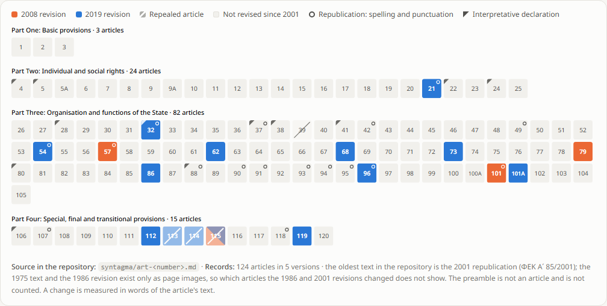

#### 2. Words in and out

The words of each article a revision changed: in 2019, 759 came out and 445 went in.

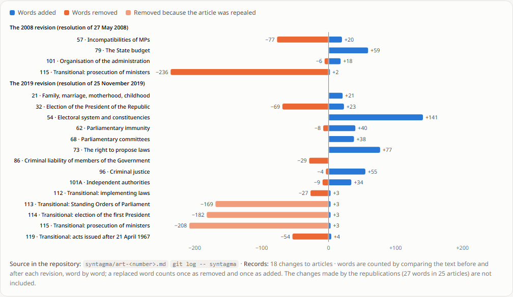

### II. Laws and presidential decrees

#### 3. “And other provisions”

The repository's laws by year and kind of title: 69% of those that ratify nothing have that ending.

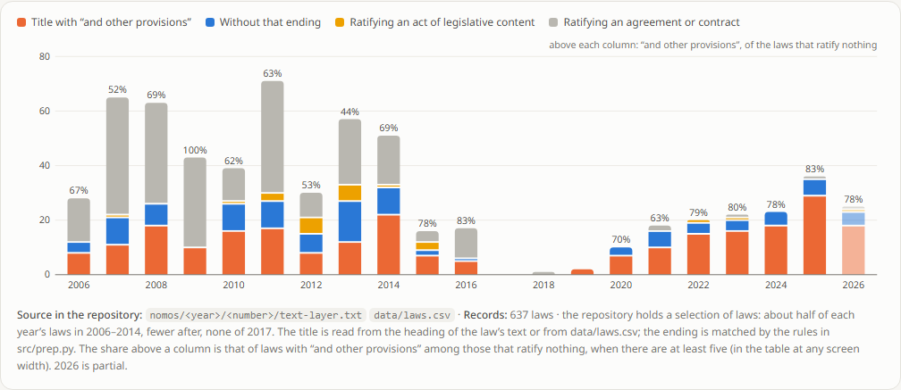

#### 4. How soon laws are amended

The 88 laws followed: 30% were amended within two years, often by articles deep inside other laws.

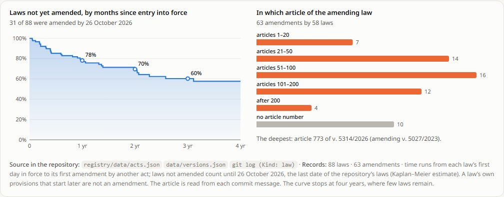

#### 5. From directive to Gazette

The 36 laws and decrees that name a dated EU directive: a median of 2.7 years to publication.

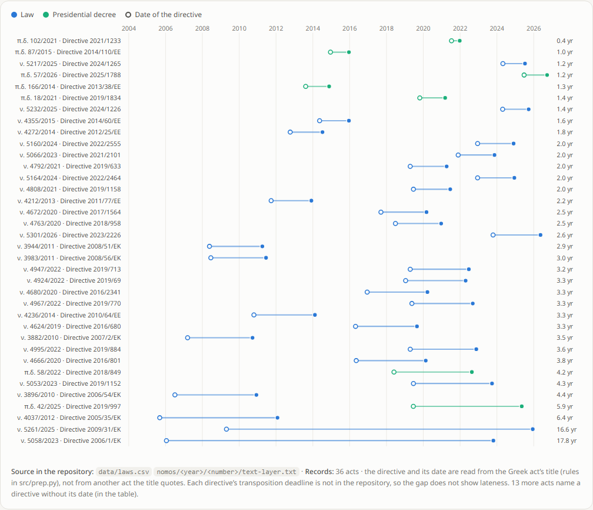

#### 6. Presidential decrees

The 503 decrees by subject and year: amendments, organising services, parishes and monasteries, local holidays.

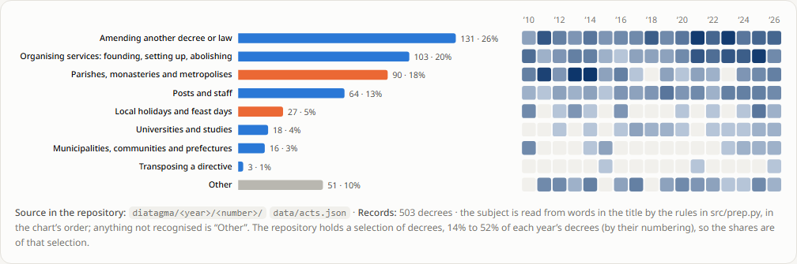

### III. Diavgeia: the acts of the administration

#### 7. Two million acts

Postings by year and kind of body: municipalities have 48%.

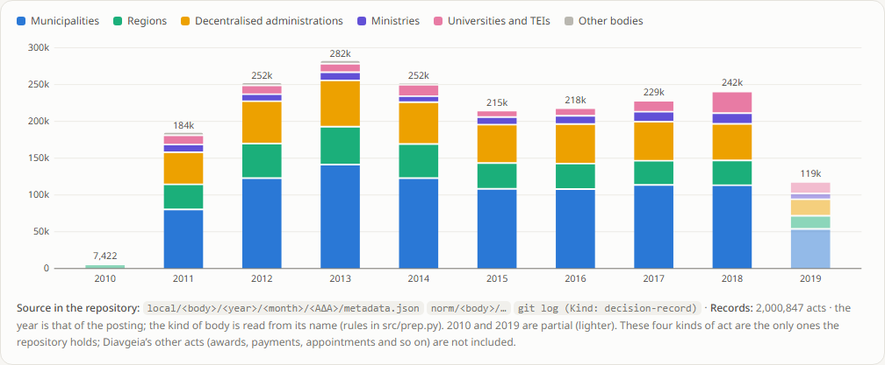

#### 8. What the titles say

The subjects of the “regulatory acts”: procurement, works and contracts 24%, a regulation 0.6%.

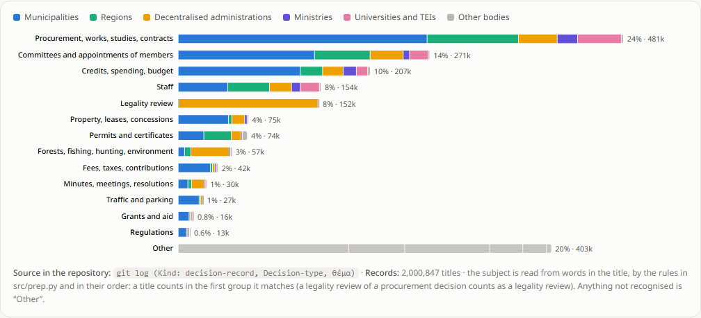

#### 9. How soon acts are posted

From issue to posting: the same day for 28% of acts in 2011, 61% in 2018.

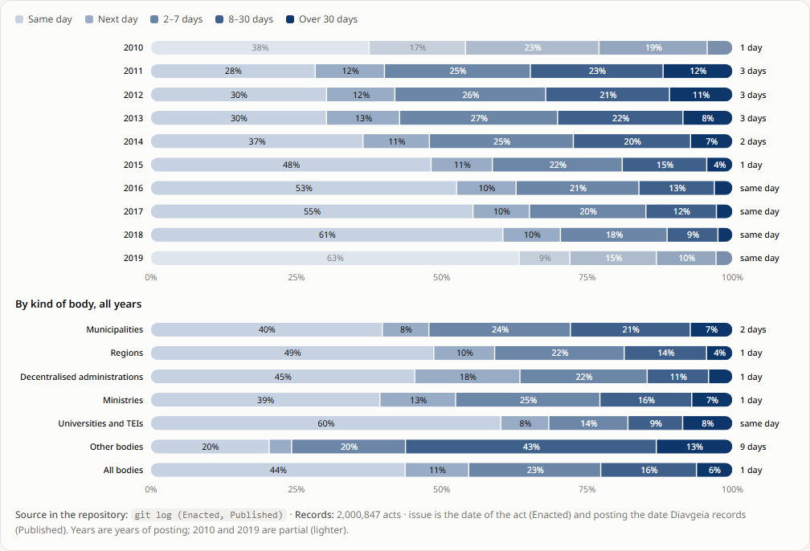

#### 10. Diavgeia’s clock

Postings by day and hour of the week: 73% between 9:00 and 14:00.

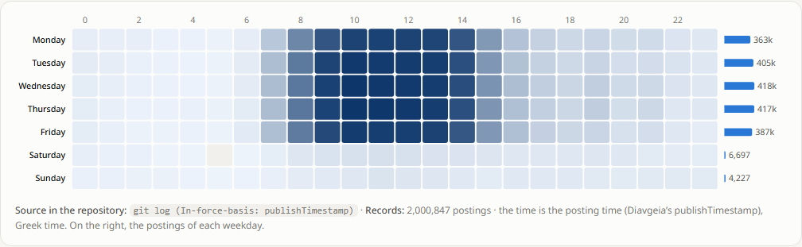

#### 11. Legality review

151,550 legality review acts of the decentralised administrations, 109,794 of them from one.

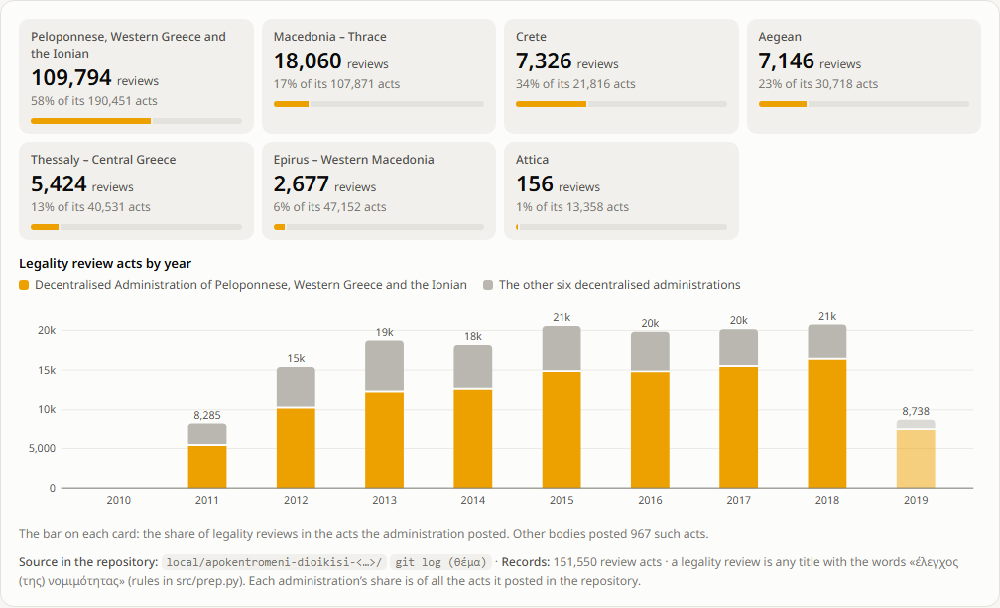

#### 12. The laws in the titles

The 16 laws the titles cite most, by year; first, Law 4412/2016 on public contracts.

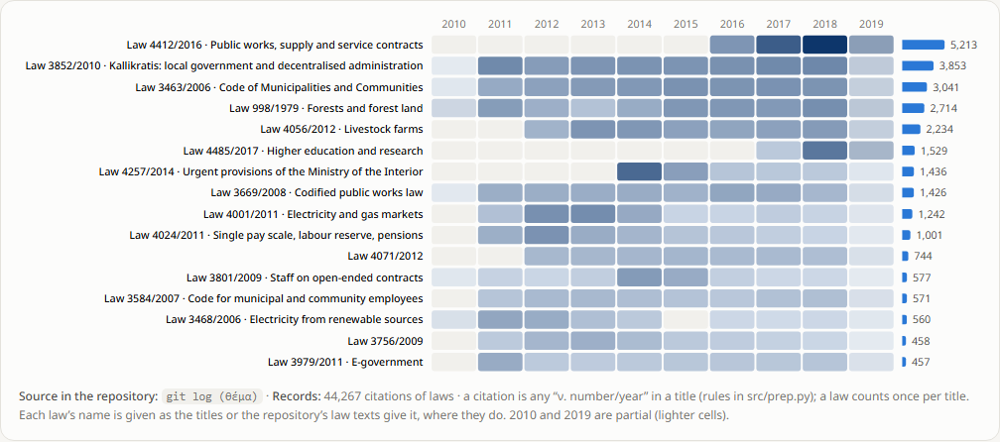

#### 13. Municipal resolutions

2,440 resolutions of municipal councils by subject and year.

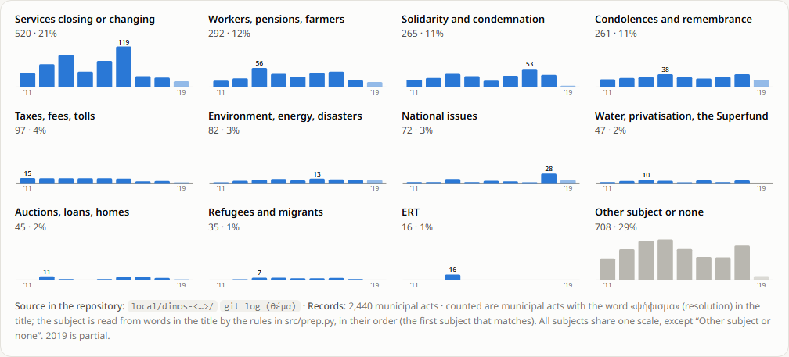

#### 14. Circulars and opinions

Which bodies issued the 7,127 circulars and the 11,701 opinions.

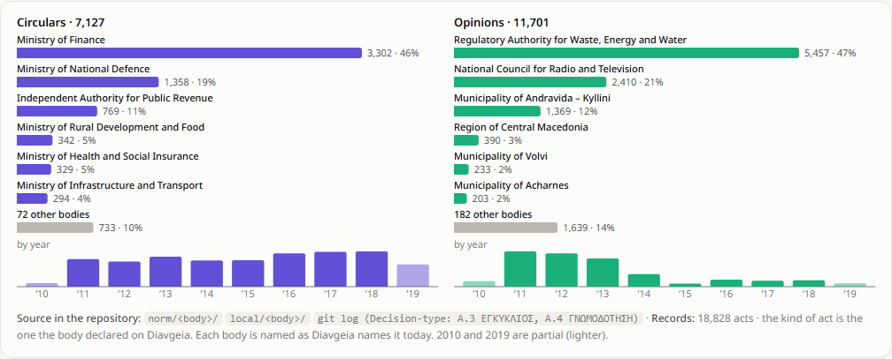

### IV. The Areios Pagos

#### 15. Decisions by year

40,049 decisions of 2007–2019, civil, criminal and of the Plenary, with those missing by the numbering.

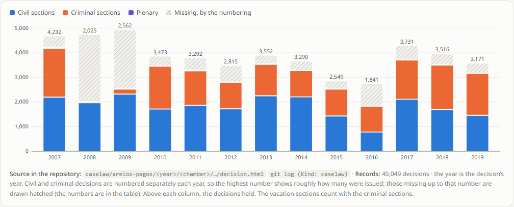

#### 16. The Areios Pagos calendar

Decisions by month: June has 14%, August 2%.

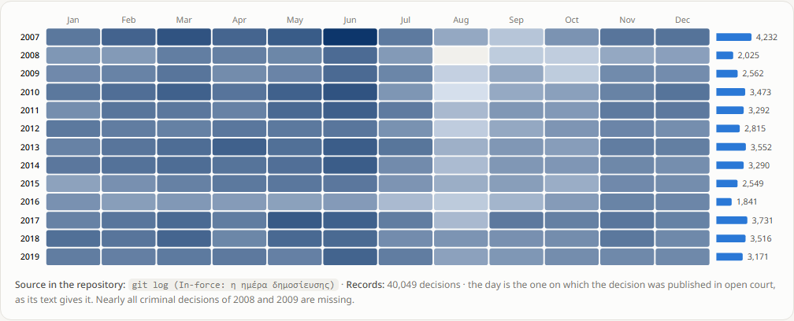

#### 17. Quash or dismiss

The operative part by section: quashing in 24% of decisions, from 14% to 32%.

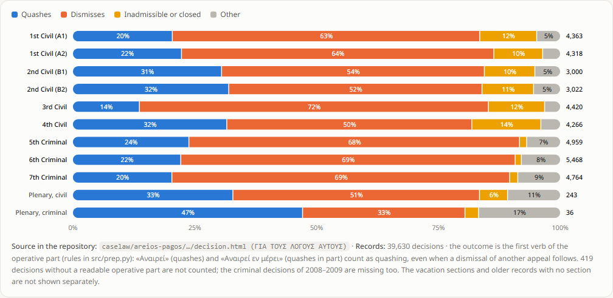

#### 18. Quashing by year

The quashing rate in the civil and the criminal sections: in the criminal sections from 24% in 2007 to 36% in 2019.

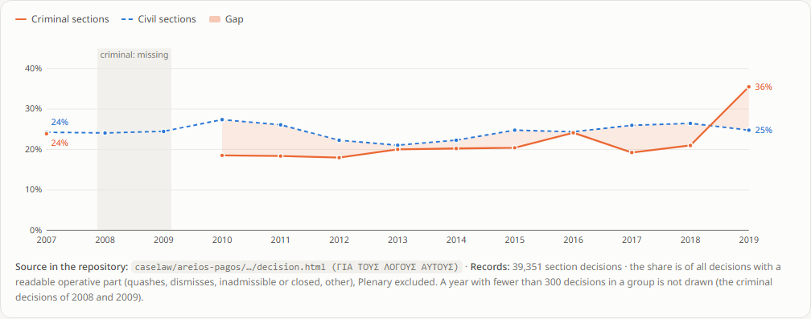

#### 19. Slower and longer decisions

The days from hearing to publication and the words of each decision, by year.

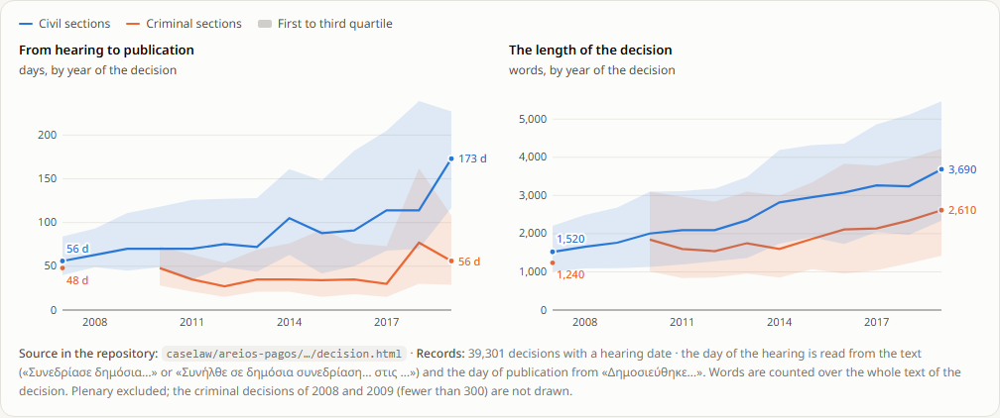

#### 20. Where the cases come from

The seat of the court whose judgment was appealed against, on a map: Athens 47%.

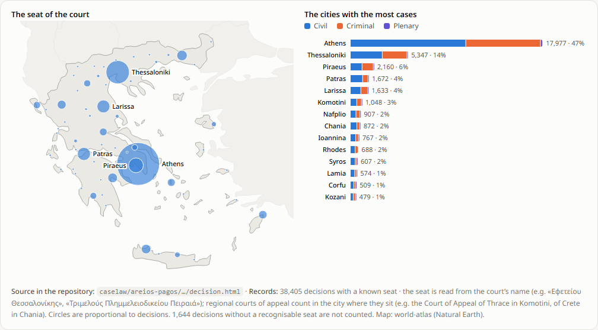

## Data

As of commit `a2eaf743c6` (16 November 2026).

| Dataset | Where in the repository | Records | Coverage |
| --- | --- | ---: | --- |
| Git history | branch `main` | 2,043,555 commits | the date of each commit is the day it took effect (`In-force:`) |
| Constitution | `syntagma/` | 124 articles in 5 versions | from 2001; the 1975 text and the 1986 revision are not included |
| Laws | `nomos/<year>/<number>/` | 637 laws; 88 with every amendment | 2006–2026; a selection: about half of each year's laws in 2006–2014, fewer after |
| Presidential decrees | `diatagma/<year>/<number>/` | 503 decrees | 2009–2026; a selection: 14–52% of each year's decrees |
| Diavgeia | `local/`, `norm/` | 2,000,847 acts from 430 bodies | October 2010 – July 2019; only each posting's record |
| Areios Pagos | `caselaw/areios-pagos/` | 40,049 decisions | 2007–2019; nearly all criminal decisions of 2008 and 2009 are missing |

## Limits

- **The laws and decrees are a selection.** Charts 3, 5 and 6 count the acts the repository holds, not all of the Gazette; chart 4 counts only the 88 laws followed through every amendment.
- **Categories are read from titles and texts.** The kind of a law's title, the subject of decrees, directives, the subjects of Diavgeia acts and resolutions, the laws the titles cite, the operative part and the seat of the court follow the rules in `src/prep.py`; whatever no rule recognises counts as “Other”.
- **The kind of each Diavgeia act is chosen by the body that posts it.** The repository holds only regulatory acts, circulars, opinions and minutes of the Legal Council of the State, and of these only each posting's record, not the text.
- **The Areios Pagos website does not have every decision.** The numbering shows how many are missing (chart 15); nearly all criminal decisions of 2008 and 2009 are missing and are not drawn in charts 18 and 19.
- **Partial years** (2010 and 2019 on Diavgeia, 2026 for laws) are drawn lighter and labelled as such.

## Rebuilding

```sh
python visualisations/src/make.py            # history, texts and tables -> src/.build/ -> to-elliniko-dikaio-se-20-grafimata.html
node visualisations/src/stills.cjs           # images for these READMEs (needs Playwright; PLAYWRIGHT=<path> if not global)
```

`make.py` reads everything from git objects, so it also works in a blobless (`--filter=blob:none`) or `--no-checkout` clone. It then downloads only what the charts read: the texts of the Areios Pagos decisions, the texts and `source.json` of the laws, the versions of the Constitution's articles and five tables, about 41,200 files (280 MB); it reads the Diavgeia acts from the commit messages alone. It reads `origin/main` (or `HEAD`) by default; `--ref` picks another branch or commit. It writes nothing into the repository except the page and the `src/.build/` folder, which git ignores.

| File | What it does |
| --- | --- |
| `src/make.py` | extracts the history, the texts and the tables into `src/.build/`, then runs `prep.py` and `build.py` |
| `src/prep.py` | computes every number for the 20 charts and the data profile into `src/.build/data.json` |
| `src/page.tpl.html` | the page: text in both languages, the charts (d3), the tables |
| `src/build.py` | puts `data.json` into the template and writes the page |
| `src/stills.cjs` | draws each chart as a PNG into `stills/el/` and `stills/en/` |
