# Το ελληνικό δίκαιο σε 20 γραφήματα

**Ελληνικά** · [English](README.en.md)

Γραφήματα για το δίκαιο όλων των χωρών, από ολόκληρο το global-law: [global-law visualisations/](https://github.com/lexifina/global-law/tree/main/visualisations). Εδώ, μόνο τα γραφήματα για την Ελλάδα.

Είκοσι γραφήματα για το ελληνικό δίκαιο, σχεδιασμένα μόνο από τα δεδομένα αυτού του αποθετηρίου: το Σύνταγμα σε κάθε του έκδοση από το 2001· τους 637 νόμους και τα 503 προεδρικά διατάγματα του ΦΕΚ που περιέχει, με κάθε τροποποίηση 88 νόμων· τις 2.000.847 κανονιστικές πράξεις, εγκυκλίους και γνωμοδοτήσεις που ανάρτησαν στη Διαύγεια δήμοι, περιφέρειες, αποκεντρωμένες διοικήσεις, υπουργεία και άλλοι φορείς από τον Οκτώβριο του 2010 ως τον Ιούλιο του 2019· και τις 40.049 αποφάσεις του Αρείου Πάγου του 2007–2019.

Ανοίξτε το [`to-elliniko-dikaio-se-20-grafimata.html`](to-elliniko-dikaio-se-20-grafimata.html) σε έναν φυλλομετρητή. Η σελίδα είναι ένα αρχείο με όλα τα δεδομένα της· από το διαδίκτυο φορτώνει μόνο τις βιβλιοθήκες d3 και topojson-client, τον χάρτη του γραφήματος 20 και τις γραμματοσειρές της. Τα κουμπιά πάνω δεξιά αλλάζουν τη γλώσσα (ελληνικά ή αγγλικά) και το θέμα (φωτεινό ή σκοτεινό). Κάθε γράφημα αναφέρει τη διαδρομή των δεδομένων του στο αποθετήριο, τον αριθμό των εγγραφών και τα όριά του, και κάτω από αυτό έχει πίνακα με όλους τους αριθμούς. Περάστε τον δείκτη πάνω από ένα στοιχείο για τις ακριβείς τιμές.

Τα γραφήματα είναι περιγραφικά: δείχνουν τι καταγράφουν οι πηγές, όχι γιατί.

## Τα γραφήματα

### I. Το Σύνταγμα

#### 1. Ο χάρτης του Συντάγματος

Τα 124 άρθρα ανά μέρος: 17 άλλαξαν οι αναθεωρήσεις του 2008 και του 2019, και τρία καταργήθηκαν το 2019.

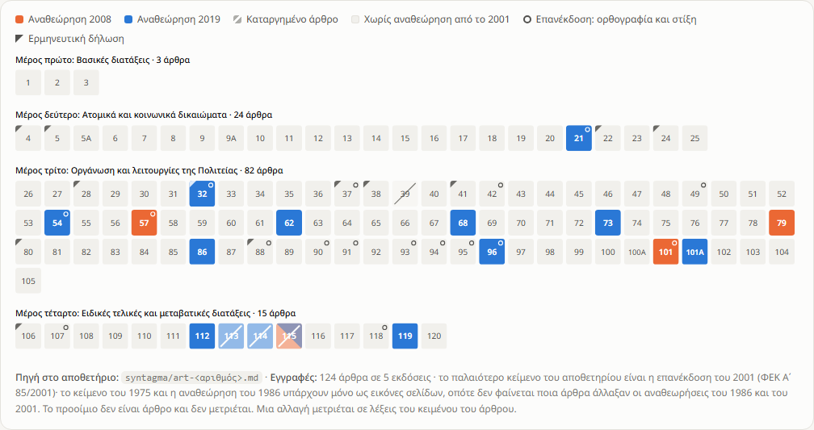

#### 2. Λέξεις που μπήκαν και βγήκαν

Οι λέξεις κάθε άρθρου που άλλαξε μια αναθεώρηση: το 2019 βγήκαν 759 και μπήκαν 445.

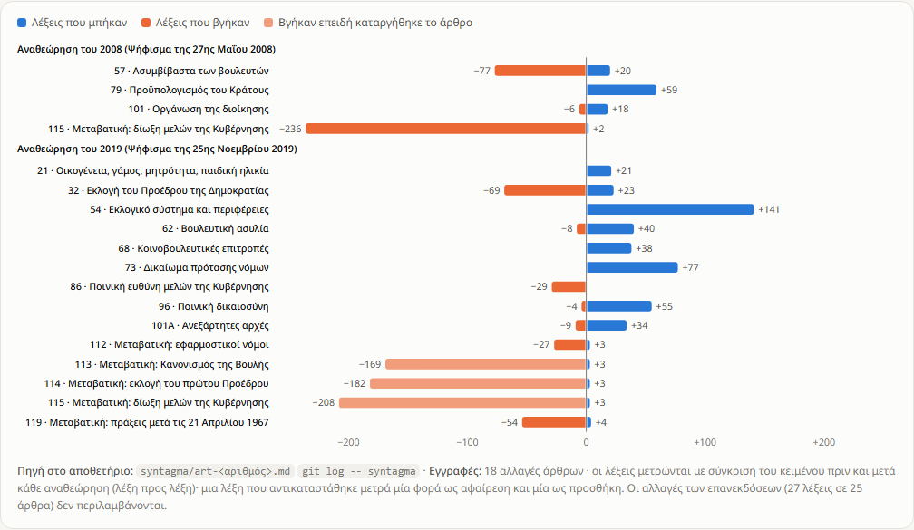

### II. Νόμοι και προεδρικά διατάγματα

#### 3. «Και άλλες διατάξεις»

Οι νόμοι του αποθετηρίου ανά έτος και είδος τίτλου: το 69 % όσων δεν κυρώνουν κάτι έχουν αυτή την κατάληξη.

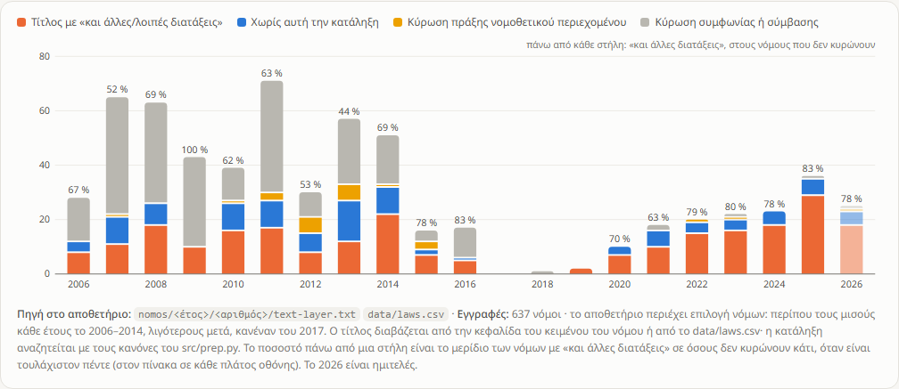

#### 4. Πόσο γρήγορα τροποποιούνται οι νόμοι

Οι 88 νόμοι που παρακολουθούνται: το 30 % τροποποιήθηκε μέσα σε δύο χρόνια, συχνά από άρθρα βαθιά μέσα σε άλλους νόμους.

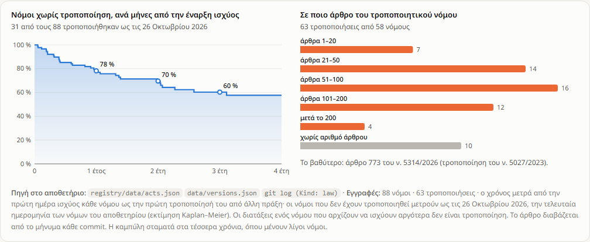

#### 5. Από την οδηγία στο ΦΕΚ

Οι 36 νόμοι και διατάγματα που ονομάζουν οδηγία της ΕΕ με ημερομηνία: διάμεσος 2,7 έτη ως τη δημοσίευση.

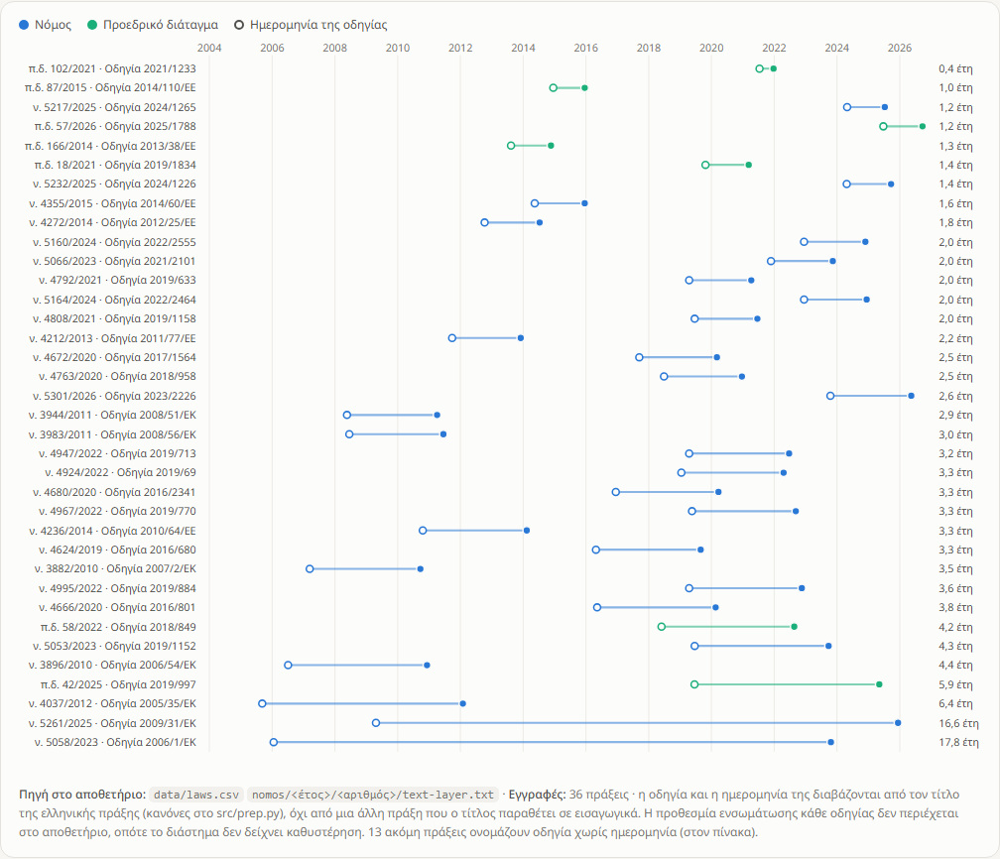

#### 6. Τα προεδρικά διατάγματα

Τα 503 διατάγματα ανά θέμα και έτος: τροποποιήσεις, οργάνωση υπηρεσιών, ενορίες και μονές, τοπικές αργίες.

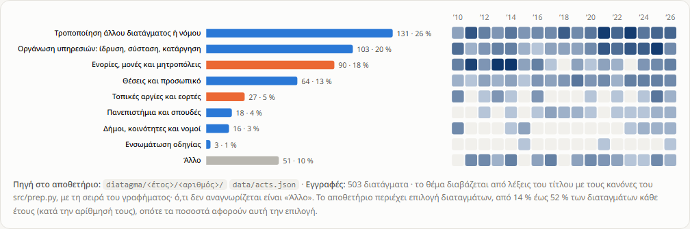

### III. Διαύγεια: οι πράξεις της διοίκησης

#### 7. Δύο εκατομμύρια πράξεις

Οι αναρτήσεις ανά έτος και είδος φορέα: οι δήμοι έχουν το 48 %.

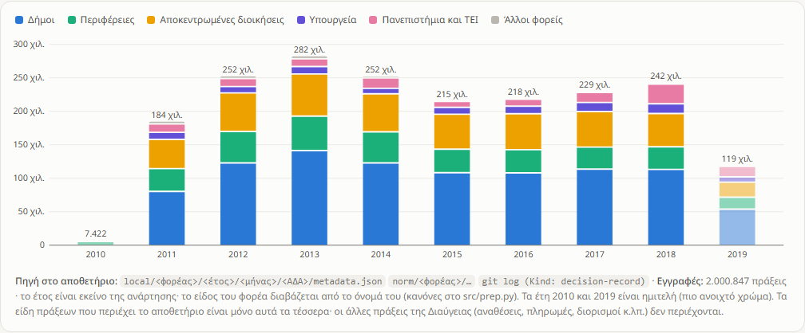

#### 8. Τι λένε οι τίτλοι

Τα θέματα των «κανονιστικών πράξεων»: προμήθειες, έργα και συμβάσεις 24 %, κάποιος κανονισμός 0,6 %.

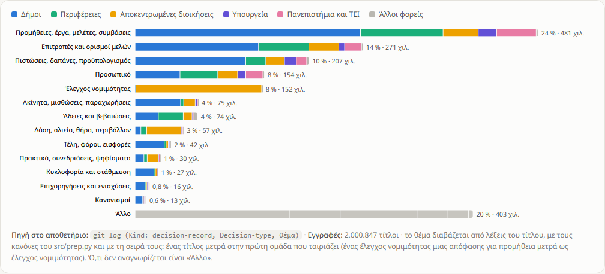

#### 9. Πόσο γρήγορα αναρτώνται

Από την έκδοση ως την ανάρτηση: την ίδια μέρα το 28 % των πράξεων το 2011, το 61 % το 2018.

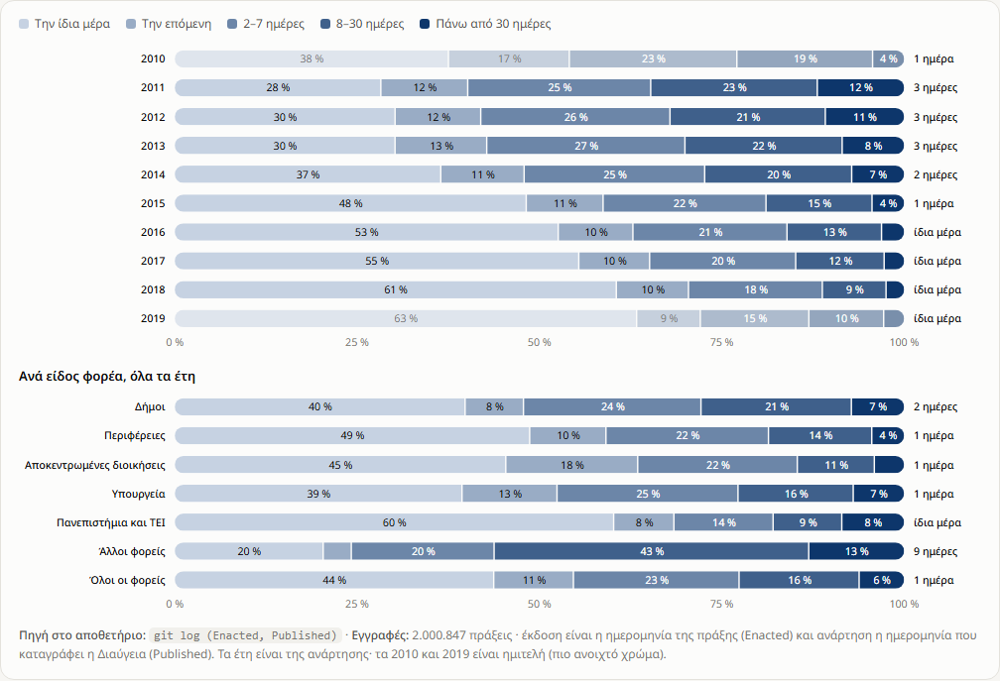

#### 10. Το ρολόι της Διαύγειας

Οι αναρτήσεις ανά ημέρα και ώρα της εβδομάδας: το 73 % από τις 9:00 ως τις 14:00.

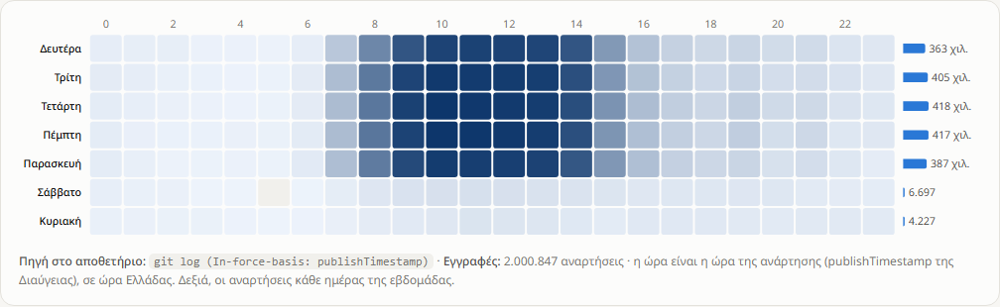

#### 11. Ο έλεγχος νομιμότητας

151.550 πράξεις ελέγχου νομιμότητας των αποκεντρωμένων διοικήσεων, οι 109.794 από μία.

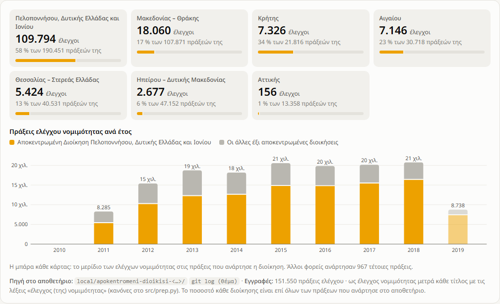

#### 12. Οι νόμοι στους τίτλους

Οι 16 νόμοι που αναφέρουν συχνότερα οι τίτλοι, ανά έτος· πρώτος ο ν. 4412/2016 για τις δημόσιες συμβάσεις.

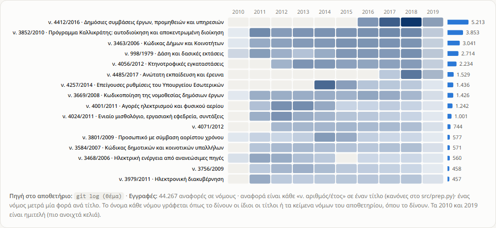

#### 13. Τα ψηφίσματα των δήμων

2.440 ψηφίσματα δημοτικών συμβουλίων ανά θέμα και έτος.

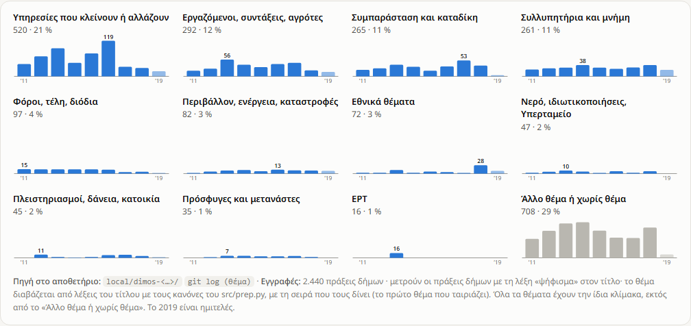

#### 14. Εγκύκλιοι και γνωμοδοτήσεις

Ποιοι φορείς εξέδωσαν τις 7.127 εγκυκλίους και τις 11.701 γνωμοδοτήσεις.

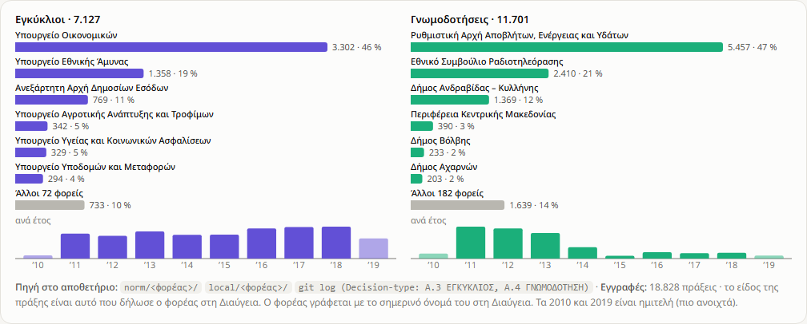

### IV. Ο Άρειος Πάγος

#### 15. Οι αποφάσεις ανά έτος

40.049 αποφάσεις του 2007–2019, πολιτικές, ποινικές και της Ολομέλειας, με όσες λείπουν κατά την αρίθμηση.

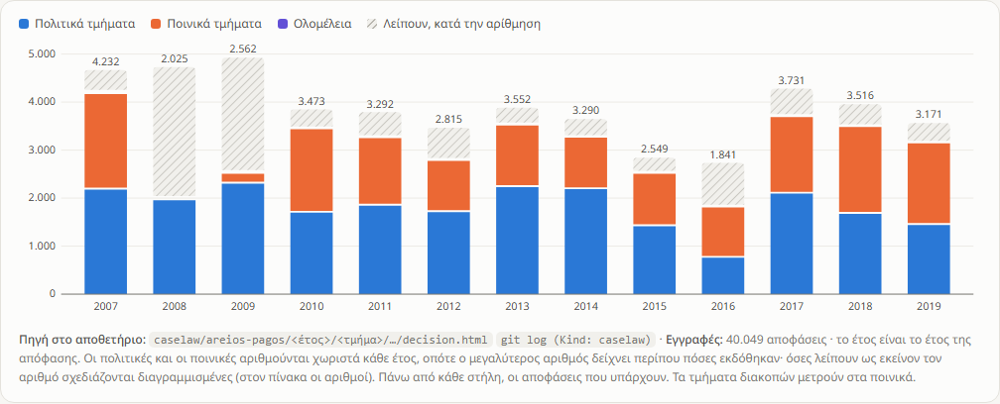

#### 16. Το ημερολόγιο του Αρείου Πάγου

Οι αποφάσεις ανά μήνα: ο Ιούνιος έχει το 14 %, ο Αύγουστος το 2 %.

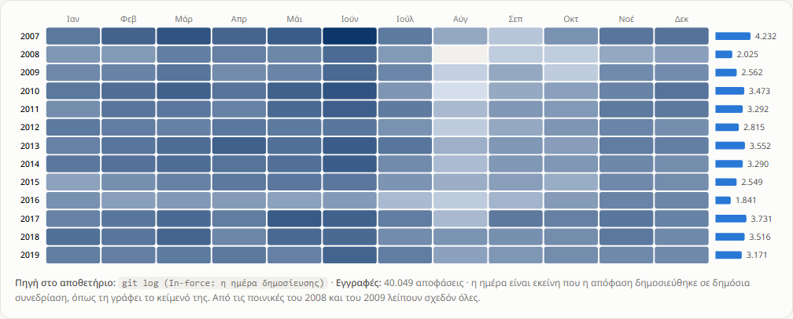

#### 17. Αναιρεί ή απορρίπτει

Το διατακτικό ανά τμήμα: αναίρεση στο 24 % των αποφάσεων, από 14 % ως 32 %.

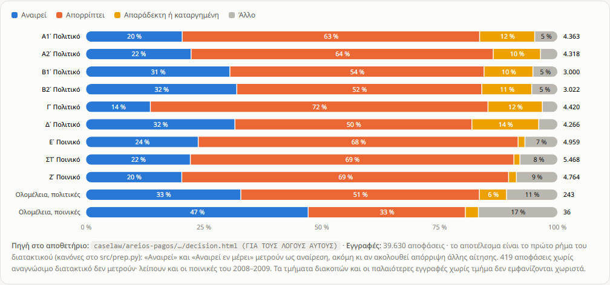

#### 18. Οι αναιρέσεις ανά έτος

Το ποσοστό αναίρεσης στα πολιτικά και στα ποινικά τμήματα: στα ποινικά από 24 % το 2007 σε 36 % το 2019.

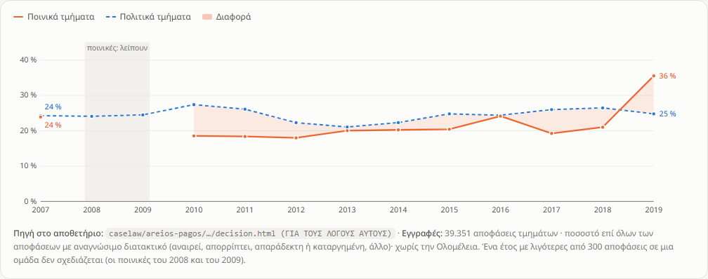

#### 19. Πιο αργές και πιο μεγάλες αποφάσεις

Οι ημέρες από τη συζήτηση ως τη δημοσίευση και οι λέξεις κάθε απόφασης, ανά έτος.

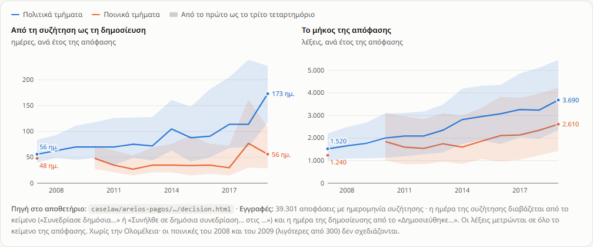

#### 20. Από πού έρχονται οι υποθέσεις

Η έδρα του δικαστηρίου που εξέδωσε την απόφαση που προσβλήθηκε, σε χάρτη: Αθήνα 47 %.

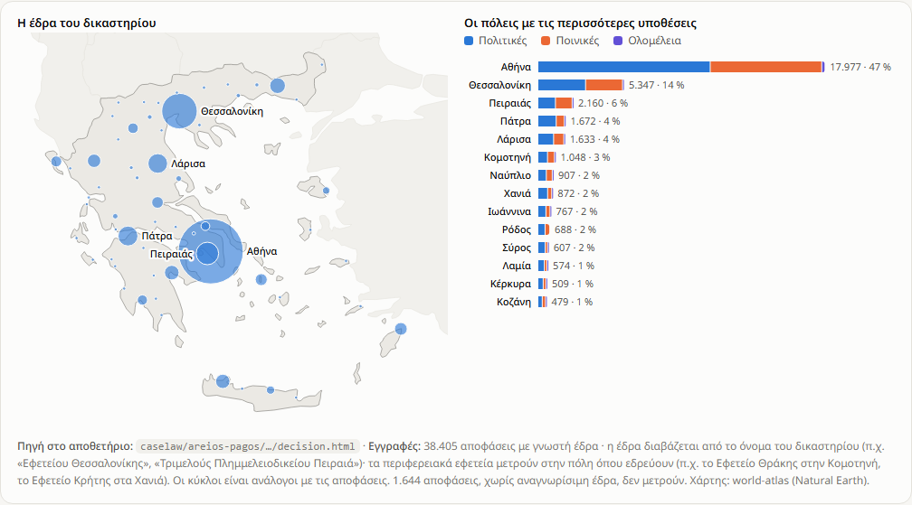

## Δεδομένα

Από το commit `a2eaf743c6` (16 Νοεμβρίου 2026).

| Δεδομένα | Πού στο αποθετήριο | Εγγραφές | Κάλυψη |
| --- | --- | ---: | --- |
| Ιστορία git | κλάδος `main` | 2.043.555 commits | η ημερομηνία κάθε commit είναι η ημέρα έναρξης ισχύος (`In-force:`) |
| Σύνταγμα | `syntagma/` | 124 άρθρα σε 5 εκδόσεις | από το 2001· το κείμενο του 1975 και η αναθεώρηση του 1986 δεν περιέχονται |
| Νόμοι | `nomos/<έτος>/<αριθμός>/` | 637 νόμοι· 88 με κάθε τροποποίηση | 2006–2026· επιλογή: περίπου οι μισοί νόμοι κάθε έτους το 2006–2014, λιγότεροι μετά |
| Προεδρικά διατάγματα | `diatagma/<έτος>/<αριθμός>/` | 503 διατάγματα | 2009–2026· επιλογή: 14–52 % των διαταγμάτων κάθε έτους |
| Διαύγεια | `local/`, `norm/` | 2.000.847 πράξεις από 430 φορείς | Οκτώβριος 2010 – Ιούλιος 2019· μόνο τα στοιχεία κάθε ανάρτησης |
| Άρειος Πάγος | `caselaw/areios-pagos/` | 40.049 αποφάσεις | 2007–2019· λείπουν σχεδόν όλες οι ποινικές του 2008 και του 2009 |

## Όρια

- **Οι νόμοι και τα διατάγματα είναι επιλογή.** Τα γραφήματα 3, 5 και 6 μετρούν τις πράξεις που περιέχει το αποθετήριο, όχι όλες του ΦΕΚ· το γράφημα 4 μετρά μόνο τους 88 νόμους που παρακολουθούνται σε κάθε τροποποίηση.
- **Οι κατηγορίες διαβάζονται από τίτλους και κείμενα.** Το είδος του τίτλου ενός νόμου, το θέμα των διαταγμάτων, οι οδηγίες, τα θέματα των πράξεων της Διαύγειας και των ψηφισμάτων, οι νόμοι που αναφέρουν οι τίτλοι, το διατακτικό και η έδρα του δικαστηρίου ακολουθούν τους κανόνες του `src/prep.py`· ό,τι δεν αναγνωρίζεται μετρά ως «Άλλο».
- **Το είδος κάθε πράξης στη Διαύγεια το επιλέγει ο φορέας που την αναρτά.** Το αποθετήριο περιέχει μόνο κανονιστικές πράξεις, εγκυκλίους, γνωμοδοτήσεις και πρακτικά του Νομικού Συμβουλίου του Κράτους, και από αυτές μόνο τα στοιχεία της ανάρτησης, όχι το κείμενο.
- **Ο ιστότοπος του Αρείου Πάγου δεν έχει όλες τις αποφάσεις.** Η αρίθμηση δείχνει πόσες λείπουν (γράφημα 15)· οι ποινικές του 2008 και του 2009 λείπουν σχεδόν όλες και δεν σχεδιάζονται στα γραφήματα 18 και 19.
- **Τα ημιτελή έτη** (2010 και 2019 στη Διαύγεια, 2026 στους νόμους) σχεδιάζονται πιο ανοιχτά και αναφέρονται.

## Ανασύνθεση

```sh
python visualisations/src/make.py            # ιστορία, κείμενα και πίνακες -> src/.build/ -> to-elliniko-dikaio-se-20-grafimata.html
node visualisations/src/stills.cjs           # οι εικόνες αυτών των README (χρειάζεται Playwright· PLAYWRIGHT=<διαδρομή> αν δεν είναι καθολικό)
```

Το `make.py` τα διαβάζει όλα από αντικείμενα του git, οπότε δουλεύει και σε κλώνο χωρίς blobs (`--filter=blob:none`) ή με `--no-checkout`. Τότε κατεβάζει μόνο ό,τι διαβάζουν τα γραφήματα: τα κείμενα των αποφάσεων του Αρείου Πάγου, τα κείμενα και τα `source.json` των νόμων, τις εκδόσεις των άρθρων του Συντάγματος και πέντε πίνακες, περίπου 41.200 αρχεία (280 MB)· τις πράξεις της Διαύγειας τις διαβάζει μόνο από τα μηνύματα των commits. Διαβάζει από προεπιλογή το `origin/main` (ή το `HEAD`)· το `--ref` επιλέγει άλλο κλάδο ή commit. Δεν γράφει τίποτα στο αποθετήριο εκτός από τη σελίδα και τον φάκελο `src/.build/`, που το git αγνοεί.

| Αρχείο | Τι κάνει |
| --- | --- |
| `src/make.py` | εξάγει την ιστορία, τα κείμενα και τους πίνακες στο `src/.build/` και εκτελεί το `prep.py` και το `build.py` |
| `src/prep.py` | υπολογίζει όλους τους αριθμούς των 20 γραφημάτων και του προφίλ των δεδομένων στο `src/.build/data.json` |
| `src/page.tpl.html` | η σελίδα: τα κείμενα στις δύο γλώσσες, τα γραφήματα (d3), οι πίνακες |
| `src/build.py` | βάζει το `data.json` στο πρότυπο και γράφει τη σελίδα |
| `src/stills.cjs` | σχεδιάζει κάθε γράφημα ως PNG στο `stills/el/` και στο `stills/en/` |
