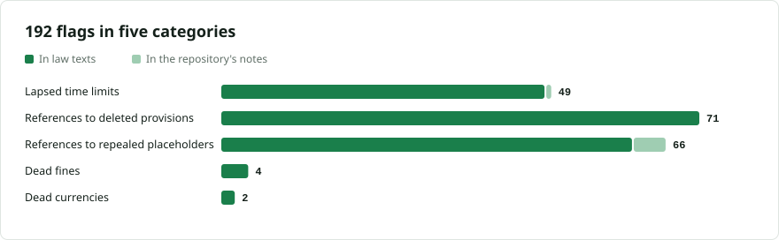

# Vulnerabilities in Greek law

[Ελληνικά](README.md) · **English**

<picture>
<source media="(prefers-color-scheme: dark)" srcset="img/flags-by-category-dark.svg">

</picture>

The vulnerability detectors from [lexifina/global-law](https://github.com/lexifina/global-law/tree/main/vulnerabilities) look for mechanical mistakes in legislation: a rule applying "until" a date that has passed, a time limit extended only after it had run out, a reference to an article that no longer exists, a penalty for breaching an article that has been repealed. global-law's published list (9 November 2026) did not cover Greece, so this is a run over this repository only, as it stood at commit [`4d91870`](https://github.com/lexifina/greece-law/commit/4d91870263d85661d0935c174c66d79a2f07fd21) on 15 November 2026, with the decisions of the Areios Pagos, the ministerial and local regulatory acts from Diavgeia, and the Penal Code and Code of Criminal Procedure as enacted, which it now holds.

**In short:** the detectors raised 192 flags. A language model reviewed 80 of the strongest, arguing each one for and against; 14 survived. Checked by hand in this repository, none of them is a defect in Greek law. Twelve cite an article of another act (most often in an article that amends that act), which the detector took for an article of the act itself that has since been repealed, and two are spent provisions: Article 107(2) of the Constitution, which called for a law to be passed once, within three months of the Constitution's entry into force, and a 2016 fees decision of the Municipality of Athens. The detectors read Greek law less fully than Czech or Serbian law: they miss most Greek "until" dates, so they found few lapsed time limits (see below). Later, this will be formalised in Lean, similar to our work on [the US tax code](https://lexifina.com/blog/formalizing-the-us-tax-code) and [US case law](https://lexifina.com/blog/formalizing-all-us-case-law-in-lean).

A flag is a prompt to look, not legal advice, and nothing here has been tested in court.

## Flags by category

| Category | What it looks for | Flags | In law texts | Reviewed | Survived review |
| --- | --- | ---: | ---: | ---: | ---: |
| Lapsed time limits | Text still applying a rule "until" a date that has passed | 49 | 48 | 40 | 2 |
| References to deleted provisions | A provision citing an article that no longer exists | 71 | 71 | 40 | 12 |
| References to repealed placeholders | A provision citing an article that now reads only "(Καταργείται)" (repealed) | 66 | 61 | 0 | 0 |
| Dead fines | A penalty for breaching an article that has been repealed | 4 | 4 | 0 | 0 |
| Dead currencies | Amounts in currencies no longer in use | 2 | 2 | 0 | 0 |

"In law texts" counts the Constitution, laws, presidential decrees, ministerial regulatory acts and the acts of municipalities and regions. The other six flags are in this repository's own notes (the `README.md` in an act's folder and `ACTS.md`); the decisions of the Areios Pagos raised none. The lapsed-time-limit detector reads "until" followed directly by a date. Greek law usually puts an article before the date, or writes the day as an ordinal: «έως την 31.12.2020», «μέχρι τις 30 Ιουνίου 2021», «έως την 31η.12.2026». The detector reads none of these: the law texts here hold about 580 such phrases, 485 of them with a date before 15 November 2026, in 266 files, and none was checked. For the same reason it could find no time limit extended after it had run out. The search for same-day conflicts, repeal gaps, retroactive dates, stale amounts, duplicate numbering and publisher notes found nothing: no article is changed by two acts on the same day or deleted and later restored; this repository dates every version from publication at the earliest, even where an act puts a provision in force before it (as the notes to ν. 4770/2021 say); and the history holds only two changes of an amount.

*Edge cases: the 14 flags that survived the review, grouped by what they turned out to be, and what the other flags are, in [EDGE-CASES.en.md](EDGE-CASES.en.md).*

## Problems found in this repository

- **The README describes an earlier repository.** It says the Penal Code (ν. 4619/2019), the Code of Criminal Procedure (ν. 4620/2019), case law and local acts of any municipality but Athens are not here, but at this commit [`nomos/2019/4619/`](https://github.com/lexifina/greece-law/tree/4d91870263d85661d0935c174c66d79a2f07fd21/nomos/2019/4619) and [`nomos/2019/4620/`](https://github.com/lexifina/greece-law/tree/4d91870263d85661d0935c174c66d79a2f07fd21/nomos/2019/4620) hold both codes as enacted, `caselaw/areios-pagos/` holds 8,849 decisions of the Areios Pagos, `local/` holds the acts of 26 other municipalities and 2 regions, and `norm/` holds ministerial regulatory acts.
- **Notes inside act folders:** each act's folder has a `README.md` beside its articles (the act's title and versions, and, for the laws followed through their amendments, notes in English on the decisions made by hand and the parse log), so tools that scan the text read it too (5 references to repealed placeholders, and one lapsed time limit in `ACTS.md`).

## Files

| File | What it holds |
| --- | --- |
| [data/flags.csv](data/flags.csv) | Every flag, one row per provision and issue |
| [data/reviewed.csv](data/reviewed.csv) | The 80 flags the model reviewed, with its verdict and reason |
| [data/by_category.csv](data/by_category.csv) | The counts in the table above |
| [tools/](tools/) | The scripts that made this run |

Columns: `category` and `category_el` (the category in English and Greek), `detector`, `kind` (`law` or `other`), `path` (the file in this repository), `date` (the date the flag turns on), `reference` (the act or line involved), `summary`, `score` (the detector's ranking, 0 to 1), `review` (`artefact`, `lawful` or `candidate_defect`), `survives_rebuttal`, `review_note` (the model's reason, in English), `url` (the provision at the commit that was read, or, for an article repealed since, at the last commit that held it).

## How it was made

- **Detectors:** global-law's [vulnerabilities/scripts](https://github.com/lexifina/global-law/tree/main/vulnerabilities/scripts), run on this repository at commit `4d91870`. global-law does not replay Greece's history yet, so the history table the detectors read was built from this repository's own commits (the author, the act that made each change, and the `In-force` and `Kind` trailers).
- **Model review:** gpt-5.4-mini, the 40 strongest flags per category; for lapsed time limits, the 40 strongest in law texts were the same 40. One pass says whether a flag is real, a second argues that it is not. Where a flag was reviewed twice, the later review is kept. There were no empty periods to review. global-law's own list used a different model.
- **Hand check:** every case that survived was read in this repository's history and texts, together with the commit of the act that repealed the article cited. The categories the model does not review were read in full by hand.

To report a correction, open an issue with the provision and an official source.

## Licence

The lists and notes are Lexifina's, dedicated to the public domain under CC0 1.0, like the rest of this repository's own contributions. Quoted law text is as the Government Gazette (ΦΕΚ) and Diavgeia publish it; it is official text of the Hellenic Republic, which Greek copyright law does not protect (ν. 2121/1993, άρθρο 2 παρ. 5); see [LICENSE](../LICENSE).
