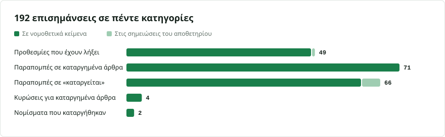

# Ευπάθειες στο ελληνικό δίκαιο

**Ελληνικά** · [English](README.en.md)

<picture>
<source media="(prefers-color-scheme: dark)" srcset="img/flags-by-category-dark.el.svg">

</picture>

Οι ανιχνευτές ευπαθειών του [lexifina/global-law](https://github.com/lexifina/global-law/tree/main/vulnerabilities) αναζητούν μηχανικά σφάλματα στη νομοθεσία: κανόνα που εξακολουθεί να εφαρμόζεται «έως» ημερομηνία που έχει παρέλθει, προθεσμία που παρατάθηκε αφού είχε ήδη λήξει, παραπομπή σε άρθρο που δεν υπάρχει πια, κύρωση για παράβαση άρθρου που έχει καταργηθεί. Ο κατάλογος που δημοσίευσε το global-law στις 9 Νοεμβρίου 2026 δεν περιλάμβανε την Ελλάδα. Ο έλεγχος αυτός αφορά επομένως μόνο το παρόν αποθετήριο, όπως ήταν στις 15 Νοεμβρίου 2026, στο commit [`4d91870`](https://github.com/lexifina/greece-law/commit/4d91870263d85661d0935c174c66d79a2f07fd21), μαζί με τις αποφάσεις του Αρείου Πάγου, τις κανονιστικές πράξεις υπουργείων και οργάνων αυτοδιοίκησης από τη Διαύγεια και τον Ποινικό Κώδικα και τον Κώδικα Ποινικής Δικονομίας όπως ψηφίστηκαν, που περιέχει πλέον.

**Συνοπτικά:** οι ανιχνευτές έδωσαν 192 επισημάνσεις. Ένα γλωσσικό μοντέλο εξέτασε τις 80 ισχυρότερες, σταθμίζοντας για καθεμία τα επιχειρήματα υπέρ και κατά· 14 άντεξαν στην εξέταση. Μετά από έλεγχο με το χέρι στο παρόν αποθετήριο, καμία δεν αποτελεί σφάλμα του ελληνικού δικαίου. Οι δώδεκα παραπέμπουν σε άρθρο άλλης πράξης (συνήθως μέσα σε άρθρο που τροποποιεί την πράξη αυτή), το οποίο ο ανιχνευτής εξέλαβε ως άρθρο της ίδιας της πράξης που καταργήθηκε στο μεταξύ, και οι δύο είναι διατάξεις που έχουν εξαντλήσει τη λειτουργία τους: η παρ. 2 του άρθρου 107 του Συντάγματος, που προέβλεπε την έκδοση νόμου μία μόνο φορά, μέσα σε τρεις μήνες από την ισχύ του Συντάγματος, και μια απόφαση του Δήμου Αθηναίων για τα τέλη του 2016. Οι ανιχνευτές διαβάζουν το ελληνικό δίκαιο λιγότερο πλήρως από το τσεχικό ή το σερβικό: δεν αναγνωρίζουν τις περισσότερες ελληνικές διατυπώσεις «έως» με ημερομηνία, γι’ αυτό βρήκαν λίγες προθεσμίες που έχουν λήξει (βλ. παρακάτω). Αργότερα όλα αυτά θα τυποποιηθούν σε Lean, όπως η εργασία μας για τον [φορολογικό κώδικα των ΗΠΑ](https://lexifina.com/blog/formalizing-the-us-tax-code) και τη [νομολογία των ΗΠΑ](https://lexifina.com/blog/formalizing-all-us-case-law-in-lean).

Μια επισήμανση είναι αφορμή για προσεκτικότερη ανάγνωση, όχι νομική συμβουλή, και τίποτα από όσα αναφέρονται εδώ δεν έχει κριθεί από δικαστήριο.

## Επισημάνσεις ανά κατηγορία

| Κατηγορία | Τι αναζητά | Επισημάνσεις | Σε νομοθετικά κείμενα | Εξετάστηκαν | Άντεξαν στην εξέταση |
| --- | --- | ---: | ---: | ---: | ---: |
| Προθεσμίες που έχουν λήξει | Κείμενο που εξακολουθεί να εφαρμόζει κανόνα «έως» ημερομηνία που έχει παρέλθει | 49 | 48 | 40 | 2 |
| Παραπομπές σε καταργημένες διατάξεις | Διάταξη που παραπέμπει σε άρθρο που δεν υπάρχει πια | 71 | 71 | 40 | 12 |
| Παραπομπές σε διατάξεις «καταργείται» | Διάταξη που παραπέμπει σε άρθρο του οποίου το κείμενο είναι πλέον μόνο «(Καταργείται)» | 66 | 61 | 0 | 0 |
| Κυρώσεις για καταργημένες διατάξεις | Κύρωση για παράβαση άρθρου που έχει καταργηθεί | 4 | 4 | 0 | 0 |
| Νομίσματα που καταργήθηκαν | Ποσά σε νομίσματα που δεν χρησιμοποιούνται πια | 2 | 2 | 0 | 0 |

Η στήλη «Σε νομοθετικά κείμενα» περιλαμβάνει το Σύνταγμα, τους νόμους, τα προεδρικά διατάγματα, τις κανονιστικές πράξεις υπουργείων και τις πράξεις δήμων και περιφερειών. Οι υπόλοιπες έξι επισημάνσεις βρίσκονται στις σημειώσεις του ίδιου του αποθετηρίου (στο `README.md` του φακέλου μιας πράξης και στο `ACTS.md`)· οι αποφάσεις του Αρείου Πάγου δεν έδωσαν καμία. Ο ανιχνευτής των προθεσμιών διαβάζει τη λέξη «έως» μόνο όταν ακολουθεί αμέσως ημερομηνία. Ο ελληνικός νομοθέτης όμως συνήθως παρεμβάλλει άρθρο πριν από την ημερομηνία ή γράφει την ημέρα ως τακτικό αριθμό: «έως την 31.12.2020», «μέχρι τις 30 Ιουνίου 2021», «έως την 31η.12.2026». Ο ανιχνευτής δεν διαβάζει καμία από αυτές τις διατυπώσεις: τα νομοθετικά κείμενα του αποθετηρίου περιέχουν περίπου 580 τέτοιες φράσεις, από τις οποίες οι 485 με ημερομηνία πριν από τις 15 Νοεμβρίου 2026, σε 266 αρχεία, και καμία δεν ελέγχθηκε. Για τον ίδιο λόγο δεν μπορούσε να εντοπίσει προθεσμία που παρατάθηκε αφού είχε λήξει. Η αναζήτηση τροποποιήσεων την ίδια ημέρα, κενών μετά από κατάργηση, αναδρομικής ισχύος, ποσών που δεν ενημερώθηκαν, διπλής αρίθμησης και σημειώσεων του εκδότη δεν βρήκε τίποτα: κανένα άρθρο δεν τροποποιείται από δύο πράξεις την ίδια ημέρα ούτε διαγράφεται για να επανέλθει αργότερα· το αποθετήριο χρονολογεί κάθε έκδοση το νωρίτερο από τη δημοσίευση, ακόμη και όταν μια πράξη θέτει διάταξη σε ισχύ πριν από αυτήν (όπως αναφέρουν οι σημειώσεις του ν. 4770/2021)· και η ιστορία περιέχει μόνο δύο μεταβολές ποσού.

*Οριακές περιπτώσεις: οι 14 επισημάνσεις που άντεξαν στην εξέταση, ομαδοποιημένες ανάλογα με το τι αποδείχθηκε ότι είναι, και τι είναι οι υπόλοιπες επισημάνσεις, στο [EDGE-CASES.md](EDGE-CASES.md).*

## Προβλήματα που εντοπίστηκαν στο αποθετήριο

- **Το README περιγράφει παλαιότερη μορφή του αποθετηρίου.** Αναφέρει ότι ο Ποινικός Κώδικας (ν. 4619/2019), ο Κώδικας Ποινικής Δικονομίας (ν. 4620/2019), η νομολογία και οι τοπικές πράξεις οποιουδήποτε δήμου εκτός της Αθήνας δεν περιλαμβάνονται, όμως στο commit αυτό οι φάκελοι [`nomos/2019/4619/`](https://github.com/lexifina/greece-law/tree/4d91870263d85661d0935c174c66d79a2f07fd21/nomos/2019/4619) και [`nomos/2019/4620/`](https://github.com/lexifina/greece-law/tree/4d91870263d85661d0935c174c66d79a2f07fd21/nomos/2019/4620) περιέχουν τους δύο κώδικες όπως ψηφίστηκαν, ο `caselaw/areios-pagos/` 8.849 αποφάσεις του Αρείου Πάγου, ο `local/` πράξεις άλλων 26 δήμων και 2 περιφερειών και ο `norm/` κανονιστικές πράξεις υπουργείων.
- **Σημειώσεις μέσα στους φακέλους των πράξεων:** ο φάκελος κάθε πράξης έχει δίπλα στα άρθρα ένα `README.md` (τον τίτλο και τις εκδόσεις της πράξης και, για τους νόμους που παρακολουθούνται σε όλες τις τροποποιήσεις τους, σημειώσεις στα αγγλικά για τις αποφάσεις που ελήφθησαν με το χέρι και το αρχείο καταγραφής του parser), οπότε το διαβάζουν και τα εργαλεία που σαρώνουν το κείμενο (5 παραπομπές σε διατάξεις «καταργείται» και, στο `ACTS.md`, μία προθεσμία που έχει λήξει).

## Αρχεία

| Αρχείο | Τι περιέχει |
| --- | --- |
| [data/flags.csv](data/flags.csv) | Κάθε επισήμανση, μία γραμμή ανά διάταξη και ζήτημα |
| [data/reviewed.csv](data/reviewed.csv) | Οι 80 επισημάνσεις που εξέτασε το μοντέλο, με την κρίση και την αιτιολογία του |
| [data/by_category.csv](data/by_category.csv) | Οι αριθμοί του παραπάνω πίνακα |
| [tools/](tools/) | Τα σενάρια που εκτέλεσαν αυτόν τον έλεγχο |

Στήλες: `category` και `category_el` (η κατηγορία στα αγγλικά και στα ελληνικά), `detector`, `kind` (`law` ή `other`), `path` (το αρχείο στο αποθετήριο), `date` (η ημερομηνία στην οποία αφορά η επισήμανση), `reference` (η σχετική πράξη ή γραμμή), `summary`, `score` (η κατάταξη του ανιχνευτή, από 0 έως 1), `review` (`artefact`, `lawful` ή `candidate_defect`), `survives_rebuttal`, `review_note` (η αιτιολογία του μοντέλου, στα αγγλικά), `url` (η διάταξη στο commit που εξετάστηκε ή, για άρθρο που καταργήθηκε στο μεταξύ, στο τελευταίο commit που το περιείχε).

## Πώς έγινε

- **Ανιχνευτές:** τα [vulnerabilities/scripts](https://github.com/lexifina/global-law/tree/main/vulnerabilities/scripts) του global-law, που εκτελέστηκαν στο παρόν αποθετήριο στο commit `4d91870`. Το global-law δεν αναπαράγει ακόμη την ιστορία της Ελλάδας, γι’ αυτό ο πίνακας ιστορίας που διαβάζουν οι ανιχνευτές καταρτίστηκε από τα commits του ίδιου του αποθετηρίου (τον συντάκτη, δηλαδή την πράξη που επέφερε κάθε μεταβολή, και τα trailers `In-force` και `Kind`).
- **Εξέταση από μοντέλο:** gpt-5.4-mini, οι 40 ισχυρότερες επισημάνσεις κάθε κατηγορίας· για τις προθεσμίες που έχουν λήξει, οι 40 ισχυρότερες σε νομοθετικά κείμενα ήταν οι ίδιες 40. Ένα πρώτο πέρασμα κρίνει αν η επισήμανση είναι βάσιμη και ένα δεύτερο υποστηρίζει ότι δεν είναι. Όπου μια επισήμανση εξετάστηκε δύο φορές, ισχύει η μεταγενέστερη εξέταση. Δεν υπήρξαν προθεσμίες παρατεταμένες μετά τη λήξη τους προς εξέταση. Ο κατάλογος του ίδιου του global-law χρησιμοποίησε άλλο μοντέλο.
- **Έλεγχος με το χέρι:** κάθε περίπτωση που άντεξε στην εξέταση διαβάστηκε στην ιστορία και στα κείμενα του αποθετηρίου, μαζί με το commit της πράξης που κατάργησε το άρθρο στο οποίο γίνεται η παραπομπή. Οι κατηγορίες που δεν εξετάζει το μοντέλο διαβάστηκαν ολόκληρες με το χέρι.

Για διόρθωση, ανοίξτε issue αναφέροντας τη διάταξη και επίσημη πηγή.

## Άδεια

Οι κατάλογοι και οι σημειώσεις είναι έργο της Lexifina και διατίθενται στον δημόσιο τομέα με την άδεια CC0 1.0, όπως και οι λοιπές συνεισφορές της στο αποθετήριο. Το παρατιθέμενο κείμενο των πράξεων είναι όπως το δημοσιεύουν η Εφημερίδα της Κυβερνήσεως (ΦΕΚ) και η Διαύγεια· ως επίσημο κείμενο της Ελληνικής Δημοκρατίας δεν προστατεύεται από την πνευματική ιδιοκτησία (ν. 2121/1993, άρθρο 2 παρ. 5)· βλ. [LICENSE](../LICENSE).
